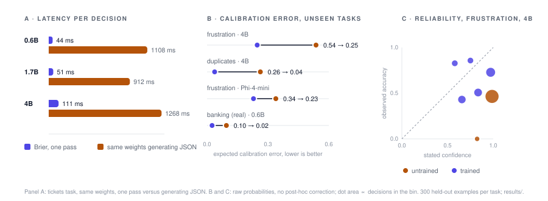
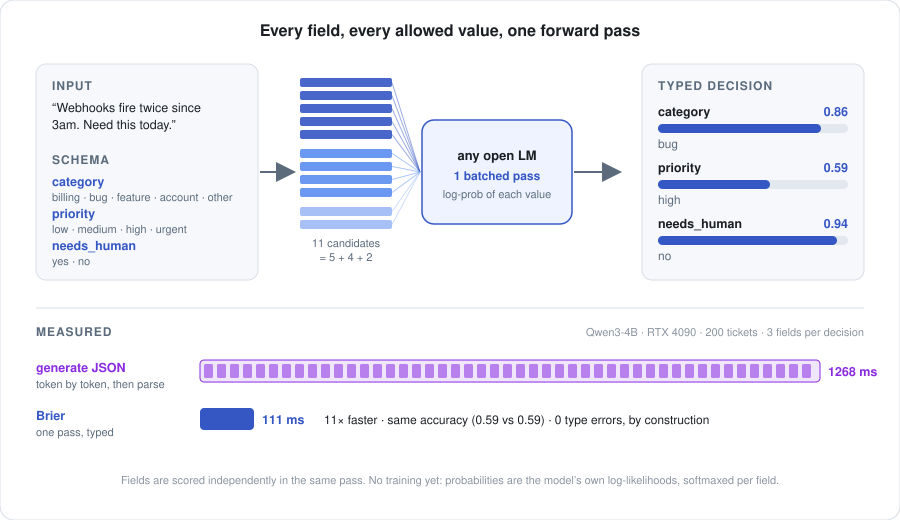

<div align="center">

<picture>
  <source media="(prefers-color-scheme: dark)" srcset="docs/brier-dark.png">
  
</picture>

<br>

**Calibrated typed decisions from any open language model, in one forward pass.**

[Architecture](docs/ARCHITECTURE.md) · [Primer](docs/PRIMER.md) · [API](docs/QUESTIONS.md) · [Calibration](docs/CALIBRATION.md) · [Training](docs/TRAINING.md) · [Milestones](docs/MILESTONES.md) · [Demo](docs/demo.html)

[](LICENSE) [](docs/TRAINING.md)

</div>

## Abstract

**Language models are asked to decide far more often than they are asked to write.**
Route this ticket. Pick a tool. Is this passage relevant. Same customer, or not. Every
one of these is a choice from a short list, and every one is answered today the slow,
fragile way: generate a JSON string one token at a time, parse it, retry when it breaks,
and believe a confidence the model made up.

Brier does not write the answer. It scores every allowed answer at once, in one forward
pass of an open model, and hands back a probability for each. No token loop: 111 ms
instead of 1268 ms on the same weights. No string: an answer outside the list is not
unlikely, it is impossible.

The probability is the product, so it has to be true. Raw, it is not. A 4B model says
0.95 and is right 59% of the time. Brier measures that gap on your own data, closes
what one temperature can close, and tells you the exact confidence above which the
model may act alone at the precision you demand, and how much of the work that covers.
Then training does what temperature cannot. A proper scoring rule over the answer set,
on decisions built with real ambiguity and deliberate near-misses, makes the model
sharper and more honest at the same time, on tasks it has never seen, a real intent
dataset among them. The same rule learns from outcomes alone, with no labels at all.
It runs unchanged on five backbones from three families, and a 0.6B model with a
25-minute adapter beats an untrained 4B at a quarter of the latency.

<p align="center"></p>

## Results

Numbers are held-out, on the evaluation half of every template pool, 300 examples per
task. Full tables and protocol in [TRAINING.md](docs/TRAINING.md).

| | untrained | trained | |
|---|---|---|---|
| Latency per three-question decision, 4B, RTX 4090 | 1268 ms generating JSON | **111 ms** one pass | 11× |
| Frustration (never trained on), Qwen3-4B | 0.44 acc · 0.54 ECE | **0.63 acc · 0.25 ECE** | raw, no correction |
| Duplicates (never trained on), Qwen3-4B | 0.73 acc · 0.26 ECE | **0.997 acc · 0.04 ECE** | raw |
| Banking77 (real, never trained on), Qwen3-0.6B | 0.85 acc · 0.10 ECE | **0.90 acc · 0.02 ECE** | raw |
| Ticket category, Phi-4-mini | 0.71 acc | **0.96 acc** | held-out templates |
| Gridworld from outcomes only, no labels, Qwen3-0.6B | 0.35 acc | **0.81 acc** | vs 0.84 supervised |
| Type errors, every model, every task | 0 | 0 | by construction |

Three findings shape the method. Clean labels alone teach overconfidence: a model
trained only on exact answers learns to be certain, and the fix is training data with
irreducible uncertainty and soft labels equal to the generator's own posterior. A
shortcut learned from cue-triggered claims transfers as a bias, and the fix is a
contrastive claim where the cue is present and the answer is no. A 0.6B backbone with a
25-minute adapter outperforms an untrained 4B on every non-templated task, at a quarter
of the latency.

## Method

<p align="center"></p>

- **Scoring.** Each allowed answer is appended to the prompt as a candidate; its score
  is the sum of its tokens' log-probabilities under the backbone. All candidates of all
  questions go through one batched pass. A softmax within each question yields its
  distribution. From 1.7B up, the prompt is run once and candidates share its cache.
- **Calibration.** One temperature per question, fit by maximum likelihood with five-fold
  cross-fitting, then the lowest confidence cutoff that reaches a target precision on
  held-out decisions, with its coverage. Expected calibration error and Brier score are
  reported raw and after temperature.
- **Training.** LoRA adapters on the backbone, trained with cross-entropy over the answer
  set, a strictly proper scoring rule, on hard or soft targets. A typed head adds an
  input-conditional temperature and a per-candidate residual over hidden states,
  zero-initialised to the plain scorer. An outcome-reward form replaces labels with the
  environment's result and adds the Brier score of the stated probability against it.
- **Evaluation.** Every templated task splits its templates into disjoint training and
  evaluation halves; three tasks are never trained on; one is a real public dataset.
  The gate for training is raw calibration error on the unseen tasks against the
  untrained model after temperature scaling.

The [architecture document](docs/ARCHITECTURE.md) walks through all of this from
nothing; the [primer](docs/PRIMER.md) derives it, from probability to the
policy-gradient objective.

## Usage

```python
from brier import Scorer, Choice, Score, Claim, ask

scorer = Scorer("microsoft/Phi-4-mini-instruct")
answers = ask(scorer, "Webhooks are firing twice for every event since 3am. Need this today.", [
    Choice("category", "which team should handle this ticket", ("billing", "bug", "feature", "account", "other")),
    Score("priority", "how fast this must be handled", ("low", "medium", "high", "urgent")),
    Claim("needs_human", "the customer is asking for a human agent rather than an automated reply"),
])

answers["category"].value          # 'bug'
answers["category"].probabilities  # {'billing': 0.07, 'bug': 0.86, 'feature': 0.0, 'account': 0.05, 'other': 0.02}
answers["priority"].expected       # 2.3   (0 = low … 3 = urgent)
answers["needs_human"].value       # 0.06  (probability the claim is true)
```

Calibrate on your own labelled examples and get a decision policy:

```sh
python3 -m brier calibrate --task tickets --model microsoft/Phi-4-mini-instruct --n 300
```

```
question             n    acc  ECE raw  ECE cal      T
category           300  0.680    0.295    0.054   6.46
  auto    target 0.95: act when confidence >= 0.910  -> precision 1.000, covers 4% of decisions
  review  target 0.80: act when confidence >= 0.721  -> precision 0.800, covers 48% of decisions
  human   everything below
```

Train, and evaluate the adapter with the same kit:

```sh
python3 train.py --model microsoft/Phi-4-mini-instruct --split train --uncertain 0.3 --steps 1200
python3 -m brier calibrate --model microsoft/Phi-4-mini-instruct --adapter adapters/<name> --split eval
python3 rl.py --model Qwen/Qwen3-0.6B --episode 6          # outcome reward, no labels
```

Any open-weight causal language model is a valid backbone; the same code has run Qwen3
at three sizes, SmolLM2 and Phi-4-mini with no changes. GPU work runs on a RunPod pod
managed by `pod.py`, which enforces a hard time-to-live on every pod it creates.

## Repository

| | |
|---|---|
| `brier/questions.py` | Choice, Score, Claim and `ask()` |
| `brier/scorer.py` | the single-pass scorer, full-row and shared-prefix paths, and the JSON-generation baseline |
| `brier/calibrate.py` · `brier/report.py` | the calibration kit and its figures |
| `brier/head.py` | the typed head |
| `train.py` · `rl.py` · `record.py` | supervised training, outcome-reward training, trajectory recording |
| `tasks/` | eight tasks with computable ground truth or human labels |
| `results/` | every number in the documents, as produced |
| `docs/` | the documents, the demo page, and `assets.py`, which draws every figure from `results/` |

## Documentation

| | |
|---|---|
| [ARCHITECTURE.md](docs/ARCHITECTURE.md) | what Brier does and why, assuming nothing |
| [PRIMER.md](docs/PRIMER.md) | the mathematics: distributions, softmax, the chain rule, scoring rules, calibration, temperature, gradient descent, LoRA, the objective, the typed head, policy gradient |
| [QUESTIONS.md](docs/QUESTIONS.md) | the API |
| [CALIBRATION.md](docs/CALIBRATION.md) | the kit and how its numbers are computed |
| [TRAINING.md](docs/TRAINING.md) | recipes, protocol, every result table, and what was learned in each round |
| [MILESTONES.md](docs/MILESTONES.md) | the plan: each milestone's question, what it delivered and found, and what is next |

## License

Apache 2.0. See [LICENSE](LICENSE).
