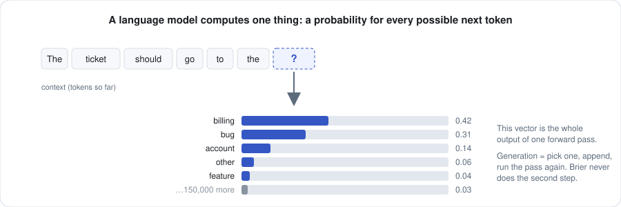
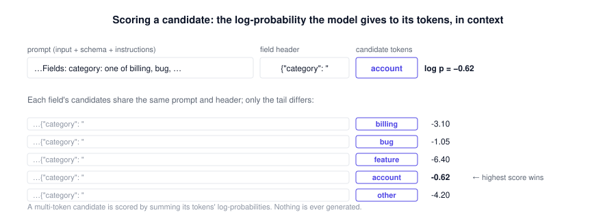
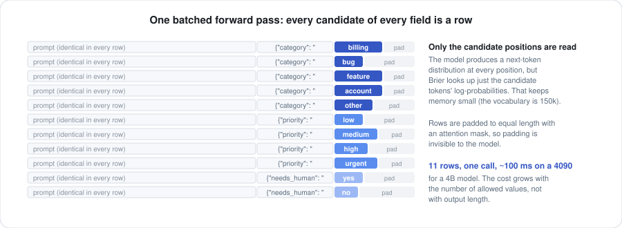
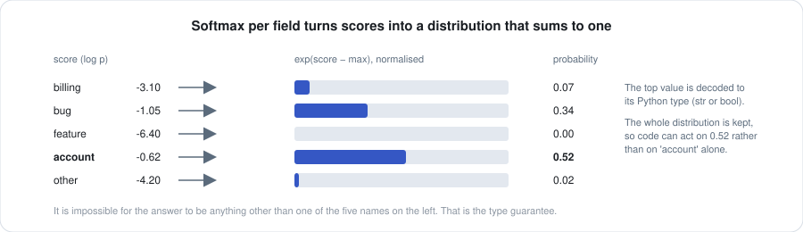
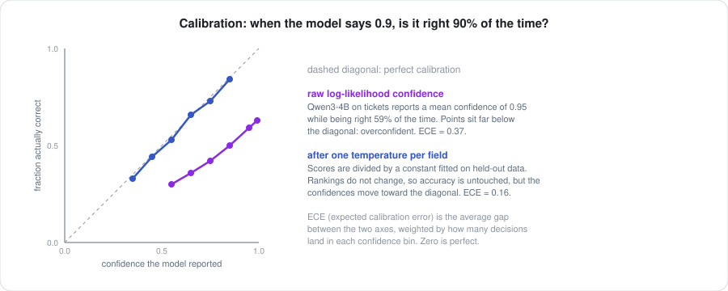
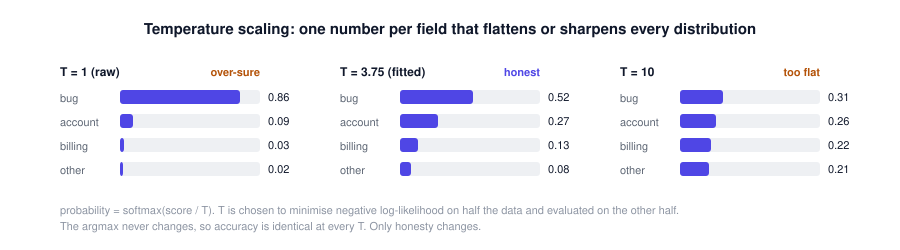
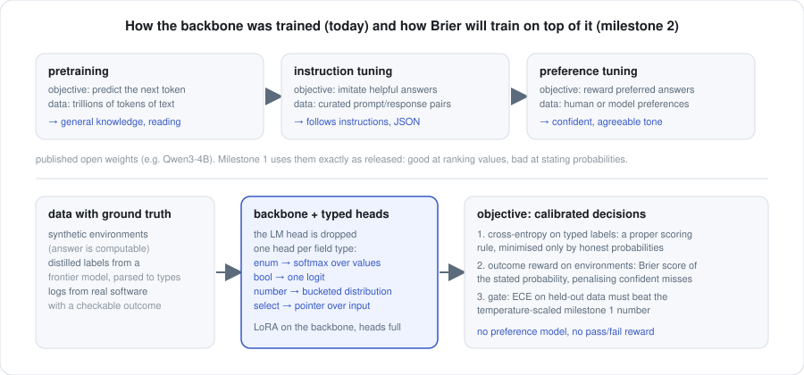
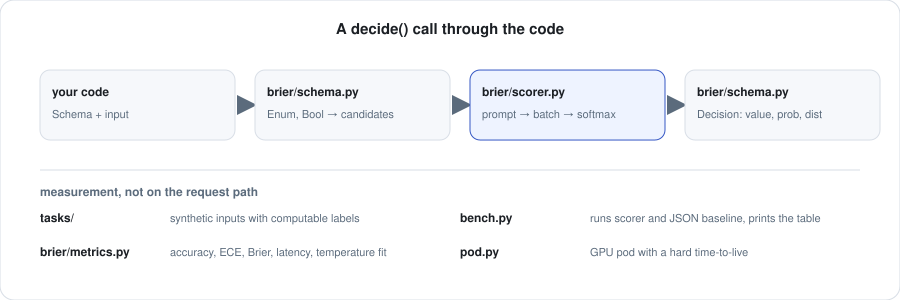

# Brier, from zero

This document assumes nothing. It starts with what a language model actually computes,
builds up to how Brier turns one into a decision function, explains what it means for a
probability to be trustworthy and how that is measured, and ends with how the model was
trained today and how it will be trained next. Every figure is generated from
`docs/assets.py`, and every number is from `results/`.

Read it top to bottom. Each part uses only what the parts before it established.

Companion documents: [PRIMER.md](PRIMER.md) for the mathematics from probability to the
training objective, [QUESTIONS.md](QUESTIONS.md) for the API, [CALIBRATION.md](CALIBRATION.md)
for the kit, [TRAINING.md](TRAINING.md) for milestone 2.

**Contents**
1. [The problem, in one example](#1-the-problem-in-one-example)
2. [Part I: what a language model computes](#part-i-what-a-language-model-computes)
3. [Part II: how Brier decides](#part-ii-how-brier-decides)
4. [Part III: trusting the probability](#part-iii-trusting-the-probability)
5. [Part IV: how the model is trained](#part-iv-how-the-model-is-trained)
6. [Part V: how it is measured](#part-v-how-it-is-measured)
7. [Part VI: the code](#part-vi-the-code)
8. [Glossary](#glossary)
9. [Questions people ask](#questions-people-ask)

---

## 1. The problem, in one example

A support ticket arrives:

> Webhooks are firing twice for every event since around 3am UTC. I need this sorted
> today if at all possible.

Software has to do three things with it, and none of them is writing a reply. It has to
pick a team (`billing`, `bug`, `feature`, `account`, or `other`), pick a priority (`low`,
`medium`, `high`, `urgent`), and decide whether a human needs to look at it (`yes` or
`no`). Three decisions, each from a small fixed set of allowed values.

The way this is done today with a language model is to ask it to write a JSON object:

```json
{"category": "bug", "priority": "high", "needs_human": false, "confidence": 0.9}
```

That works, mostly. But it is slow, because the model writes the answer one token at a
time. It is fragile, because the string has to be parsed and validated and sometimes
comes back malformed. And the confidence number is a guess the model made up on the
spot, with no relationship to how often it is actually right.

Brier answers the same question differently. It never writes a string. It looks at every
allowed value for every field at once, in a single pass through the model, and returns a
value per field with a probability attached:

```
category     bug      0.86
priority     high     0.59
needs_human  no       0.94
```

Roughly ten times faster, structurally incapable of returning a malformed value, and with
probabilities that can be measured and corrected. The rest of this document explains
exactly how, and exactly what those probabilities are and are not.

---

## Part I: what a language model computes

### 1.1 Tokens

A language model does not read words or characters. It reads **tokens**: short chunks of
text from a fixed vocabulary of around 150,000 entries. `" billing"` is one token.
`" needs_human"` might be three. A tokenizer converts text to a list of token ids and
back. Everything below happens on token ids.

### 1.2 One forward pass, one distribution

Given a sequence of tokens, the model performs one **forward pass** and produces, for
every position in the sequence, a probability distribution over which token comes next.
That is the entire output. There is no "answer" inside the model; there is only "given
what I have seen, here is how likely each possible next token is."

<p align="center"></p>

Two things about this figure matter for everything that follows.

First, the distribution is over the **whole vocabulary**, all 150,000 entries, at every
position. Most of them have negligible probability, but they are all computed.

Second, the model is remarkably good at this ranking. Given the ticket above and the text
`{"category": "`, a competent model puts most of the mass on `bug` and `billing` and
almost none on `feature`. That ranking ability is what Brier harvests.

### 1.3 Generation is a loop

To produce text, a model is run in a loop: forward pass, pick a token from the
distribution, append it to the sequence, forward pass again. Writing the JSON object in
section 1 takes about 25 tokens, so about 25 forward passes, each one a full trip through
the model. On a 4B-parameter model on a good GPU that is about a second. On a frontier
model behind an API it is several seconds.

Every token is sampled, so every token is a chance to go wrong: a missing quote, a value
that is not in the allowed set, a field name misspelt. Developers wrap the call in a
parser, a validator, and a retry loop, and the confidence field comes from the same
sampling process as everything else, which is to say it is generated text, not a
measurement.

### 1.4 Log-probabilities

Probabilities multiply, and multiplying many small numbers underflows. So models work in
**log-probabilities**: the natural log of the probability. A log-probability of 0 means
certain; −0.62 means about 54%; −6.4 means about 0.2%. To score a sequence of tokens,
you add their log-probabilities. That sum is the log of the probability of the whole
sequence, in context.

This is the last piece of background. Everything else is Brier.

---

## Part II: how Brier decides

### 2.1 Questions

Brier is asked **questions** about a **state**. There are three kinds, and the full
reference is [QUESTIONS.md](QUESTIONS.md):

- `Choice("category", "which team should handle this ticket", ("billing", "bug", "feature", "account", "other"))`,
  which of these options.
- `Score("priority", "how fast this must be handled", ("low", "medium", "high", "urgent"))`,
  which level on an ordered scale. The answer also carries the probability-weighted
  mean position, so "between medium and high" is expressible.
- `Claim("needs_human", "the customer is asking for a human agent")`, is this statement
  true, answered as a probability.

All three reduce to the same thing underneath: a **finite set of allowed answers**. The
word *finite* is doing the work. Because every question has an enumerable set of
answers, Brier can look at all of them. A free-text answer would have infinitely many
values and could not be scored this way; that is the price of the guarantee.

(`Schema`, `Enum` and `Bool` in `schema.py` are the older field-based form of the same
idea and are kept for the original benchmark.)

### 2.2 The prompt

Brier renders the input and the schema into a prompt using the model's chat template,
the same one the model was trained on:

```
Read the input and answer every field with exactly one of its allowed values.
Reply with a single JSON object and nothing else.

Input:
Webhooks are firing twice for every event since around 3am UTC. I need this
sorted today if at all possible.

Fields:
- category: one of billing, bug, feature, account, other. (which team should handle this)
- priority: one of low, medium, high, urgent. (how fast it must be handled)
- needs_human: one of yes, no. (does this require a human agent rather than an automated reply)
```

Then, instead of letting the model write, Brier starts the answer for it. For the
`category` field it appends `{"category": "` and stops there.

The format of that header matters more than it looks. The first version of Brier used
`category:` on its own line. A 4B model scored `other` with total confidence on every
ticket, because that is not how it had learned to answer such a prompt. Switching to the
JSON header, which matches what the model was trained to produce, fixed it immediately.
The same lesson recurred with `Score` questions: rendering level descriptions inline
(`calm: neutral or friendly`) dropped accuracy from 0.43 to 0.28 on Qwen3-4B, because
the description text bled into the answer space; listing the bare level names in order
fixed it. The lesson generalises: **the scoring prefix must be something the model would
actually have written**, or the log-probabilities are about the wrong question.

### 2.3 Scoring one candidate

Now take one allowed value, say `account`. Append its tokens after the header, run a
forward pass, and read off the log-probability the model assigned to each of the
candidate's tokens at its position. Sum them. That sum is the candidate's **score**.

<p align="center"></p>

Nothing was generated. The model was asked, in effect, "given this context, how likely
is it that the next thing written is `account`?" and answered with a number. Repeat for
`billing`, `bug`, `feature`, `other`.

### 2.4 One batched pass

Scoring candidates one at a time would take five forward passes for `category` alone.
Instead, Brier builds one sequence per candidate per field, eleven in the example (five
categories, four priorities, two booleans), pads them to the same length, and sends them
through the model together as one **batch**.

<p align="center"></p>

Three details make this cheap:

- **The prompt is identical in every row**, so the model's work on it is the same
  tensor arithmetic repeated across the batch, which GPUs are built for.
- **Only the candidate positions are read.** The model computes a full vocabulary
  distribution at every position of every row, but Brier gathers the log-probabilities of
  just the candidate tokens before doing anything else. This is the difference between
  holding a few hundred numbers and holding eleven rows × two hundred positions ×
  150,000 vocabulary entries, which is what exhausted an 8GB laptop on the first attempt.
- **Padding is masked.** Rows of different lengths are padded, and an attention mask
  tells the model to ignore the padding, so it has no effect on the scores.

The cost of a decision therefore scales with the **number of allowed values**, not with
how long the answer would be to write out. Eleven candidates cost one call of about
100 ms on a 4B model on an RTX 4090.

### 2.5 Softmax per field

Each field now has one score per allowed value. Scores are log-probabilities, so
exponentiating and normalising them within the field produces a proper distribution: a
probability for each allowed value that sums to one. That operation is the **softmax**.

<p align="center"></p>

The top value is decoded to its Python type and returned, together with its probability
and the full distribution:

```python
d["category"]                 # 'account'
d.fields["category"].prob     # 0.52
d.fields["category"].dist     # {'billing': 0.07, 'bug': 0.34, 'feature': 0.00, 'account': 0.52, 'other': 0.02}
```

Note that the probability is **within the field**. It says "of these five, this one",
not "this is correct". The distinction is the subject of Part III.

### 2.6 Why a type error is impossible

Look again at what was returned. The answer to `category` was chosen from the five
strings the schema listed. There was no step at which a string was generated, parsed, or
checked. The model was only ever asked to compare the five allowed values; it could not
have expressed a sixth.

That is the whole of the guarantee, and it is worth being precise about what it covers.
It covers **type**: the value is always one of the allowed ones, the field is always
present, the shape is always what the schema said. It does not cover **correctness**:
`account` was the top value in the figure, and the ticket was about a bug. Brier makes
malformed answers impossible and wrong answers measurable. It does not make wrong answers
impossible.

### 2.7 What is given up: independence

Every field is scored from the same prompt, in the same batch, with no knowledge of the
other fields' answers. `priority` does not see that `category` came out as `bug`. This is
what makes a single pass possible, and it is a real limitation: when fields depend on
each other, a model that answered them in sequence could do better.

It also means Brier has no chain of thought. It cannot "think about" the ticket before
answering; it answers with whatever the forward pass already knows. For the routing,
extraction, and classification tasks it is built for, that is the point: these are
fast, intuitive decisions, and the slow deliberate mode is wasted on them. For a task
that genuinely needs reasoning, generate text.

### 2.8 Sharing the prompt across candidates

Section 2.4 sends every candidate as a full row, so the prompt is processed once per
candidate. The scorer has a second path, `shared_prefix=True`, that runs the prompt once,
keeps its key/value cache, and scores only the short candidate tails against that cache.
It is exact: in float32 the two paths agree to four decimals. In bfloat16 they differ by
kernel numerics, up to a tenth in probability on the smallest model, which is a reminder
that any single bfloat16 number carries that much noise.

Whether it is faster depends on the model. Measured p50 latency per decision on an
RTX 4090, tickets task, eleven candidates:

| backbone | full rows | shared prefix | speedup |
|---|---|---|---|
| Qwen3-0.6B | 47 ms | 76 ms | 0.6x |
| SmolLM2-1.7B-Instruct | 121 ms | 52 ms | 2.3x |
| Phi-4-mini-instruct (3.8B) | 101 ms | 58 ms | 1.7x |
| Qwen3-4B | 119 ms | 76 ms | 1.6x |

On a 0.6B model a batch of eleven full rows is nearly free and the second sequential
pass costs more than it saves. From about 1.7B up, the shared prefix wins, and its
advantage grows with prompt length and option count. The default is the full-row path;
switch per scorer for larger models or long states.

### 2.9 Where the speed comes from

Putting it together: JSON generation is about 25 sequential forward passes, each one
waiting for the last. Brier is one forward pass over a small batch. On the tickets task
with Qwen3-4B on an RTX 4090, that is 1268 ms against 111 ms, and the ratio holds at
every model size measured (see Part V). The gap would be larger still against an API
model, where each generated token also pays a network round trip.

---

## Part III: trusting the probability

### 3.1 What calibration means

A probability is **calibrated** when it matches reality in aggregate: of all the
decisions where the model said 0.9, about 90% should turn out to be right. Of those where
it said 0.6, about 60%. A calibrated 0.9 and a calibrated 0.6 mean different things, and
software can act on that difference: auto-approve above 0.9, queue for review below.

An uncalibrated probability carries no such information. If the model says 0.95 whether
it is right 95% of the time or 55% of the time, the number is decoration.

### 3.2 The reliability diagram

The standard way to see calibration is to bin decisions by the confidence the model
reported and, for each bin, plot the fraction that were actually correct. Perfect
calibration is the diagonal. Points below the diagonal are **overconfident**: the model
claimed more than it delivered.

<p align="center"></p>

The purple curve is what Part II produces out of the box. The blue curve is what one
cheap correction, described in 3.5, does to it.

### 3.3 Measuring it: ECE and Brier score

Two numbers summarise the diagram.

**Expected calibration error (ECE)** is the average vertical gap between the curve and
the diagonal, weighting each bin by how many decisions fell in it. Zero is perfect. Brier
uses ten equal-width bins. ECE is the number the project optimises for.

**Brier score** is the mean squared error between the reported confidence and the
outcome (1 if correct, 0 if not). It rewards being right *and* being honest about it, and
it is a **proper scoring rule**: the only way to minimise it is to report your true
probability. That property is why it is the right training objective later, and why the
project is named after it.

Accuracy is reported alongside both, because a model can be perfectly calibrated and
useless (always say 0.5, be right half the time), or accurate and dishonest.

### 3.4 Why raw log-likelihoods are overconfident

The scores in Part II come straight from the model's next-token distribution, and that
distribution was never trained to be calibrated on this question. It was trained to
predict text, then tuned to produce answers people prefer, and people prefer confident
answers. The result is that the softmax in 2.5 is far too sharp. On the tickets task,
Qwen3-4B reports a mean confidence of 0.95 while being right 59% of the time; its ECE is
0.37.

The **ranking** is still good, which is why accuracy is fine. It is only the **scale** of
the probabilities that is wrong. That distinction is what makes the next step work.

### 3.5 Temperature scaling

If the ranking is right and the scale is wrong, a single number can fix the scale.
Divide every score by a constant **T** before the softmax. T above 1 flattens the
distribution; T below 1 sharpens it. The argmax never changes, so accuracy is untouched.

<p align="center"></p>

Brier fits one T per field by minimising negative log-likelihood on half of the
benchmark data, then measures ECE on the other half, so the reported improvement is
honest. On the 4B tickets run, that takes ECE from 0.37 to 0.16. On gridworld, from 0.19
to 0.11. This is the cheapest possible calibration and it already halves the error.
Its limit is that it is one number per field: it cannot make the model more confident on
easy inputs and less on hard ones. That requires training, which is Part IV.

### 3.6 From probabilities to a policy

A calibrated probability is still only a number. The question software asks is "above
what confidence may I act automatically and stay at 95% precision?" The
[calibration kit](CALIBRATION.md) answers it: it fits the per-question temperature with
cross-fitting, reports ECE and Brier score on held-out folds, draws the reliability
diagram, and derives the confidence cutoffs for `auto`, `review` and `human` tiers at
target precisions, together with the coverage each tier gets. On Qwen3-4B untrained, the
`needs_human` question can be automated at 95% precision for 42% of tickets; `category`
for only 4%. Those coverages, not the accuracies, are what decide whether a model is
useful on a task.

### 3.7 Contextual debiasing, and why it is optional

Language models also carry a **prior**: given the header `{"priority": "` and no input
at all, the model already prefers some values. Contextual calibration scores a
content-free input ("N/A") once per schema and subtracts that prior from every real
score. Brier implements it behind a flag. It helped on some fields and hurt on others in
testing (it flipped `danger` on the gridworld task to always-yes), so it is off by
default. It is mentioned here because it is a common suggestion and the measurement says
it is not a free win.

---

## Part IV: how the model is trained

### 4.1 Today: the backbone, exactly as published

Milestone 1 does no training. The model behind every number in this document is an open
model used exactly as released. Understanding what it went through explains both why it
works and why it is miscalibrated.

<p align="center"></p>

The top row of the figure is how every modern language model is made:

1. **Pretraining.** Predict the next token, over trillions of tokens of text. This is
   where reading comprehension and world knowledge come from, and it is the expensive
   part: thousands of GPUs for months. It is also where the ranking ability that Brier
   relies on comes from.
2. **Instruction tuning.** Supervised fine-tuning on prompt/response pairs so the model
   answers questions and follows formats, including JSON. This is why the JSON header in
   2.2 works.
3. **Preference tuning.** Reinforcement learning against human or model preferences, so
   the model produces answers people rate highly. This is where the overconfidence is
   amplified: raters prefer decisive answers.

Brier takes the output of that pipeline and uses it as a scorer rather than a writer.
The backbone is interchangeable; any causal language model from the Hugging Face hub
works, and Part V shows three sizes of one family.

### 4.2 Why that training gives good rankings and bad probabilities

The pretraining objective (next-token cross-entropy) *is* a proper scoring rule, so a
pretrained model's raw distribution is reasonably calibrated *as a model of text*. The
question Brier asks is different: not "what text comes next" but "which of these five
values is right for this ticket". Nothing in the pipeline optimised for that, and the
preference stage actively pushed toward sharpness. The good ranking survives because it
is a side-effect of understanding the text; the calibration does not, because it was
never the target.

### 4.3 Milestone 2: training for calibrated decisions

The bottom row of the figure is the plan; [TRAINING.md](TRAINING.md) is what was built
and measured. The first training stage keeps the backbone's LM head and changes the
*objective*, which turns out to be the part that matters:

**The objective.** For every question in a training example, score every allowed
answer exactly as inference does (one batched pass, section 2.4), softmax over them
(section 2.5), and take the loss to be the negative log-probability of the correct
answer. This is cross-entropy over the *answer set* rather than over the vocabulary:
the same proper scoring rule the backbone was pretrained with, aimed at the event Brier
actually cares about. Because it is a proper scoring rule, minimising it drives the
probabilities toward honesty as a side-effect of driving them toward correctness; the
[primer](PRIMER.md#15-the-brier-training-objective) works through why.

**The adaptation.** LoRA adapters of rank 16 on the attention and MLP matrices of every
block, so the base weights are frozen and the adapter is a few tens of megabytes. Fits
a 4B model on one 24 GB GPU.

**The data.** Decisions with known answers, not conversations: the built-in synthetic
tasks, whose generators know the label because they chose it. Three sources scale
beyond that: more environments where the answer is computable, labels distilled from a
frontier model and parsed to the typed answer, and logs from real software with a
checkable outcome.

**The gate.** Held-out calibration error must beat the temperature-scaled untrained
number, and it must improve on a task the model never trained on. If training cannot
beat a one-parameter fix, it is not earning its keep.

**Typed heads**, which replace the LM head with a small per-field-type output layer
reading the hidden states directly, are the second stage. They remove the dependence on
tokenization and prompt format at the cost of starting from nothing rather than from the
backbone's good prior; the primer's last section discusses the trade.

### 4.4 What this is, in one sentence

A model that has been pretrained to read, then retrained to answer typed questions with
probabilities it will be scored on, and that is never allowed to write.

---

## Part V: how it is measured

### 5.1 Two tasks with computable ground truth

Benchmarks on real data inherit the labels' noise. Both Brier tasks are synthetic so that
the right answer is known exactly, and so that anyone can regenerate them.

**tickets.** Each ticket is assembled from a category-specific complaint, a
priority-signalling sentence, an optional request for a human, and optional noise, then
shuffled. The generator knows the labels because it chose them. An early version attached
"I'm requesting a full refund" as the human-request phrase, which leaks category
information; that was fixed before the numbers below were run. `priority` remains hard,
because its signals are single sentences a small model may not weight correctly.

**gridworld.** A 5×5 grid with a player, an exit, a monster, and walls, rendered as
text. `move` is the first step of a shortest path to the exit that avoids the monster,
computed by breadth-first search; ties count as correct. `danger` is whether the monster
is in an adjacent cell. This is the "state in, action out" shape that a decision model is
ultimately for.

### 5.2 The baseline

The comparison is the same model, asked to write a JSON object with the same fields and
a self-reported confidence between 0 and 1. Its output is parsed and validated, and a
missing or out-of-set value counts as a type error. This is a fair fight: same weights,
same prompt content, same GPU. It is not an optimised generation setup, and the gap to a
tuned one would be smaller than the table shows, but not by an order of magnitude.

### 5.3 The numbers

200 examples per task, one RTX 4090, three sizes of one model family.

| model | task | method | accuracy | ECE raw | ECE after temp | p50 latency | type errors |
|---|---|---|---|---|---|---|---|
| Qwen3-0.6B | tickets | scored | 0.498 | 0.313 | 0.101 | 44 ms | 0 |
| Qwen3-0.6B | tickets | json | 0.368 | 0.532 | n/a | 1108 ms | 0 |
| Qwen3-0.6B | gridworld | scored | 0.603 | 0.204 | 0.070 | 41 ms | 0 |
| Qwen3-0.6B | gridworld | json | 0.625 | 0.275 | n/a | 849 ms | 0 |
| Qwen3-1.7B | tickets | scored | 0.495 | 0.438 | 0.214 | 51 ms | 0 |
| Qwen3-1.7B | tickets | json | 0.485 | 0.371 | n/a | 912 ms | 0 |
| Qwen3-1.7B | gridworld | scored | 0.540 | 0.252 | 0.112 | 40 ms | 0 |
| Qwen3-1.7B | gridworld | json | 0.647 | 0.253 | n/a | 692 ms | 0 |
| Qwen3-4B | tickets | scored | 0.585 | 0.369 | 0.158 | 111 ms | 0 |
| Qwen3-4B | tickets | json | 0.587 | 0.314 | n/a | 1268 ms | 0 |
| Qwen3-4B | gridworld | scored | 0.805 | 0.187 | 0.111 | 84 ms | 0 |
| Qwen3-4B | gridworld | json | 0.757 | 0.186 | n/a | 1031 ms | 0 |

### 5.4 How to read it

- **Latency** is the claim that holds everywhere: 10 to 20 times faster at every size,
  for the reason in 2.8.
- **Accuracy** tracks the backbone. At 4B the scorer matches or beats generation on both
  tasks. At smaller sizes neither method is good and they trade wins. Scoring does not
  add intelligence; it extracts what the model has, faster.
- **Type errors** are zero for the scorer by construction. They are also zero for
  generation here, because a well-tuned instruct model on a three-field schema rarely
  malforms JSON. The guarantee earns its keep on messier schemas, longer outputs, and
  weaker models, none of which this bench exercises.
- **ECE raw** shows the overconfidence of 3.4. **ECE after temp** shows the one-parameter
  fix of 3.5. That last column is the floor milestone 2 must beat.

### 5.5 Reproducing it

```sh
python3 bench.py --n 200 --model Qwen/Qwen3-4B
```

Full per-field results, including the per-bin reliability tables behind the ECE numbers,
are written to `results/`.

---

## Part VI: the code

<p align="center"></p>

The request path is two files.

**`brier/schema.py`.** `Enum` and `Bool` fields, each knowing its allowed values, how
to parse a raw string into one of them (used only by the JSON baseline), and how to
decode a chosen value into a Python type. `Schema` renders the field list into the
prompt. `Decision` is what comes back: per field, the decoded value, the chosen string,
its probability, the full distribution, and the raw scores (kept so temperature scaling
can be fitted offline).

**`brier/scorer.py`.** `Scorer` loads a model and tokenizer once. Its core is
`score_groups(prefix, groups)`: build one row per candidate, pad and batch, run one
forward pass, gather the candidate positions' log-probabilities, sum per candidate.
`decide()` (the schema form) and `ask()` (the question form) are thin layers on it.
`generate_json()` is the baseline: a normal generation call, a regex to find the
object, a parse, and a per-field validation. The `debias` flag is section 3.7.

**`brier/questions.py`.** `Choice`, `Score`, `Claim`; `ask()` renders the state and the
questions into one prompt, calls `score_groups`, and softmaxes per question into
`Answer` objects with value, probabilities, confidence, margin and, for scores, the
expected level.

**`brier/calibrate.py`, `brier/report.py`.** The calibration kit: `collect` runs
labelled examples and keeps raw scores; `calibrate` cross-fits a temperature per
question, measures ECE and Brier held-out, and derives the decision policy;
`Calibration` saves, loads and applies; `report` prints; `reliability_svg` draws.

**`train.py`.** Milestone 2: LoRA fine-tuning with the per-question cross-entropy loss,
using the scorer's own `build_rows`, `batch` and `candidate_logprobs` so that training
and inference score candidates identically.

The measurement path is everything else.

**`tasks/`.** Five generators (tickets, gridworld, tool-call selection, passage
relevance, frustration), each producing `{state, questions, labels}` examples with
ground truth the generator chose. `tasks.examples(name, n, seed)` is the one entry
point used by the bench, the calibration CLI and the trainer.

**`brier/metrics.py`.** ECE with its per-bin table, Brier score, latency percentiles,
and `fit_temperature`, a grid search over T minimising negative log-likelihood on the
raw scores.

**`bench.py`.** For each task and each method, runs every example, collects
per-field confidence and correctness, fits temperature on the first half and scores on
the second, prints the table, and writes the JSON in `results/`.

**`pod.py`.** Not part of Brier at all: a RunPod wrapper whose only design goal is that
a GPU pod cannot be left running. Every pod it creates has a hard deadline enforced by a
detached watchdog process.

---

## Glossary

- **Token.** The unit a language model reads and writes; a short chunk of text from a
  fixed vocabulary.
- **Forward pass.** One run of the model over a sequence, producing a next-token
  distribution at every position.
- **Log-probability.** The natural log of a probability. Sums instead of products; more
  negative is less likely.
- **Candidate.** One allowed value of one field, appended to the prompt for scoring.
- **Batch.** Several sequences sent through the model together.
- **Softmax.** Exponentiate a set of scores and divide by their sum, giving probabilities
  that sum to one.
- **Calibration.** Agreement between stated probabilities and observed frequencies.
- **ECE.** Expected calibration error; the average gap from the reliability diagonal.
- **Brier score.** Mean squared error between stated confidence and outcome; a proper
  scoring rule.
- **Proper scoring rule.** A loss that is minimised only by reporting the true
  probability.
- **Temperature.** A divisor applied to scores before softmax; controls sharpness
  without changing the ranking.
- **LoRA.** Low-rank adapters: small trainable matrices added to a frozen model so it
  can be fine-tuned cheaply.
- **Backbone.** The pretrained language model whose hidden states everything else is
  built on.
- **Typed head.** A small output layer that produces a distribution over a field's
  allowed values instead of over the vocabulary.

---

## Questions people ask

**Is this just constrained decoding?** Constrained decoding still generates, one token
at a time, with a grammar masking out invalid tokens. It gets the type guarantee but not
the single pass, and it gives no distribution over the alternatives. Brier scores every
alternative at once and returns the distribution.

**Could the backbone be something other than a language model?** Yes. Anything that
reads text and produces hidden states works once the typed heads of Part IV exist. Today
the scorer relies on the next-token distribution, so it needs a causal language model;
after milestone 2 that requirement goes away.

**Why not just ask a big model and trust it?** Speed and honesty. A frontier model
behind an API takes seconds per decision and its confidence field is generated text.
For the enormous volume of small decisions in software, both matter more than the last
few points of accuracy.

**What can it not do?** Write anything. Reason step by step. Answer a field whose
values are not enumerable. Answer one field in light of another (today). Be right more
often than its backbone knows how to be.

**Where does the name come from?** Glenn Brier, who in 1950 proposed scoring weather
forecasters on the squared error of their stated probabilities. It was the first proper
scoring rule in wide use, and it is the standard the model is held to.
