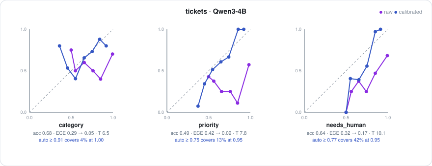

# The calibration kit

Raw probabilities from a language model are overconfident. This kit measures by how
much, on your questions and your data, fits one temperature per question to fix the
global part of it, and derives the confidence thresholds at which you can act
automatically with a stated precision. It is the evaluation harness for every model
Brier runs, trained or not.

**Contents**: [What it produces](#what-it-produces) · [Running it](#running-it) · [Reading the report](#reading-the-report) · [Applying a calibration](#applying-a-calibration) · [How the numbers are computed](#how-the-numbers-are-computed) · [Results on the built-in tasks](#results-on-the-built-in-tasks) · [When to recalibrate](#when-to-recalibrate)

## What it produces

For each question, from labelled examples:

- **T**, the temperature that makes the question's probabilities honest.
- **Accuracy, ECE, Brier score, mean confidence**, raw and after temperature, all
  measured on held-out folds.
- **A reliability diagram** as an SVG.
- **A decision policy**: for each target precision (0.95 for `auto`, 0.80 for `review`
  by default) the lowest calibrated confidence at which that precision is reached, and
  the fraction of decisions that clear it.

Saved as one JSON file per task that `Calibration.load` reads back.

## Running it

On the built-in tasks:

```sh
python3 -m brier calibrate --task tickets,gridworld --model Qwen/Qwen3-4B --n 300
python3 -m brier calibrate --task tickets --model Qwen/Qwen3-0.6B --adapter adapters/Qwen3-0.6B-brier-r16-s1500
```

On your own data, from Python:

```python
from brier import Scorer, Choice, Noul
from brier.calibrate import collect, calibrate, report, Calibration
from brier.report import reliability_svg

questions = [Choice("category", "...", (...)), Noul("needs_human", "...")]
examples = [(state, {"category": "bug", "needs_human": True}), ...]   # a few hundred, labelled

scorer = Scorer("Qwen/Qwen3-4B")
records = collect(scorer, questions, examples)      # one pass per example, raw scores kept
cal = calibrate(questions, records, targets=(("auto", 0.95), ("review", 0.80)))
print(report(cal))
cal.save("cal_tickets.json")
open("rel_tickets.svg", "w").write(reliability_svg(cal))
```

Labels may be a single value, a boolean for a Noul, or a tuple of acceptable values
when several answers are correct.

## Reading the report

```
question             n    acc  ECE raw  ECE cal Brier raw Brier cal conf raw conf cal      T
category           300  0.680    0.295    0.054     0.301     0.205    0.968    0.692   6.46
priority           300  0.493    0.422    0.092     0.416     0.207    0.916    0.564   7.80
needs_human        300  0.643    0.319    0.168     0.318     0.193    0.962    0.724  10.15

decision policy (calibrated confidence cutoffs, held-out):
  category         auto    target 0.95: act when confidence >= 0.910  -> precision 1.000, covers 4% of decisions
  category         review  target 0.80: act when confidence >= 0.721  -> precision 0.800, covers 48% of decisions
  category         human   everything below
```

Line by line, for `category` on Qwen3-4B with no training:

- The model is right 68% of the time and, raw, reports 0.97 mean confidence: an ECE of
  0.30, badly overconfident.
- A temperature of 6.5 brings mean confidence to 0.69 and ECE to 0.05. Accuracy is
  unchanged, because temperature does not reorder answers.
- After calibration, only 4% of tickets clear the bar for 95% precision, and 48% clear
  the bar for 80%. The rest should go to a person. That is the honest capacity of this
  model on this task, and it is the number that decides whether the model is useful, not
  the accuracy.

## Applying a calibration

```python
cal = Calibration.load("cal_tickets.json")
answers = ask(scorer, state, questions, temperatures=cal.temperatures)
cal.apply(answers)                         # sets answer.tier per question
if answers["category"].tier == "auto":
    route(answers["category"].value)
```

<p align="center"></p>

## How the numbers are computed

Each step is a section of the [primer](PRIMER.md).

1. **Collect.** Every example is answered once at T = 1 and the raw per-option scores
   (log-probabilities) are kept. Nothing else about the model is needed afterwards.
2. **Cross-fit the temperature.** The records are split into five folds. For each fold,
   T is fit on the other four by minimising negative log-likelihood over a log-spaced
   grid, and the held-out fold's confidences are computed at that T. The pooled held-out
   confidences are what every reported number uses. The T written to the file is fit on
   all records. (Primer §11.)
3. **ECE and Brier.** Ten equal-width confidence bins; ECE is the count-weighted mean gap
   between bin confidence and bin accuracy. Brier score is the mean squared error of
   confidence against correctness. (Primer §9, §10.)
4. **Thresholds.** Held-out decisions sorted by calibrated confidence; for each target
   precision, the lowest cutoff whose running precision meets it, requiring at least five
   decisions or 2% of the data above the cutoff. (Primer §12.)

## Results on the built-in tasks

Qwen3-4B, untrained, 300 examples per task, five-fold cross-fitted temperature.

| task | question | accuracy | ECE raw | ECE cal | T | auto cutoff | auto coverage |
|---|---|---|---|---|---|---|---|
| tickets | category | 0.680 | 0.295 | 0.054 | 6.5 | 0.91 | 4% |
| tickets | priority | 0.493 | 0.422 | 0.092 | 7.8 | 0.75 | 13% |
| tickets | needs_human | 0.643 | 0.319 | 0.168 | 10.2 | 0.77 | 42% |
| gridworld | move | 0.733 | 0.201 | 0.100 | 5.6 | unreachable | |
| gridworld | danger | 0.870 | 0.128 | 0.048 | 5.0 | 0.90 | 64% |
| toolcall | tool | 0.970 | 0.028 | 0.008 | 3.4 | 0.65 | 100% |
| passages | answers | 0.933 | 0.058 | 0.009 | 4.3 | 0.71 | 97% |

Two readings. Tool selection and passage relevance, which are the shape of most real
decision workloads, are near-solved by a 4B model with no training and become honest
after a single temperature: an auto tier covering essentially everything at 95%
precision. The harder synthetic tasks show the other regime: accuracy in the 0.5 to 0.7
range, where calibration cannot manufacture precision and the policy correctly sends most
decisions to a person. Training ([TRAINING.md](TRAINING.md)) is aimed at the second
regime.

The temperatures are all well above 1, between 3 and 10. That is the size of the
overconfidence: the raw scores need to be flattened by that factor before the
probabilities mean what they say.

## When to recalibrate

Thresholds guarantee precision on data like the calibration data. Recalibrate when the
input distribution changes (new product, new customer segment, new language), when the
questions change, and after any training. Three hundred labelled examples per question
take a few minutes on a single GPU.
