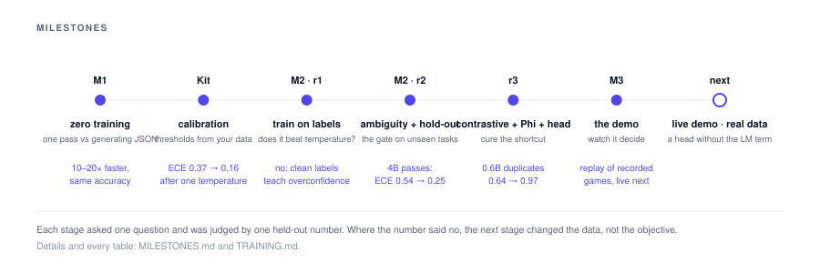

# Milestones

The project's plan, what each stage set out to prove, what it measured, and what it
changed. Dates are when the numbers were produced. Every result named here is in
[TRAINING.md](TRAINING.md) or [CALIBRATION.md](CALIBRATION.md) with its table.

**Contents**: [Milestone 1](#milestone-1-zero-training) · [Question API and kit](#question-api-and-calibration-kit) · [Milestone 2](#milestone-2-training-for-calibrated-decisions) · [Round three](#round-three) · [Milestone 3](#milestone-3-the-demo) · [Next](#next) · [Principles](#principles-that-held)

## Milestone 1, zero training

*2026-09-18. Done.*

**Question.** Is it worth training anything? Take an open model exactly as released,
score every allowed answer in one forward pass, and measure against the same weights
generating JSON.

**Delivered.** The single-pass scorer, the JSON baseline with a self-reported confidence,
two synthetic tasks with computable ground truth (tickets, gridworld), and the metrics
(accuracy, ECE, Brier, latency, held-out temperature scaling). Qwen3 at 0.6B, 1.7B and
4B on an RTX 4090.

**Found.** One pass is 10 to 20× faster than generation from the same weights at equal or
better accuracy. Type errors are zero for both methods on this simple a schema, so the
structural guarantee was not yet the differentiator. Raw confidence is badly inflated
(0.95 mean confidence at 0.59 accuracy on the 4B) and one temperature per question cuts
the calibration error two to four times. Two format lessons: the scoring header must be
something the model would have written (a JSON key works, a bare `field:` line does
not), and Grade levels must be listed as bare names, because inline descriptions bleed
into the answer space.

**Decision.** Training is worth it, and calibration is the gap.

## Question API and calibration kit

*2026-09-18. Done.*

**Question.** Vendors of decision models ship probabilities and tell users to pick their
own thresholds. Can the thresholds be derived from the user's own data with a stated
guarantee?

**Delivered.** Pick, Grade and Claim questions answered in one pass with full
distributions, a stated definition of confidence, and expected level for scores. The
kit: per-question temperature fit by maximum likelihood with five-fold cross-fitting,
ECE and Brier score on held-out folds, reliability diagrams, and the lowest confidence
cutoff that reaches a target precision for `auto`, `review` and `human` tiers, with the
coverage each gets.

**Found.** On the 4B untrained, tool selection and passage relevance are near-solved and
become honest after one temperature, with an auto tier covering essentially everything
at 95% precision. Tickets sit in the regime where calibration cannot manufacture
precision and most decisions go to a person. Contextual debiasing with a content-free
input is fragile and is off by default.

**Decision.** The kit is the evaluation harness for every model from here, trained or
not.

## Milestone 2, training for calibrated decisions

*Round one 2026-09-18, round two 2026-09-19. Done.*

**Question.** Does training the backbone on the decision objective beat the one-parameter
fix, including on tasks it never saw?

**Delivered.** LoRA adapters trained with cross-entropy over the answer set, a strictly
proper scoring rule, using the scorer's own code path. Three new tasks (tool selection,
passage relevance, frustration). The gate: trained raw ECE on never-trained tasks must be
under the untrained model's temperature-scaled ECE.

**Round one found.** Trained tasks reach 1.000 accuracy with a temperature of 0.05: template
memorisation, marked as such. Gridworld, with random grids, shows real learning (0.6B
0.35 to 0.84). The unseen task improves 14 to 20 points but fails the gate at every size.
Clean labels teach a model that it is always right.

**Round two changed.** Template hold-out (disjoint template halves for training and
evaluation), 30% ambiguous training examples with soft labels equal to the generator's
posterior, a second never-trained task (duplicates), a real dataset (banking77, human
labels), outcome-reward training with no labels, shared-prefix cached scoring, and five
backbones from three families.

**Round two found.** Memorisation gone; fitted temperatures fall from about 10 to between
1 and 2. At 4B the gate passes on frustration (0.44 to 0.63, ECE 0.54 to 0.25) and
duplicates (0.73 to 0.997, ECE 0.26 to 0.04). Every size reaches 0.90 or better on real
banking data with ECE at or under 0.03. At 0.6B duplicates regresses through a
"shared cues mean yes" shortcut, diagnosed by confusion matrix. Outcome reward without
labels reaches 0.81 on gridworld against 0.84 supervised. Cached scoring is exact and
1.6 to 2.3× faster from 1.7B up. Phi-4-mini is the strongest untrained backbone.

**Decision.** The objective works; data decides what it learns. Next round is data.

## Round three

*2026-09-19. Done; results in TRAINING.md.*

**Question.** Does a contrastive claim cure the shortcut, does the strongest backbone
train as well as it evaluates, does a head over hidden states help, and does a delayed
outcome teach anything a label cannot?

**Delivered.** The matching task and not-human phrases (contrastive claims), Phi-4-mini
trained with the same recipe (LoRA targets detected per architecture), the typed head
(input-conditional temperature plus per-candidate residual, zero-initialised to the plain
scorer), six-step outcome episodes, and the trajectory recorder for the demo. Four pods
in parallel.

**Found.** Contrastive data cured the negative transfer: 0.6B duplicates 0.64 to 0.97
with nothing else changed. Phi-4-mini trained is the strongest model in the project
(0.96 on ticket category, 0.99 on duplicates, 0.92 on real banking). The same data lifts the
4B on the never-trained frustration task from 0.63 to 0.83. The typed head improves
calibration on trained tasks and hurts the unseen ordinal task at both sizes, so it is
optional, on by evaluation.

## Milestone 3, the demo

*2026-09-19. Built.*

**Question.** Can someone watch the model decide, tick by tick, with its probabilities
visible?

**Delivered.** [demo.html](demo.html) replays recorded gridworld games: the grid, the
four move probabilities, the chosen move, whether it was optimal, and the latency of
each decision, with play, step and reset, for a trained and an untrained model.
`record.py` produces the trajectories from any model or adapter. The recorded set is
twelve games each: the outcome-reward 0.6B, trained with no labels, reaches the exit
in seven and walks into the monster in two; the untrained 0.6B reaches it in one.

**Live.** `python3 -m brier.serve` puts the scorer behind three endpoints and serves
`docs/live.html`: any state, any typed questions, decisions updating as you type with
the latency of the pass, calibration tiers when a file is loaded, and gridworld played
live with the move distribution drawn on the grid. It runs on a laptop with the 0.6B
(about a second per decision on Apple silicon) and on a GPU with any backbone and
adapter.

## Round four, the generic corpus

*2026-09-19. Done; tables in TRAINING.md.*

**Question.** Does the objective learn real decisions in general, or only the synthetic
ones it was built on?

**Delivered.** Twelve public datasets as Pick, Grade and Claim questions, streamed and
script-free; one adapter per backbone trained on a mixture of the five synthetic tasks
and ten real ones, with three real datasets and two synthetic tasks held out entirely; a
distributed trainer, with a four-GPU run of the Phi adapter measured against one GPU.

**Found.** Large gains on real held-out data at both sizes (0.6B on MS MARCO 0.12 to
0.88, on SNLI 0.33 to 0.84; Phi on toxicity 0.49 to 0.94, banking 0.98), transfer to the
never-trained datasets, raw calibration error at or under 0.10 almost everywhere, and a
0.6B that rivals an untrained 3.8B. Four GPUs finish the same job in 16 minutes against
39. Breadth costs a few points on the narrowest synthetic task.

## Round five, the pointer head

*2026-09-19/20. Done; tables in TRAINING.md.*

**Question.** Can a head that scores every option from one forward pass match the row
scorer, and what does it take.

**Delivered.** `brier/pointer.py`: options scored from the hidden states where the prompt
lists them, no vocabulary projection, one row per request, an ordinal term for Grade
questions, distillation from the row scorer as a warm start. Five runs in parallel plus
a latency benchmark.

**Found.** Flat latency in the number of questions (Phi-4-mini: 50 ms whether three or
ten questions, against 145 and 1,230 ms for the row scorer, which cannot fit thirty).
Parity with the row scorer on Pick and Claim questions across the real datasets. Grade
questions trail a head trained from labels alone; more data and the ordinal term with
distillation are the fixes, measured in the tables.

## Next

- Close the pointer head's Grade gap so ordered scales leave the row scorer entirely.
- Conformal prediction sets: a distribution-free coverage guarantee per question, from the same held-out data.
- Distilled labels on real tickets and tool-call logs, with disagreements kept.
- Multi-step credit assignment: discounting or a value estimate for longer episodes.
- Phi-4-mini as the working backbone throughout; adapters are published as a GitHub release (`python3 -m brier fetch`).

## Principles that held

- **Measure before training.** The kit existed before the first adapter, and every
  training claim is a held-out number it produced.
- **The gate refuses.** Where the numbers did not support a claim, the document says so,
  including the round-one memorisation and the round-two negative transfer.
- **The model learns exactly the rules its data contains.** Every failure in the project
  was a data failure and every fix was a data fix: ambiguity for overconfidence,
  counterexamples for shortcuts.
- **Any open backbone.** The same code ran five models from three families; the working
  backbone is chosen by the table, not by habit.
