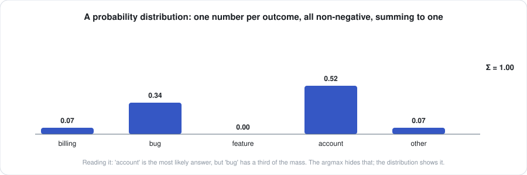
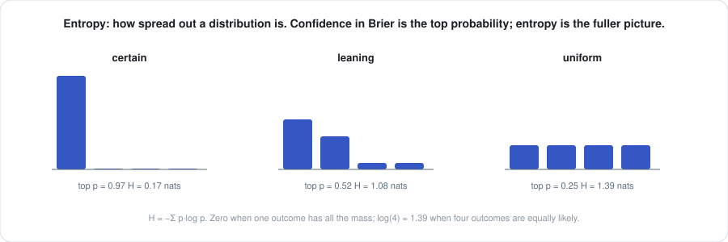
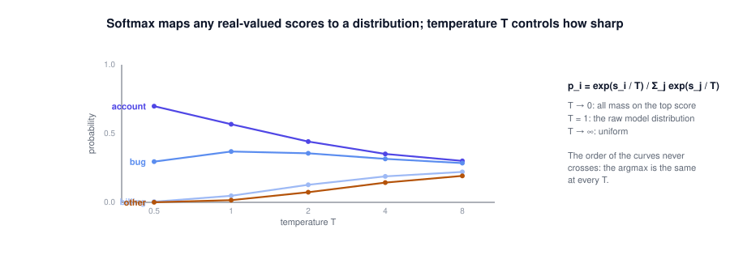
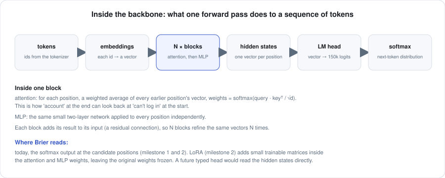
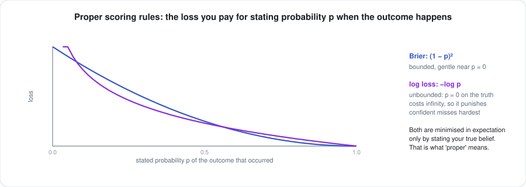
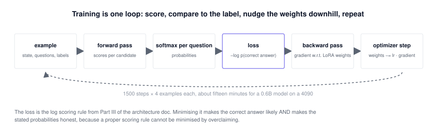
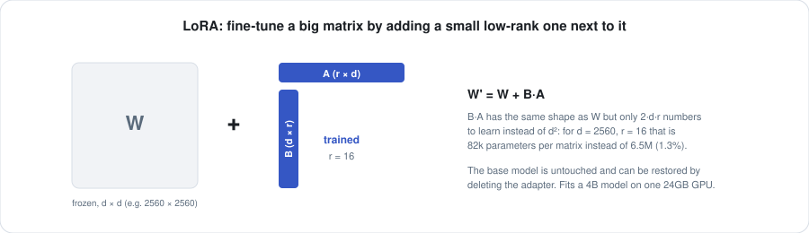

# The primer: the mathematics under Brier, from zero

This is the deep dive. It exists so that anyone on the team can read every line of
`brier/` and every number in `results/` and know exactly what it means and why it is
computed that way. It assumes high-school algebra and nothing else. Each section builds
on the previous one; the last sections reach the training objective and the reasons it
works.

Where the [architecture doc](ARCHITECTURE.md) says *what* Brier does, this document says
*why the mathematics permits it*.

**Contents**
1. [Probability and distributions](#1-probability-and-distributions)
2. [Expectation, entropy, and what "confidence" can mean](#2-expectation-entropy-and-what-confidence-can-mean)
3. [Logarithms and log-probabilities](#3-logarithms-and-log-probabilities)
4. [Softmax and temperature](#4-softmax-and-temperature)
5. [Conditional probability and the chain rule](#5-conditional-probability-and-the-chain-rule)
6. [What a language model is, mathematically](#6-what-a-language-model-is-mathematically)
7. [Inside the transformer](#7-inside-the-transformer)
8. [Scoring a candidate: the chain rule applied](#8-scoring-a-candidate-the-chain-rule-applied)
9. [Calibration, formally](#9-calibration-formally)
10. [Proper scoring rules](#10-proper-scoring-rules)
11. [Temperature scaling as maximum likelihood](#11-temperature-scaling-as-maximum-likelihood)
12. [Decision thresholds: precision, coverage, and the policy](#12-decision-thresholds-precision-coverage-and-the-policy)
13. [Gradient descent](#13-gradient-descent)
14. [Fine-tuning and LoRA](#14-fine-tuning-and-lora)
15. [The Brier training objective](#15-the-brier-training-objective)
16. [Why it generalises, and when it will not](#16-why-it-generalises-and-when-it-will-not)
17. [The typed head](#17-the-typed-head)
18. [Outcome rewards: the policy-gradient form](#18-outcome-rewards-the-policy-gradient-form)
19. [Beyond: open questions](#19-beyond-open-questions)

---

## 1. Probability and distributions

A **probability** is a number between 0 and 1 attached to an outcome, expressing how
likely it is. A **probability distribution** over a finite set of outcomes is one such
number per outcome, with the numbers summing to exactly 1. That is the entire definition.

<p align="center"></p>

In Brier, the outcomes are the allowed answers to one question. For
`category ∈ {billing, bug, feature, account, other}`, a distribution is five numbers. The
figure shows one: `account` at 0.52, `bug` at 0.34, the rest small.

Two facts to hold on to:

- The **argmax** is the outcome with the largest probability. It is what most systems
  return. It throws away the other four numbers.
- The **shape** of the distribution is information. A 0.52 with a 0.34 runner-up says
  "probably account, possibly bug"; a 0.52 with four 0.12s says "account, and nothing
  else is close." Same argmax, same top probability, different situations. Brier returns
  the whole distribution so downstream code can tell them apart.

## 2. Expectation, entropy, and what "confidence" can mean

**Expectation.** If outcomes have numeric values $v_1, \dots, v_n$ and probabilities
$p_1, \dots, p_n$, the expected value is the probability-weighted average:

```math
\mathbb{E}[v] = \sum_{i=1}^{n} p_i\, v_i
```

Brier uses it for `Score` questions: levels `calm < annoyed < angry < furious` are given
positions $0, 1, 2, 3$, and `expected` is $\sum_i p_i \cdot i$. A distribution of 0.5 on
`annoyed` and 0.5 on `angry` has expected level 1.5, which correctly says "between the
two" where the argmax would have to pick one.

**Entropy** measures how spread out a distribution is:

```math
H(p) = -\sum_{i=1}^{n} p_i \log p_i
```

It is $0$ when one outcome has all the mass, and $\log n$ when all $n$ outcomes are
equal.

<p align="center"></p>

**Confidence.** Any single number summarising the distribution's certainty. There are
several defensible choices: the top probability, one minus normalised entropy, the margin
between first and second. Brier reports the **top probability** as `confidence` and the
**margin** as `margin`, and states this in code, so nobody has to guess what the number
is. Whatever the choice, confidence is *derived from* the distribution, never a separate
thing the model produces. This matters in Part III of the architecture doc: a confidence
that is a function of probabilities can be calibrated by fixing the probabilities.

## 3. Logarithms and log-probabilities

The natural logarithm $\log x$ (base $e \approx 2.718$) turns multiplication into
addition:

```math
\log(ab) = \log a + \log b
```

For probabilities, which lie in $(0, 1]$, the log is $\le 0$: $\log 1 = 0$,
$\log 0.5 \approx -0.69$, $\log 0.01 \approx -4.6$, and $\log p \to -\infty$ as
$p \to 0$.

Models work in log-probabilities for two reasons. Numerically, a product of two hundred
probabilities each around 0.1 is 10⁻²⁰⁰, which underflows to zero in floating point,
while the sum of their logs, −460, is a perfectly ordinary number. Algebraically,
sequences are scored by *multiplying* per-token probabilities (section 5), which becomes
*adding* per-token log-probabilities.

Some anchors used throughout `results/`:

| log-probability | probability |
|---|---|
| $-0.62$ | $0.54$ |
| $-1.05$ | $0.35$ |
| $-3.1$ | $0.045$ |
| $-6.4$ | $0.0017$ |

## 4. Softmax and temperature

Softmax turns any list of real numbers $s_1, \dots, s_n$ (called **scores** or
**logits**) into a distribution:

```math
p_i \;=\; \frac{\exp(s_i / T)}{\sum_{j=1}^{n} \exp(s_j / T)}
```

with $T \gt  0$ the **temperature**. Exponentiation makes every term positive; dividing by
the sum makes them add to one. Because $\exp$ is increasing, the order of the $p_i$ is
the order of the $s_i$: the argmax never changes with $T$.

<p align="center"></p>

$T$ controls sharpness. As $T \to 0$ all mass goes to the top score; at $T = 1$ the
distribution is whatever the scores say; as $T \to \infty$ it becomes uniform. Two
details worth knowing:

- Softmax is **shift-invariant**: adding a constant to every score leaves the output
  unchanged, because it cancels in the ratio. Implementations subtract the maximum score
  before exponentiating so that the largest exponent is 0 and nothing overflows. That is
  the `m = max(scores)` line in `scorer.py`.
- If the scores are already log-probabilities $\log q_i$, softmax at $T = 1$ is just
  renormalisation: $p_i = q_i / \sum_j q_j$. This is what Brier does to a question's
  candidates:
  the scores in section 8 are log-probabilities of sequences, and softmax over them is
  the conditional distribution over the allowed answers given that the answer is one of
  them.

## 5. Conditional probability and the chain rule

$P(A \mid B)$ is the probability of $A$ given that $B$ is known. The **chain rule**
writes the probability of a whole sequence as a product of conditionals:

```math
P(x_1, x_2, \dots, x_n) \;=\; P(x_1)\, P(x_2 \mid x_1)\, P(x_3 \mid x_1, x_2) \cdots P(x_n \mid x_1, \dots, x_{n-1})
\;=\; \prod_{t=1}^{n} P(x_t \mid x_{\lt t})
```

This is not an approximation; it is an identity. Its importance is that a system which
can compute $P(\text{next} \mid \text{everything so far})$ can, by multiplying, compute
the probability of any sequence. In logs, by adding:

```math
\log P(x_1, \dots, x_n) \;=\; \sum_{t=1}^{n} \log P(x_t \mid x_{\lt t})
```

## 6. What a language model is, mathematically

A language model is a function with parameters $\theta$ that takes a sequence of
tokens $x_1, \dots, x_t$ and returns, for every token $v$ in the vocabulary,

```math
P_\theta(x_{t+1} = v \mid x_1, \dots, x_t)
```

That is all. It is a next-token conditional distribution, and by the chain rule,
therefore a distribution over all sequences.

**Training** a language model means choosing $\theta$ (the weights, billions of numbers)
to make the training text likely, that is, to minimise the **cross-entropy** between
the model's prediction and the actual next token at every position of every document:

```math
\mathcal{L}_{\text{LM}}(\theta) \;=\; -\sum_{\text{docs}} \sum_{t} \log P_\theta(x_{t+1} \mid x_{\le t})
```

Section 10 shows this is a proper scoring rule, which is why a pretrained model's
next-token distribution is reasonably honest *as a model of text*.

Two consequences shape everything Brier does:

- The model assigns a probability to *every* continuation, including ones it would never
  generate. Brier asks for the probabilities of the allowed answers; it never asks the
  model to choose.
- The objective was text likelihood, not decision accuracy or decision calibration. A
  good next-token model will rank sensible answers above nonsense, but nothing forced the
  *scale* of its probabilities to match how often it is right about tickets. Sections 9
  and 15 are about closing that gap.

## 7. Inside the transformer

Everything above treats the model as a black box. This section opens it just enough to
understand what LoRA modifies and where a typed head would attach.

<p align="center"></p>

1. **Embeddings.** Each token id is looked up in a table and becomes a vector of *d*
   numbers (*d* is 1024 for Qwen3-0.6B, 2560 for 4B). Position information is added.
2. **Blocks.** The sequence of vectors passes through *N* identical blocks (28 for
   Qwen3-0.6B, 36 for 4B). Each block has two parts.
   - **Attention.** For each position, compute a *query* vector, and for every position
     at or before it a *key* and a *value* vector (all by multiplying the hidden vector
     by learned matrices $W_q, W_k, W_v$). The output at a position is the average of
     the values, weighted by the softmax of scaled dot products:

     ```math
     \text{Attention}(Q, K, V) \;=\; \text{softmax}\!\left(\frac{Q K^{\top}}{\sqrt{d}}\right) V
     ```

     This is how information moves
     between positions: the vector at the candidate token can look back at the input.
     Causal masking ensures positions only look backward, which is what makes the model
     a valid *next*-token predictor and what makes batched scoring correct (a candidate
     cannot see other rows or its own future).
   - **MLP.** The same two-layer network applied to every position independently, with
     matrices $W_{\text{gate}}, W_{\text{up}}, W_{\text{down}}$.
   Each part adds its output to its input (**residual connection**) and is preceded by a
   normalisation. So the block is a refinement, not a replacement, of the vectors.
3. **Hidden states.** After the last block, one vector per position. This is the
   model's representation of "everything so far, as seen from here."
4. **LM head.** A final matrix maps each hidden vector to one score per vocabulary
   entry (150k scores). Softmax over them is the next-token distribution.

The seven matrices named above, $W_q, W_k, W_v, W_o$ in attention and
$W_{\text{gate}}, W_{\text{up}}, W_{\text{down}}$ in the MLP, are exactly the ones LoRA
adapts in section 14. The hidden states
in step 3 are where a typed head (section 17) would read.

## 8. Scoring a candidate: the chain rule applied

Now the core of Brier in one line. Given a prompt $c$ (the state, the questions, the
chat template) and a candidate answer whose tokens are $a_1, \dots, a_k$, its score is

```math
s(a) \;=\; \log P_\theta(a_1, \dots, a_k \mid c) \;=\; \sum_{i=1}^{k} \log P_\theta(a_i \mid c, a_1, \dots, a_{i-1})
```

by the chain rule (section 5), with each term read directly from the model's next-token
distribution (section 6) at the corresponding position. One forward pass over the
sequence $c \cdot a$ yields all $k$ terms at once, because the model produces a
distribution at every position.

For a question with allowed answers $a^{(1)}, \dots, a^{(n)}$, softmax over their scores
(section 4, $T = 1$) gives

```math
P\big(\text{answer} = a^{(j)} \,\big|\, c,\ \text{answer} \in \{a^{(1)}, \dots, a^{(n)}\}\big)
\;=\; \frac{\exp s(a^{(j)})}{\sum_{i=1}^{n} \exp s(a^{(i)})}
```

which is precisely the model's conditional distribution over the allowed set. Nothing
outside the set can receive probability. That is the type guarantee, stated as an
equation.

Two subtleties that bit during development and are worth understanding:

- **The prefix must be in-distribution.** The score is *P(a | c)* for the *c* that was
  actually used. If *c* ends in a format the model would never produce (the early
  `category:` header), the conditional is about an unlikely world and the ranking is
  garbage. The JSON header works because instruction tuning made it likely.
- **Multi-token candidates.** A two-token answer pays two log-probabilities and tends to
  score lower than a one-token answer of equal plausibility, because each token is a
  factor ≤ 1. Brier's tasks use answers that tokenize to one or two tokens, and
  calibration (section 11) absorbs a constant bias, but a deliberately unfair option set
  (one long answer among short ones) would need length normalisation. That is a known
  open item.

## 9. Calibration, formally

Let a model report confidence $c$ for a decision and let $y \in \{0, 1\}$ record
whether the decision was correct. The model is **calibrated** if, for every value $c$,

```math
P(y = 1 \mid \text{confidence} = c) \;=\; c
```

Among all decisions where it said 0.8, 80% are right. This is a statement about
*aggregates*: it says nothing about any single decision, and a calibrated model can be
wrong on a 0.99 (it should be, about 1% of the time).

Because $c$ is continuous, the definition is checked by binning. Split $[0, 1]$ into
$M$ bins; in bin $m$ with $n_m$ decisions, let $\text{conf}(m)$ be the mean reported
confidence and $\text{acc}(m)$ the fraction correct. The **expected calibration
error** is

```math
\text{ECE} \;=\; \sum_{m=1}^{M} \frac{n_m}{N}\,\big|\,\text{acc}(m) - \text{conf}(m)\,\big|
```

the average gap between what was claimed and what was delivered, weighted by how many
decisions fell in each bin. Brier uses $M = 10$ equal-width bins. The reliability
diagram in the architecture doc is the plot of *acc(m)* against *conf(m)*; ECE is the
weighted distance from the diagonal.

A model can be miscalibrated in two directions. **Overconfident**: $\text{conf} \gt \text{acc}$, the curve
below the diagonal. This is the near-universal failure of
language models used as classifiers. **Underconfident**: $\text{conf} \lt  \text{acc}$,
above the diagonal; rarer, and it appears when temperature is set too high.

## 10. Proper scoring rules

How do you train or evaluate a probability, when the truth is a single outcome rather
than a probability? With a **scoring rule**: a loss $L(p, y)$ charged for stating
distribution $p$ when outcome $y$ occurs. A rule is **proper** if the expected loss
under any true distribution $q$,

```math
\mathbb{E}_{y \sim q}\,[L(p, y)],
```

is minimised by stating $p = q$. It is **strictly proper** if $q$ is the *unique*
minimiser. Under a strictly proper rule, honesty is the only optimal policy: there is no
way to game the score by overclaiming or hedging.

Two rules matter here.

**Log loss** (cross-entropy):

```math
L_{\log}(p, y) \;=\; -\log p(y)
```

Stating probability $p$ on the outcome that happened costs $-\log p$: nothing for
$p = 1$, unbounded as $p \to 0$. To see it is proper, take a binary outcome with true
probability $q$. The expected loss of stating $p$ is

```math
\mathbb{E}[L_{\log}] \;=\; -q \log p \;-\; (1 - q)\log(1 - p),
\qquad
\frac{\partial}{\partial p}\,\mathbb{E}[L_{\log}] \;=\; -\frac{q}{p} + \frac{1-q}{1-p} \;=\; 0
\;\iff\; p = q .
```

This is the training loss of every language model and, in section 15, of Brier.

**Brier score**:

```math
L_{\text{Brier}}(p, y) \;=\; \sum_{i=1}^{n} \big(p_i - \mathbb{1}[y = i]\big)^2,
\qquad \text{binary case: } (p - y)^2
```

the squared distance between the stated distribution and the one-hot truth. Bounded,
gentler than log loss on confident misses, and also strictly proper by the same
derivative argument:

```math
\frac{\partial}{\partial p}\,\mathbb{E}\big[(p - y)^2\big] \;=\; 2(p - q) \;=\; 0 \;\iff\; p = q .
```

Brier reports it in `metrics.py` alongside ECE and uses it as the outcome reward in
section 18.

<p align="center"></p>

The decisive property: **a proper scoring rule improves calibration as a by-product of
minimising it.** Any systematic overconfidence is a way to lose points that an honest
model would not lose, so gradient descent on log loss or Brier score pushes toward the
diagonal. This is why the training objective in section 15 needs no separate
"calibration term": it is built in.

Accuracy, for contrast, is not a proper scoring rule. It only sees the argmax and pays
the same for a confident right answer and a hesitant one, so a model trained purely on
accuracy has no incentive to be honest about probabilities.

## 11. Temperature scaling as maximum likelihood

Section 4 showed *T* changes sharpness without changing ranking. Section 9 showed the
raw model is too sharp. So: find the *T* that makes the model honest, on data with known
answers.

"Honest" is operationalised with the log scoring rule (section 10). Given held-out
decisions $d = 1, \dots, D$, each with scores $s^{(d)}$ and correct index $y^{(d)}$,
choose $T$ to minimise the negative log-likelihood

```math
\text{NLL}(T) \;=\; -\sum_{d=1}^{D} \log \frac{\exp\big(s^{(d)}_{y^{(d)}} / T\big)}{\sum_{j} \exp\big(s^{(d)}_{j} / T\big)}
```

This is one-dimensional, so a grid search over $T$ (Brier uses 160 log-spaced values
from 0.05 to 20) is exact enough. The resulting $T$ is the maximum-likelihood
temperature.

Fitting $T$ on the same data you evaluate on would overstate the improvement, so
`calibrate.py` uses **cross-fitting**: split the data into $k$ folds, fit $T$ on $k-1$,
score the held-out fold, rotate, and pool the held-out confidences to compute ECE and the
thresholds. The final $T$ shipped in the calibration file is fit on all the data. Every
"ECE after temp" number in `results/` is a held-out number.

Temperature scaling has one parameter per question. It can fix a *global* miscalibration
(the model is uniformly too sure) and cannot fix a *conditional* one (the model is too
sure on hard inputs and appropriately sure on easy ones). Sections 15 and 17 are what
fix the latter.

## 12. Decision thresholds: precision, coverage, and the policy

Calibrated probabilities are the input to a decision policy, not the output. The
question a system actually asks is: *above what confidence can I act automatically and
still be right at least 95% of the time?*

Sort the held-out decisions by calibrated confidence, descending. For each cutoff $t$
consider the set $S(t)$ of decisions with confidence $\ge t$:

```math
\text{precision}(t) \;=\; \frac{1}{|S(t)|}\sum_{d \in S(t)} y_d,
\qquad
\text{coverage}(t) \;=\; \frac{|S(t)|}{N}
```

Precision is generally non-increasing as $t$ falls (you admit less confident decisions),
coverage is non-decreasing. For a target precision $\pi$, the policy chooses

```math
t^\ast \;=\; \min\{\, t : \text{precision}(t) \ge \pi \,\}
```

the lowest cutoff whose precision is still at least $\pi$, which maximises coverage
subject to the guarantee.
Brier requires the set to contain at least 5 decisions or 2% of the data, whichever is
larger, so a threshold is never set on a handful of lucky examples, and reports the tier
as *unreachable* if no cutoff meets the target.

The tiers are then: **auto** if confidence $\ge t^\ast_{0.95}$, **review** if
$\ge t^\ast_{0.80}$, else **human**. This is the three-band policy every
decision-model vendor tells you to invent; `calibrate.py` derives it from your own data
and tells you what coverage you get at each band.

Note what the guarantee is: precision *on data like the calibration data*. If the
distribution of inputs shifts, the thresholds are stale. Recalibrate on fresh labelled
examples; the tool is cheap enough to run routinely.

## 13. Gradient descent

Training changes the model's parameters $\theta$ to reduce a loss $L(\theta)$. The
**gradient** $\nabla_\theta L$ is the vector of partial derivatives of $L$ with respect to
every parameter; it points in the direction of steepest increase. Gradient descent takes
a step the other way:

```math
\theta \;\leftarrow\; \theta \;-\; \eta\, \nabla_\theta L(\theta)
```

with **learning rate** $\eta$ controlling step size. Brier uses AdamW, which rescales each
parameter's step by a running estimate of its gradient's magnitude so that parameters
with consistently small gradients still move, and a schedule that warms *η* up over the
first 50 steps and decays it linearly after.

<p align="center"></p>

The **backward pass** computes *∇L* by the chain rule of calculus, layer by layer from
the loss back to the parameters (automatic differentiation; PyTorch does this). Its
memory cost is the reason for two settings in `train.py`: **gradient checkpointing**
recomputes intermediate activations during the backward pass instead of storing them,
and **gradient accumulation** sums gradients over four examples before stepping, giving
a larger effective batch than fits in memory at once. **Gradient clipping** rescales
the gradient if its norm exceeds 1, guarding against a single bad example throwing the
weights.

## 14. Fine-tuning and LoRA

Training all four billion parameters of a 4B model needs the parameters, their
gradients, and the optimizer's running estimates in memory at once: roughly 16 bytes per
parameter, 64 GB, plus activations. It does not fit a consumer GPU, and it risks
overwriting what pretraining learned.

**LoRA** (low-rank adaptation) sidesteps both. For a weight matrix
$W \in \mathbb{R}^{d \times d}$, it freezes $W$ and adds a trainable product $BA$ where
$A \in \mathbb{R}^{r \times d}$ and $B \in \mathbb{R}^{d \times r}$, with $r$ small (16
here):

```math
W' \;=\; W + BA, \qquad \text{trainable parameters: } 2dr \ \text{instead of}\ d^2
```

<p align="center"></p>

$BA$ has the same shape as $W$ but only $2dr$ parameters instead of $d^2$. For
$d = 2560$ and $r = 16$ that is 82k against 6.5M, about 1.3%. $B$ starts at zero so
training begins exactly at the pretrained model. Brier attaches adapters to the seven
matrices named in section 7, in every block. The adapter is saved separately from the
base model (a few tens of megabytes), can be loaded onto the base at inference, and can
be deleted to recover the original exactly.

The **rank** $r$ bounds how much the adapter can change the matrix. Low rank is a
regulariser: it can steer the model toward a new behaviour but cannot rewrite it, which
is what you want when the goal is "same knowledge, better calibrated decisions."

## 15. The Brier training objective

Everything is now in place. For a training example with prompt $c$, a question with
allowed answers $a^{(1)}, \dots, a^{(n)}$, and a correct set $Y$ (usually one answer;
sometimes several, as in gridworld ties):

1. Score every allowed answer, $s_i = \log P_\theta(a^{(i)} \mid c)$ (section 8). One
   batched forward pass, same code as inference.
2. Softmax over the scores, $p_i = \exp(s_i) / \sum_j \exp(s_j)$ (section 4).
3. Loss, the log scoring rule summed over acceptable answers (section 10):

   ```math
   L(\theta) \;=\; -\log \sum_{i \in Y} p_i
   \;=\; -\log \sum_{i \in Y} \frac{\exp s_i}{\sum_{j} \exp s_j}
   ```

   averaged over the questions in the example.
4. Backward pass into the LoRA parameters only (sections 13, 14). AdamW step.

When the label is a **soft target** $t = (t_1, \dots, t_n)$ with $\sum_i t_i = 1$
(the ambiguous examples of round two, whose target is the generator's own posterior),
the loss is the cross-entropy against that target:

```math
L(\theta) \;=\; -\sum_{i=1}^{n} t_i \log p_i
```

which is minimised by $p = t$, so the model is explicitly taught to say 0.5 when the
input supports two answers equally.

This is `example_loss` in `train.py`, and it is deliberately the same function as
`ask()` with a loss attached. There is no separate training-time architecture.

What it does to the model, and why:

- **Accuracy rises** because the loss falls when the correct answer's probability rises.
- **Calibration improves** because the loss is a strictly proper scoring rule (section
  10): the expected loss is minimised only when *p* matches the true frequency of
  correctness. A model that keeps saying 0.99 while being right 60% of the time is
  paying −log(0.01) on 40% of examples, an enormous penalty that gradient descent will
  remove by lowering those probabilities. This is the precise sense in which Brier
  "trains for calibrated decisions."
- **Conditional calibration becomes possible.** Unlike a single temperature (section 11),
  the adapter can learn that some inputs are hard and others easy, and modulate the
  scores per input. That is the capability the gate in section 16 tests for.
- **The type guarantee is untouched**, because training never changes what is compared;
  it changes the scores of the compared items.

One contrast with how the backbone was trained (architecture doc, Part IV). Pretraining
minimised log loss over the vocabulary at every position of raw text. Brier minimises log
loss over the *allowed answers* at the *answer position* of a *decision prompt*. Same
rule, different event space: the model is asked to be honest about the thing we actually
care about.

## 16. Why it generalises, and when it will not

The training examples come from generators (`tasks/`). Held-out examples from the same
generators test whether the objective does what section 15 claims; they do not test
whether the model has learned "frustration" or only "these templates." Two things in the
evaluation address that:

- **An unseen task.** The frustration task is excluded from training and evaluated
  after. Improvement there can only come from the model having learned something about
  *answering typed questions honestly* in general.
- **The gate is calibration, not accuracy.** The number that must improve is held-out
  ECE, raw and after temperature. Accuracy on in-distribution examples is easy to
  inflate by memorising templates; calibration on an unseen task is not.

Where it will fail, predictably: inputs far from anything in training (a new language, a
new domain), questions whose answers are not determined by the input (label noise looks
like uncertainty and will be learned as such, which is correct but disappointing), and
anything requiring arithmetic, counting, or multi-hop reasoning, which a single forward
pass with no chain of thought cannot do. These are the same failure modes every
single-pass decision model publishes, and Brier will document its own on real data
rather than claim otherwise.

## 17. The typed head

The scorer reads the LM head's distribution (section 8). `brier/head.py` adds the first
component that reads the backbone's hidden states (section 7, step 3) instead. For a
candidate $i$, let $h_{\text{state}}$ be the hidden vector at the last position before
the candidate begins (the model's summary of the state and the question) and
$h_{\text{cand},i}$ the hidden vector at the candidate's last token. The head computes

```math
s'_i \;=\; s_i \cdot \exp\!\big(\tau^{\top} h_{\text{state}}\big) \;+\; w^{\top} h_{\text{cand},i} \;+\; b
```

with trainable $\tau, w \in \mathbb{R}^{d}$ and $b \in \mathbb{R}$, all initialised to
zero, so the untrained head is exactly the plain scorer ($s'_i = s_i$; verified to a
difference of 0.0).

The two terms have different jobs. The first is an **input-conditional temperature**:
$1/T$ in section 11 was one number per question; here it is
$\exp(\tau^{\top} h_{\text{state}})$, a function of the input, so the model can be
sharp on easy states and flat on hard ones. That is the *conditional* calibration a
single temperature cannot provide. The second is a per-candidate **residual** that lets
the head re-rank answers using information the vocabulary distribution compresses away.
Both are trained jointly with the LoRA adapters by the same loss as section 15.

## 18. Outcome rewards: the policy-gradient form

Section 15 needs the correct answer. Environments provide something weaker and more
honest: an **outcome** $y \in \{0, 1\}$ for the action actually taken. In gridworld the
model states a distribution $p$ over the four moves, one move $a$ is sampled, it is
executed, and the environment reports whether the player got closer to the exit (single
step) or whether the episode reached the exit at all (multi-step, the same $y$ for every
move in the episode).

Two gradients are combined. The **policy-gradient** term raises the probability of
actions that led to good outcomes:

```math
\nabla_\theta\, \mathbb{E}_{a \sim p_\theta}[y]
\;=\; \mathbb{E}_{a \sim p_\theta}\big[\, y \,\nabla_\theta \log p_\theta(a) \,\big]
\;\approx\; (y - \bar{y})\,\nabla_\theta \log p_\theta(a)
```

where $\bar{y}$ is a running mean of past outcomes, the **baseline**, which lowers the
variance of the estimate without changing its expectation. The identity in the middle is
the log-derivative trick, $\nabla p = p\,\nabla \log p$. The **calibration** term is the
Brier score of the stated probability against the outcome, differentiated directly:

```math
L_{\text{cal}} \;=\; \big(p_\theta(a) - y\big)^2
```

The loss minimised per step is

```math
L_{\text{RL}} \;=\; -(y - \bar{y})\,\log p_\theta(a) \;+\; \lambda\,\big(p_\theta(a) - y\big)^2
```

with $\lambda = 1$. Because the second term is a strictly proper scoring rule
(section 10), its fixed point is $p_\theta(a) = P(y = 1 \mid \text{state}, a)$: the
model states the true probability that its chosen action works. This is what "trained
for calibrated decisions" means in the reinforcement form; the supervised objective of
section 15 is its special case where the outcome of every action is known.

## 19. Beyond: open questions

**A head without the LM term.** Section 17 keeps $s_i$ from the vocabulary. Dropping it
and scoring from $h_{\text{cand},i}$ alone would remove the tokenization dependence of
section 8 entirely, at the cost of starting from nothing rather than from the backbone's
prior; it needs more data than the residual form and is the natural next experiment.

**Multi-step credit.** Section 18 assigns the episode outcome to every move in the
episode. Discounting later moves less, or learning a value function to estimate each
move's contribution, are the standard refinements and would matter for longer
episodes.

**Dependent questions.** Every question is answered from the same prompt independently.
A second pass conditioned on the first pass's answers would recover dependencies at
double the latency. Whether the accuracy gain is worth it on real workloads is unknown
and measurable.

**Length normalisation.** Section 8's multi-token bias has standard fixes (divide by
token count, or compare against an unconditional baseline). Which one preserves
calibration best is an experiment the calibration kit can run in an afternoon.

**What is settled.** A causal language model's next-token distribution, restricted to a
finite answer set by the chain rule and softmax, is a valid decision distribution with
a structural type guarantee; its calibration is poor out of the box and is repaired by
maximum-likelihood temperature or, more thoroughly, by minimising a proper scoring rule
over the answer set, with labels (section 15) or with outcomes (section 18); an
input-conditional temperature (section 17) gives the model a way to be sure on easy
inputs and not on hard ones; and the resulting thresholds give a precision guarantee on
data like the calibration data. Everything in `results/` is one of those statements
measured.
