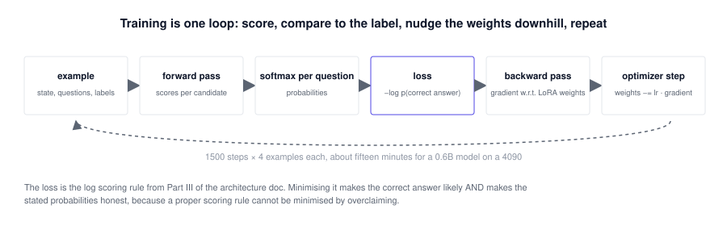
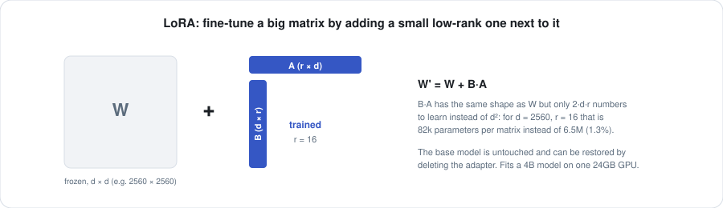
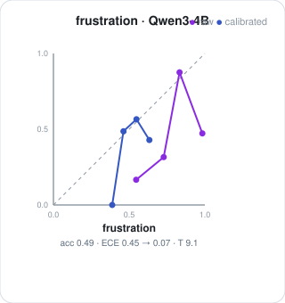
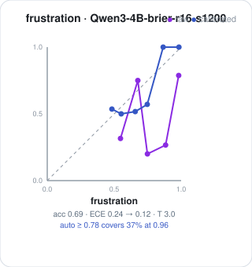

# Training: milestone 2

Milestone 1 established that an open model's raw scores rank answers well and state
probabilities badly, and that one temperature per question repairs the global part of
that. Milestone 2 asks whether *training* the model on the decision objective does
better: higher accuracy, and calibration that beats the temperature-scaled baseline
without any post-hoc fix, including on a task the model never saw.

This page is the recipe and the measured result. The mathematics is in the
[primer](PRIMER.md), sections 13 to 16.

**Contents**: [The objective](#the-objective) · [What is trained](#what-is-trained) · [Data](#data) · [Running it](#running-it) · [Evaluation and the gate](#evaluation-and-the-gate) · [Round one results](#round-one-results) · [Round one lessons](#what-was-learned-in-round-one) · [Round two protocol](#round-two-a-harder-protocol) · [Round two results](#round-two-results) · [Round two lessons](#what-was-learned-in-round-two) · [Next](#next)

## The objective

For each training example (a state, its questions, their labels), and for each question:

1. Score every allowed answer with the backbone, in one batched pass. This is the same
   `build_rows`, `batch` and `candidate_logprobs` that `ask()` uses at inference.
2. Softmax over the scores to get a distribution over the allowed answers.
3. Loss = −log (probability of the correct answer). When several answers are acceptable
   (gridworld ties), −log of their summed probability.

Averaged over the questions in the example, then over four examples per optimizer step.

<p align="center"></p>

This is cross-entropy over the *answer set*, a strictly proper scoring rule. Two things
follow that a plain accuracy objective would not give. The correct answer's probability
goes up, and any systematic overconfidence goes down, because a model that says 0.99
while being right 60% of the time is paying −log(0.01) on 40% of examples and gradient
descent will not tolerate that. There is no separate calibration term: honesty is a
consequence of the rule being proper (primer §10, §15).

## What is trained

LoRA adapters of rank 16 (alpha 32, dropout 0.05) on the seven projection matrices of
every transformer block: `q, k, v, o` in attention and `gate, up, down` in the MLP. The
base weights are frozen. For Qwen3-0.6B that is about 10M trainable parameters; for 4B
about 33M. Adapters are saved to `adapters/<model>-brier-r16-s<steps>/` and loaded onto
the base model at evaluation with `--adapter`.

<p align="center"></p>

Optimizer: AdamW, learning rate 1e-4, 50-step warm-up then linear decay to 5%,
gradient clipping at 1.0, gradient checkpointing on, bfloat16 throughout.

## Data

Four of the five built-in tasks, 600 examples each, generated with a seed disjoint from
the evaluation seed:

| task | question(s) | trained on |
|---|---|---|
| tickets | category (Pick), priority (Grade), needs_human (Claim) | yes |
| gridworld | move (Pick, ties allowed), danger (Claim) | yes |
| toolcall | tool (Pick over a per-example subset of eight tools) | yes |
| passages | answers (Claim) | yes |
| frustration | frustration (Grade, four levels) | **no**, held out entirely |

The generators know every label because they chose it, so there is no label noise to
learn. Frustration is excluded so that its result measures whether the model learned to
answer typed questions honestly in general, not just these templates.

## Running it

```sh
python3 train.py --model Qwen/Qwen3-0.6B --steps 1500          # ~25 min on an RTX 4090
python3 train.py --model Qwen/Qwen3-4B   --steps 1200          # ~75 min
python3 -m brier calibrate --model Qwen/Qwen3-0.6B --adapter adapters/Qwen3-0.6B-brier-r16-s1500 --n 300
```

The evaluation command is the calibration kit with an adapter, so trained and untrained
models are measured by exactly the same code on exactly the same held-out examples.

## Evaluation and the gate

For each model size, the kit is run untrained and trained on 300 examples per task
(seed 7, never seen in training). Three numbers per question decide the gate:

- **ECE raw**, the calibration of the model's own probabilities with no correction. The
  trained model's raw ECE must beat the untrained model's *temperature-scaled* ECE: the
  learned honesty must exceed what one fitted number achieves.
- **ECE after temperature**, cross-fitted, for both. Training should still leave the
  temperature close to 1, which means the model is honest without help.
- **Frustration**, the unseen task. Any improvement there is generalisation.

Accuracy is reported but is not the gate, because on in-distribution examples it can be
inflated by memorising templates.

## Round one results

Untrained → trained, 300 held-out examples per task. "ECE raw" is the model's own
probabilities; "ECE after temp" is cross-fitted temperature scaling on top. The gate
column asks whether the trained model's *raw* calibration beats the untrained model's
*temperature-scaled* calibration.

### Qwen3-0.6B

| task | question | accuracy | ECE raw | ECE after temp | T | raw beats untrained+temp |
|---|---|---|---|---|---|---|
| tickets | category | 0.287 → **1.000** | 0.425 → **0.000** | 0.082 → 0.000 | 11.8 → 0.05 | pass |
| tickets | priority | 0.340 → **1.000** | 0.502 → **0.000** | 0.168 → 0.000 | 5.8 → 0.05 | pass |
| tickets | needs_human | 0.310 → **1.000** | 0.570 → **0.000** | 0.261 → 0.000 | 20.0 → 0.05 | pass |
| gridworld | move | 0.353 → **0.840** | 0.488 → **0.123** | 0.095 → 0.131 | 9.4 → 1.79 | no |
| gridworld | danger | 0.870 → **0.977** | 0.155 → **0.012** | 0.012 → 0.015 | 0.5 → 1.06 | no |
| toolcall | tool | 0.883 → **1.000** | 0.064 → **0.000** | 0.036 → 0.000 | 2.0 → 0.05 | pass |
| passages | answers | 0.490 → **0.987** | 0.332 → **0.013** | 0.273 → 0.003 | 3.0 → 2.09 | pass |
| frustration (unseen) | frustration | 0.383 → **0.520** | 0.600 → **0.451** | 0.087 → 0.166 | 11.8 → 5.99 | no |

### Qwen3-1.7B

| task | question | accuracy | ECE raw | ECE after temp | T | raw beats untrained+temp |
|---|---|---|---|---|---|---|
| tickets | category | 0.483 → **1.000** | 0.488 → **0.000** | 0.065 → 0.000 | 10.1 → 0.05 | pass |
| tickets | priority | 0.573 → **1.000** | 0.241 → **0.000** | 0.076 → 0.000 | 4.1 → 0.05 | pass |
| tickets | needs_human | 0.363 → **1.000** | 0.631 → **0.000** | 0.322 → 0.000 | 20.0 → 0.05 | pass |
| gridworld | move | 0.437 → **0.853** | 0.457 → **0.112** | 0.100 → 0.134 | 19.3 → 1.73 | no |
| gridworld | danger | 0.130 → **1.000** | 0.855 → **0.000** | 0.436 → 0.000 | 20.0 → 0.05 | pass |
| toolcall | tool | 0.797 → **1.000** | 0.192 → **0.001** | 0.060 → 0.000 | 7.8 → 0.05 | pass |
| passages | answers | 0.477 → **0.997** | 0.521 → **0.003** | 0.284 → 0.002 | 20.0 → 1.28 | pass |
| frustration (unseen) | frustration | 0.563 → **0.767** | 0.372 → **0.216** | 0.188 → 0.091 | 7.2 → 3.96 | no |

### Qwen3-4B

| task | question | accuracy | ECE raw | ECE after temp | T | raw beats untrained+temp |
|---|---|---|---|---|---|---|
| tickets | category | 0.680 → **1.000** | 0.295 → **0.000** | 0.054 → 0.000 | 6.5 → 0.05 | pass |
| tickets | priority | 0.493 → **1.000** | 0.422 → **0.000** | 0.092 → 0.000 | 7.8 → 0.05 | pass |
| tickets | needs_human | 0.643 → **1.000** | 0.319 → **0.000** | 0.168 → 0.000 | 10.1 → 0.05 | pass |
| gridworld | move | 0.733 → **0.873** | 0.201 → **0.106** | 0.100 → 0.123 | 5.6 → 1.23 | no |
| gridworld | danger | 0.870 → **1.000** | 0.128 → **0.001** | 0.048 → 0.000 | 5.0 → 0.05 | pass |
| toolcall | tool | 0.970 → **1.000** | 0.028 → **0.000** | 0.008 → 0.000 | 3.4 → 0.05 | pass |
| passages | answers | 0.933 → **0.997** | 0.058 → **0.004** | 0.009 → 0.002 | 4.3 → 1.28 | pass |
| frustration (unseen) | frustration | 0.493 → **0.693** | 0.449 → **0.237** | 0.073 → 0.116 | 9.1 → 3.04 | no |

<p align="center"> </p>

*Frustration, the task never trained on: untrained Qwen3-4B on the left, trained on the
right. Raw in purple, temperature-scaled in blue.*

## What was learned in round one

**The objective works, and the in-distribution numbers are not the evidence.** On the
four trained tasks every model reaches near-perfect accuracy with a temperature of 0.05,
the bottom of the search grid. That is memorisation: the evaluation examples are new
draws, but from the same finite template pools the model trained on. Those rows show
that the loss does what section 15 of the primer says it does when the answer is
learnable; they say nothing about generalisation. They are reported because hiding them
would be worse, and marked as such.

**Gridworld is the honest in-distribution test.** Grids are random, so there are no
templates to memorise, and the answer is a shortest-path computation. The 0.6B model
goes from 0.37 to 0.84 on `move`, the 4B from 0.73 to 0.87, with raw calibration error
halving. This is a model learning to read a grid and pick a direction from a proper
scoring rule alone, with no chain of thought. At every size the trained raw
calibration on `move` lands within a few hundredths of the temperature-scaled untrained
number without quite beating it, so by the strict gate it is a narrow miss, but the
accuracy gain is large and real.

**The unseen task shows both the gain and the limit.** On frustration, which no model
trained on, accuracy rises by 14 to 20 points at every size and raw calibration error
falls by a quarter to a half, with the fitted temperature dropping by half or more
(from 9 to 3 for the 4B). The model
learned something general about answering typed questions: it is more often right and
much less overconfident. It is still overconfident. Its raw ECE does not beat what one
temperature does for the untrained model, so the strict gate is not met on the task
that matters most.

**Why: clean training data teaches confidence.** Every training label was exact and
every training task became solvable, so the model saw a world in which it was always
right and learned to say so. Nothing in the data taught it what a genuinely uncertain
case looks like. Gridworld ties were the only source of "several answers are
acceptable," and they are not the same as "the answer is unknowable from this state."
A proper scoring rule can only teach honesty about uncertainty that exists in the
training distribution. The next training set needs irreducible uncertainty on purpose:
ambiguous tickets with soft labels, passages that partially answer the question, states
where the generator itself is unsure, and labels distilled from a stronger model with
their disagreements kept rather than resolved.

**Size matters less than expected.** The 0.6B model trained reaches accuracies on
gridworld and frustration that the untrained 4B does not. For decision tasks with a
clear objective, a small adapted model beats a larger unadapted one, at a quarter of
the latency.

**The kit did its job.** Every claim above is a held-out number the calibration kit
produced, and the gate refused to pass where the numbers did not support it. That is
the point of having the measurement before the training.

## Round two: a harder protocol

The first round's in-distribution numbers were memorisation, and its unseen-task
calibration missed the gate because the training data contained no uncertainty. Round
two changes the protocol in four ways, all now in the code:

- **Template hold-out.** Every templated task splits its template pools in two.
  Training draws from one half (`--split train`), evaluation from the other
  (`--split eval`), so an evaluation example never shares a sentence template with
  anything the model trained on.
- **Uncertainty on purpose.** A fraction of training examples (`--uncertain 0.3`) is
  built to be genuinely ambiguous, with a soft label equal to the generator's own
  posterior: two categories' sentences mixed (0.5 each), a ticket with no priority
  sentence (the prior over priorities), a request that names two tools, a passage that
  names the topic without the value, adjacent frustration levels joined. The loss is
  cross-entropy against the soft target, still a proper scoring rule, and now the model
  is shown what "not knowable from this input" looks like.
- **A second unseen task**, `duplicates`: do two contact records describe the same
  person, with variants (initials, email formats, typos) as positives and near-misses
  (same company, same surname) as negatives. Never trained on, like frustration.
- **A real dataset**, `banking`: customer banking queries with human intent labels
  (PolyAI banking77), restricted to ten intents. Real text, real label noise, never
  trained on.

And one new training mode, `rl.py`: outcome-reward training on gridworld with no
labels. The model states a distribution over moves, one move is sampled and executed,
and the environment reports whether the player got closer to the exit. The loss is a
policy-gradient term on that outcome plus the Brier score of the stated probability
against it. A caveat that the environment makes plain: for a single step, "got closer"
is exactly the optimal-move label, so this is reinforcement learning in mechanism (the
signal is for the chosen action only, on the model's own decisions) and not yet in
information content. Multi-step episodes with delayed outcomes would change that.

## Round two results

Every number below is on the **eval template split**: no evaluation example shares a
sentence template with training. Frustration, duplicates and banking were never trained
on. Tables are generated by `docs/results_table2.py`.

### Backbones, untrained (accuracy / ECE raw → ECE after temperature)

| task | question | Qwen3-0.6B | Qwen3-1.7B | SmolLM2-1.7B-Instruct | Phi-4-mini-instruct | Qwen3-4B |
|---|---|---|---|---|---|---|
| tickets | category | 0.23 / 0.48 → 0.03 | 0.33 / 0.61 → 0.13 | 0.25 / 0.12 → 0.07 | 0.71 / 0.12 → 0.11 | 0.60 / 0.35 → 0.08 |
| tickets | priority | 0.40 / 0.38 → 0.13 | 0.63 / 0.20 → 0.06 | 0.20 / 0.34 → 0.07 | 0.61 / 0.16 → 0.07 | 0.35 / 0.58 → 0.09 |
| tickets | needs_human | 0.32 / 0.54 → 0.39 | 0.40 / 0.59 → 0.28 | 0.31 / 0.66 → 0.24 | 0.67 / 0.18 → 0.08 | 0.61 / 0.36 → 0.22 |
| gridworld | move | 0.35 / 0.49 → 0.09 | 0.44 / 0.46 → 0.10 | 0.36 / 0.05 → 0.09 | 0.63 / 0.08 → 0.09 | 0.73 / 0.20 → 0.10 |
| gridworld | danger | 0.87 / 0.15 → 0.01 | 0.13 / 0.85 → 0.44 | 0.13 / 0.71 → 0.39 | 0.87 / 0.08 → 0.05 | 0.87 / 0.13 → 0.05 |
| toolcall | tool | 0.94 / 0.03 → 0.02 | 0.86 / 0.13 → 0.05 | 0.61 / 0.10 → 0.04 | 0.96 / 0.02 → 0.02 | 0.99 / 0.01 → 0.01 |
| passages | answers | 0.50 / 0.35 → 0.32 | 0.50 / 0.50 → 0.33 | 0.50 / 0.42 → 0.03 | 0.88 / 0.12 → 0.09 | 0.88 / 0.12 → 0.09 |
| frustration | frustration | 0.38 / 0.62 → 0.23 | 0.60 / 0.38 → 0.10 | 0.27 / 0.30 → 0.11 | 0.52 / 0.34 → 0.15 | 0.44 / 0.54 → 0.31 |
| duplicates | same | 0.86 / 0.10 → 0.06 | 0.96 / 0.03 → 0.02 | 0.52 / 0.45 → 0.03 | 0.95 / 0.03 → 0.02 | 0.73 / 0.26 → 0.14 |
| banking | intent | 0.85 / 0.10 → 0.03 | 0.94 / 0.06 → 0.03 | 0.61 / 0.15 → 0.13 | 0.94 / 0.03 → 0.02 | 0.96 / 0.03 → 0.02 |

### Qwen3-0.6B: untrained → trained on held-out templates, 30% ambiguous training examples

| task | question | accuracy | ECE raw | ECE after temp | T | raw beats untrained+temp |
|---|---|---|---|---|---|---|
| tickets | category | 0.227 → **0.703** | 0.477 → **0.195** | 0.032 → 0.074 | 13.7 → 2.33 | no |
| tickets | priority | 0.397 → **0.727** | 0.382 → **0.074** | 0.127 → 0.069 | 2.9 → 0.65 | pass |
| tickets | needs_human | 0.320 → **1.000** | 0.543 → **0.000** | 0.388 → 0.000 | 10.5 → 0.05 | pass |
| gridworld | move | 0.353 → **0.837** | 0.488 → **0.119** | 0.095 → 0.112 | 9.4 → 1.86 | no |
| gridworld | danger | 0.870 → **1.000** | 0.155 → **0.000** | 0.012 → 0.000 | 0.5 → 0.05 | pass |
| toolcall | tool | 0.943 → **1.000** | 0.029 → **0.003** | 0.022 → 0.000 | 0.9 → 0.05 | pass |
| passages | answers | 0.503 → **0.877** | 0.345 → **0.104** | 0.320 → 0.096 | 2.4 → 2.33 | pass |
| frustration (unseen) | frustration | 0.377 → **0.443** | 0.618 → **0.397** | 0.234 → 0.102 | 14.8 → 5.15 | no |
| duplicates (unseen) | same | 0.863 → **0.643** | 0.095 → **0.275** | 0.058 → 0.289 | 0.5 → 2.42 | no |
| banking (unseen) | intent | 0.847 → **0.900** | 0.095 → **0.025** | 0.025 → 0.035 | 2.2 → 1.33 | pass |

### Qwen3-1.7B: untrained → trained on held-out templates, 30% ambiguous training examples

| task | question | accuracy | ECE raw | ECE after temp | T | raw beats untrained+temp |
|---|---|---|---|---|---|---|
| tickets | category | 0.333 → **0.820** | 0.612 → **0.097** | 0.129 → 0.045 | 11.8 → 2.01 | pass |
| tickets | priority | 0.627 → **0.680** | 0.205 → **0.127** | 0.060 → 0.104 | 2.8 → 1.23 | no |
| tickets | needs_human | 0.400 → **1.000** | 0.588 → **0.000** | 0.280 → 0.000 | 20.0 → 0.05 | pass |
| gridworld | move | 0.437 → **0.847** | 0.457 → **0.102** | 0.100 → 0.138 | 19.3 → 1.93 | no |
| gridworld | danger | 0.130 → **1.000** | 0.855 → **0.000** | 0.436 → 0.000 | 20.0 → 0.05 | pass |
| toolcall | tool | 0.860 → **1.000** | 0.129 → **0.003** | 0.047 → 0.000 | 7.0 → 0.05 | pass |
| passages | answers | 0.500 → **0.877** | 0.496 → **0.109** | 0.334 → 0.092 | 20.0 → 2.71 | pass |
| frustration (unseen) | frustration | 0.603 → **0.620** | 0.377 → **0.226** | 0.101 → 0.223 | 8.1 → 1.73 | no |
| duplicates (unseen) | same | 0.957 → **0.987** | 0.026 → **0.022** | 0.022 → 0.013 | 1.5 → 0.50 | no |
| banking (unseen) | intent | 0.943 → **0.947** | 0.056 → **0.018** | 0.028 → 0.018 | 5.6 → 1.49 | pass |

### Qwen3-4B: untrained → trained on held-out templates, 30% ambiguous training examples

| task | question | accuracy | ECE raw | ECE after temp | T | raw beats untrained+temp |
|---|---|---|---|---|---|---|
| tickets | category | 0.603 → **0.870** | 0.349 → **0.072** | 0.081 → 0.020 | 6.5 → 1.86 | pass |
| tickets | priority | 0.350 → **0.627** | 0.577 → **0.249** | 0.088 → 0.134 | 20.0 → 2.93 | no |
| tickets | needs_human | 0.607 → **1.000** | 0.363 → **0.000** | 0.217 → 0.000 | 10.9 → 0.05 | pass |
| gridworld | move | 0.733 → **0.873** | 0.201 → **0.107** | 0.100 → 0.116 | 5.6 → 1.33 | no |
| gridworld | danger | 0.870 → **1.000** | 0.128 → **0.000** | 0.048 → 0.000 | 5.0 → 0.05 | pass |
| toolcall | tool | 0.993 → **1.000** | 0.008 → **0.000** | 0.007 → 0.000 | 2.6 → 0.05 | pass |
| passages | answers | 0.877 → **0.877** | 0.123 → **0.093** | 0.089 → 0.074 | 6.5 → 2.52 | no |
| frustration (unseen) | frustration | 0.440 → **0.633** | 0.537 → **0.247** | 0.308 → 0.166 | 8.1 → 2.01 | pass |
| duplicates (unseen) | same | 0.733 → **0.997** | 0.263 → **0.037** | 0.136 → 0.005 | 13.2 → 0.15 | pass |
| banking (unseen) | intent | 0.963 → **0.950** | 0.031 → **0.033** | 0.020 → 0.024 | 4.0 → 1.66 | no |

### Qwen3-0.6B on gridworld: supervised versus outcome reward

| run | move accuracy | move ECE raw | move ECE after temp | frustration accuracy | frustration ECE raw |
|---|---|---|---|---|---|
| untrained | 0.353 | 0.488 | 0.095 | 0.377 | 0.618 |
| supervised (labels) | 0.837 | 0.119 | 0.112 | 0.443 | 0.397 |
| outcome reward from base | 0.813 | 0.183 | 0.093 | 0.247 | 0.730 |
| outcome reward from supervised | 0.820 | 0.123 | 0.153 | 0.577 | 0.357 |

## What was learned in round two

**Template hold-out removed the memorisation.** With templates held out, the trained
rows are no longer a wall of 1.000. Category goes to 0.70, priority to 0.73, passages
to 0.88 on the 0.6B. Three questions still reach 1.000 (needs_human, danger, tool)
because their answers are single cues the model can learn from either template half.
Those rows are now believable.

**Ambiguous training examples fixed the overconfidence, mostly.** In round one the
fitted temperatures after training were 0.05, the bottom of the grid: the model was
maximally sharp. With 30% of training examples carrying soft labels equal to the
generator's own posterior, the temperatures land between 0.7 and 2.3 on most questions,
and raw calibration error on the held-out tasks falls to within a few hundredths of the
temperature-scaled number. On the real banking data the strict gate passes at 0.6B:
accuracy 0.85 to 0.90, raw ECE 0.095 to 0.025, with no post-hoc fix. That is the result
round one was missing, and the change that produced it was data, not the objective.

**Real data behaves.** Banking77 is human-written text with human labels and their
noise. The untrained 0.6B already routes ten intents at 0.85; trained on synthetic
tasks only, it reaches 0.90 and stays honest. The automatic tier at 95% precision
covers 82% of queries before training. This is the shape of most production decision
workloads, and it is the strongest argument for the toolkit.

**Outcome reward works without labels.** Trained from the base model on nothing but
the environment's "did the player get closer" signal, the 0.6B reaches 0.81 on gridworld
against 0.84 supervised, with raw calibration error 0.18 and 0.09 after temperature.
Started from the supervised adapter it reaches 0.82 and, unexpectedly, lifts the
never-trained frustration task from 0.44 to 0.58; that transfer is one run on 300
examples and needs replication before it is claimed.

**At 4B the unseen gate passes.** Frustration goes from 0.44 to 0.63 with raw ECE 0.54
to 0.25, under the untrained temperature-scaled 0.31. Duplicates goes from 0.73 to 0.997
with raw ECE 0.26 to 0.04. Two of the three never-trained tasks clear the strict gate
with no post-hoc correction; the third, banking, was already at 0.96 accuracy and 0.03
ECE untrained and stays there. This is the milestone round one set: a model trained on
synthetic decisions is more accurate and more honest, raw, on tasks it never saw.

**At 1.7B the picture is in between.** Banking passes the gate (raw ECE 0.056 to 0.018
at 0.947 accuracy), duplicates stays high and honest at 0.99 with no negative transfer,
and frustration improves in raw calibration without clearing the bar.

**At 0.6B, transfer can go the wrong way.** The same duplicates task got worse after
training the small model: 0.86 to 0.64. The confusion matrix says why: it answers "same
person" 89% of the time against a true rate of 52%, false positives 28 to 74, misses
zero. Every Claim in the training set is cue-triggered, present cue means yes, so the
small model learned that shared surface details imply yes, and duplicates is built from
near-misses that share details on purpose. The 4B learned the finer rule from the same
data. Two lessons: capacity decides whether a model extracts the general rule or the
shortcut, and a training set needs contrastive claims, where overlap is misleading, if
small models are to be trusted on unseen claims.

**Frustration is the hard one for small models.** At 0.6B accuracy rises and raw ECE
falls but the gate is not met; at 4B it passes. A four-level ordinal judgement from one
sentence is ambiguous enough that a small model cannot separate its own uncertainty from
the task's, and temperature alone is very effective on a task where a model is uniformly
unsure, which makes the gate a high bar.

**Backbone independence is measured, and it changes the default.** SmolLM2-1.7B and
Phi-4-mini ran through the identical pipeline with no code changes. Untrained,
Phi-4-mini (3.8B) is the strongest small backbone in the table: it beats Qwen3-4B on
ticket category (0.71 against 0.60), needs_human (0.67 against 0.61) and frustration
(0.52 against 0.44), matches it on passages and banking, and its raw calibration errors
are the lowest of the five before any temperature. SmolLM2 is weak on these tasks and
badly biased on danger. Qwen3-1.7B is oddly worse than Qwen3-0.6B on danger (0.13, it
answers "yes" almost always) while better elsewhere, a reminder that untrained
behaviour on a binary claim is mostly prior. The working backbone should be re-chosen
by this table, not by habit; Phi-4-mini is the candidate to train next.

**Shared-prefix scoring is exact and pays from 1.7B up.** See
[ARCHITECTURE.md §2.8](ARCHITECTURE.md#28-sharing-the-prompt-across-candidates).

## Round three: contrastive data, a typed head, another backbone, longer episodes

Four changes, run in parallel on four pods:

- **Contrastive claims in training.** A new training task, `matching` (does an invoice
  line match an order line, where negatives share the product or the total on purpose),
  and contrastive negatives in tickets ("no need for a person, an automated reply is
  fine") so that `needs_human` cannot be learned from the word "person". This targets
  the round-two failure where the 0.6B learned that shared cues mean yes.
- **A typed head.** `brier/head.py`: two corrections over the LM-head scores, an
  input-conditional temperature from the state's hidden representation and a
  per-candidate residual from the candidate's, all parameters starting at zero so the
  untrained head is exactly the plain scorer (verified: max difference 0.0). Trained
  jointly with LoRA. This is the first piece of the model that reads hidden states
  rather than the vocabulary, and it gives the model a way to be more or less sure
  per input, which a single temperature cannot.
- **Phi-4-mini trained.** The strongest untrained backbone in round two, put through the
  same recipe. LoRA targets are now detected per architecture (Phi fuses the q, k, v
  projections into one matrix).
- **Six-step episodes.** `rl.py --episode 6`: the reward for every move in an episode is
  whether the episode reached the exit, a delayed outcome that single-step training
  never sees. And `record.py` writes trajectories with per-step distributions for the
  [demo page](demo.html).

Cells are accuracy / ECE raw → ECE after temperature, on the eval template split, 300 examples per task. Tables are generated by `docs/results_table3.py`.

### Qwen3-0.6B: round two → round three (contrastive data) → round three + typed head

| task | question | untrained | round 2 | round 3 | round 3 + head |
|---|---|---|---|---|---|
| tickets | category | 0.23 / 0.48 → 0.03 | 0.70 / 0.20 → 0.07 | 0.82 / 0.11 → 0.09 | 0.86 / 0.18 → 0.09 |
| tickets | priority | 0.40 / 0.38 → 0.13 | 0.73 / 0.07 → 0.07 | 0.76 / 0.19 → 0.16 | 0.47 / 0.16 → 0.12 |
| tickets | needs_human | 0.32 / 0.54 → 0.39 | 1.00 / 0.00 → 0.00 | 0.99 / 0.01 → 0.00 | 0.98 / 0.02 → 0.01 |
| gridworld | move | 0.35 / 0.49 → 0.09 | 0.84 / 0.12 → 0.11 | 0.84 / 0.13 → 0.12 | 0.83 / 0.12 → 0.13 |
| gridworld | danger | 0.87 / 0.15 → 0.01 | 1.00 / 0.00 → 0.00 | 0.95 / 0.02 → 0.02 | 0.91 / 0.04 → 0.02 |
| toolcall | tool | 0.94 / 0.03 → 0.02 | 1.00 / 0.00 → 0.00 | 1.00 / 0.01 → 0.00 | 0.98 / 0.02 → 0.02 |
| passages | answers | 0.50 / 0.35 → 0.32 | 0.88 / 0.10 → 0.10 | 0.87 / 0.08 → 0.03 | 0.88 / 0.13 → 0.08 |
| matching | matches | 0.63 / 0.21 → 0.22 |  | 1.00 / 0.00 → 0.00 | 1.00 / 0.00 → 0.00 |
| frustration (unseen) | frustration | 0.38 / 0.62 → 0.23 | 0.44 / 0.40 → 0.10 | 0.46 / 0.44 → 0.13 | 0.43 / 0.25 → 0.20 |
| duplicates (unseen) | same | 0.86 / 0.10 → 0.06 | 0.64 / 0.27 → 0.29 | 0.97 / 0.03 → 0.02 | 0.98 / 0.02 → 0.01 |
| banking (unseen) | intent | 0.85 / 0.10 → 0.03 | 0.90 / 0.02 → 0.03 | 0.89 / 0.06 → 0.03 | 0.83 / 0.07 → 0.05 |

### Qwen3-4B: round two → round three → round three + typed head

| task | question | untrained | round 2 | round 3 | round 3 + head |
|---|---|---|---|---|---|
| tickets | category | 0.60 / 0.35 → 0.08 | 0.87 / 0.07 → 0.02 | 0.85 / 0.12 → 0.09 | 0.87 / 0.10 → 0.03 |
| tickets | priority | 0.35 / 0.58 → 0.09 | 0.63 / 0.25 → 0.13 | 0.59 / 0.28 → 0.20 | 0.65 / 0.33 → 0.07 |
| tickets | needs_human | 0.61 / 0.36 → 0.22 | 1.00 / 0.00 → 0.00 | 1.00 / 0.00 → 0.00 | 1.00 / 0.00 → 0.00 |
| gridworld | move | 0.73 / 0.20 → 0.10 | 0.87 / 0.11 → 0.12 | 0.87 / 0.11 → 0.12 | 0.84 / 0.07 → 0.08 |
| gridworld | danger | 0.87 / 0.13 → 0.05 | 1.00 / 0.00 → 0.00 | 1.00 / 0.00 → 0.00 | 1.00 / 0.00 → 0.00 |
| toolcall | tool | 0.99 / 0.01 → 0.01 | 1.00 / 0.00 → 0.00 | 1.00 / 0.00 → 0.00 | 1.00 / 0.00 → 0.00 |
| passages | answers | 0.88 / 0.12 → 0.09 | 0.88 / 0.09 → 0.07 | 0.89 / 0.06 → 0.05 | 0.93 / 0.01 → 0.00 |
| matching | matches | 0.76 / 0.23 → 0.11 |  | 1.00 / 0.00 → 0.00 | 1.00 / 0.00 → 0.00 |
| frustration (unseen) | frustration | 0.44 / 0.54 → 0.31 | 0.63 / 0.25 → 0.17 | 0.83 / 0.20 → 0.20 | 0.65 / 0.24 → 0.16 |
| duplicates (unseen) | same | 0.73 / 0.26 → 0.14 | 1.00 / 0.04 → 0.01 | 0.97 / 0.02 → 0.01 | 0.98 / 0.02 → 0.02 |
| banking (unseen) | intent | 0.96 / 0.03 → 0.02 | 0.95 / 0.03 → 0.02 | 0.96 / 0.03 → 0.03 | 0.96 / 0.02 → 0.03 |

### Phi-4-mini: untrained → trained (round three recipe)

| task | question | untrained | trained |
|---|---|---|---|
| tickets | category | 0.71 / 0.12 → 0.11 | 0.96 / 0.04 → 0.02 |
| tickets | priority | 0.61 / 0.16 → 0.07 | 0.79 / 0.20 → 0.21 |
| tickets | needs_human | 0.67 / 0.18 → 0.08 | 1.00 / 0.00 → 0.00 |
| gridworld | move | 0.63 / 0.08 → 0.09 | 0.85 / 0.10 → 0.10 |
| gridworld | danger | 0.87 / 0.08 → 0.05 | 0.99 / 0.01 → 0.00 |
| toolcall | tool | 0.96 / 0.02 → 0.02 | 1.00 / 0.00 → 0.00 |
| passages | answers | 0.88 / 0.12 → 0.09 | 0.88 / 0.12 → 0.10 |
| matching | matches | 0.82 / 0.10 → 0.09 | 1.00 / 0.00 → 0.00 |
| frustration (unseen) | frustration | 0.52 / 0.34 → 0.15 | 0.58 / 0.23 → 0.26 |
| duplicates (unseen) | same | 0.95 / 0.03 → 0.02 | 0.99 / 0.02 → 0.01 |
| banking (unseen) | intent | 0.94 / 0.03 → 0.02 | 0.92 / 0.05 → 0.04 |

### Qwen3-0.6B on gridworld: single-step versus six-step outcome episodes

| run | move accuracy | move ECE raw | move ECE after temp | frustration accuracy | frustration ECE raw |
|---|---|---|---|---|---|
| untrained | 0.353 | 0.488 | 0.095 | 0.377 | 0.618 |
| supervised, round 2 | 0.837 | 0.119 | 0.112 | 0.443 | 0.397 |
| outcome reward, 1 step | 0.813 | 0.183 | 0.093 | 0.247 | 0.730 |
| outcome reward, 6-step episodes | 0.813 | 0.280 | 0.174 | 0.330 | 0.506 |

## What was learned in round three

**Contrastive data cured the negative transfer.** With the matching task and the
not-human phrases in training, and nothing else changed, the 0.6B's duplicates result
goes from 0.64 (round two, worse than untrained) to 0.97, with raw calibration error
0.27 to 0.03. The model no longer learns that shared cues mean yes, because the training
set now contains claims where shared cues mean no. Category also improves, 0.70 to 0.82.
This is the cleanest demonstration in the project that the model learns exactly the
decision rules its data contains, and that the fix for a shortcut is a counterexample.

**Contrastive data also lifted the hardest unseen task at 4B.** With the matching task
and the not-human phrases added and nothing else changed, the 4B's frustration accuracy
goes from 0.63 in round two to 0.83, with raw calibration error 0.25 to 0.20. Two
training tasks whose negatives share surface features with their positives taught a
general habit of reading past the cue, and a four-level ordinal judgement the model
never trained on is where that habit paid most.

**The typed head is a calibration tool, and it has a cost.** Compared with the same
data and no head, the head lowers raw calibration error on the trained tasks (passages
0.06 to 0.01 at 4B, 0.13 to 0.08 at 0.6B) and helps the ordinal priority question at 4B
(0.59 to 0.65). It also hurts the unseen ordinal task: frustration at 4B is 0.83 without
the head and 0.65 with it, and at 0.6B the residual term costs priority 0.76 to 0.47 and
banking 0.89 to 0.83. The input-conditional temperature is doing what it was designed
to do; the per-candidate residual has enough capacity to fit the training tasks'
answer sets and carries that fit to tasks it should not. The head therefore stays
optional: on by evaluation, not by default, and the next configuration to test is the
temperature term alone.

**Phi-4-mini trained is the strongest model in the project.** The best untrained
backbone, put through the round-three recipe, reaches 0.96 on ticket category (the
0.6B reaches 0.82 and the 4B 0.87 in round two), 0.79 on priority, 0.85 on gridworld
moves, and on the never-trained tasks 0.99 on duplicates, 0.58 on frustration with raw
calibration error down from 0.34 to 0.23, and 0.92 on banking. Nothing in the pipeline
changed for it except the automatic detection of its fused projection matrices for
LoRA. It should be the working backbone from here.

**Six-step episodes teach the same policy from a weaker signal.** Rewarding every move
in an episode with whether the episode reached the exit, the 0.6B reaches 0.813 on
gridworld, identical to single-step outcome reward and three points under supervised,
from a reward that arrives up to six moves late and is shared by good and bad moves
alike. Its raw calibration is worse (0.28 against 0.18 single-step), which is what
credit assignment noise looks like: the model cannot tell which of its six stated
probabilities the outcome was about. Discounting or a value estimate is the standard
fix and the next item on the outcome-reward list. Training took 45 minutes on one 4090
against 11 for single-step, because each step plays out six sequential forward passes.


## Round four: the generic corpus

The question this round asks is the one the project rests on: does the objective learn
real decisions in general, or only the synthetic ones it was built on? The answer needs
real labelled data from many domains, whole domains held out, and one adapter trained
on the mixture.

**The corpus.** Twelve public datasets, streamed from the Hub, each mapped onto one or
two questions in our three kinds (`tasks/public.py`):

| kind | datasets |
|---|---|
| Pick | AG News topics, DBpedia entity types, SNLI and MNLI relation, Emotion, MASSIVE intents (ten), banking77 intents (ten) |
| Grade | SST-5 sentiment, Yelp star rating |
| Claim | SNLI and MNLI entailment, Quora duplicate questions, Civil Comments toxicity, MS MARCO passage relevance, IMDB recommendation |

Civil Comments carries the fraction of annotators who flagged a comment, which becomes a
soft label in training: the first real source of irreducible uncertainty in the data.

**The protocol.** Training mixes the five synthetic tasks with ten of the public sets,
600 examples each, 30% ambiguous synthetic examples as before. Three whole public
datasets (MNLI, Emotion, IMDB) and the two synthetic unseen tasks (frustration,
duplicates) are never trained on. Every task is evaluated on 300 examples from its own
evaluation split, raw, and the adapter is compared with the untrained backbone and the
synthetic-only adapter from round three on exactly the same examples.

**The runs.** One adapter per backbone at 0.6B and Phi-4-mini on single GPUs, and the
Phi adapter again on four GPUs with the distributed trainer, same examples, to measure
the speedup: 8,000 examples in 16 minutes on four L40S against about 39 minutes for the
same job on one 4090.

Cells are accuracy / raw ECE on 300 examples from each dataset's own evaluation split; no calibration file applied. Generated by `docs/results_table4.py`.

### Qwen3-0.6B: accuracy / raw ECE, 300 held-out examples per task

| task | question | untrained | synthetic adapter | mixed adapter | mixed, 4 GPUs |
|---|---|---|---|---|---|
| tickets | category | 0.23 / 0.47 | 0.82 / 0.11 | 0.86 / 0.06 |  |
| tickets | priority | 0.39 / 0.42 | 0.60 / 0.14 | 0.90 / 0.20 |  |
| tickets | needs_human | 0.31 / 0.55 | 0.99 / 0.01 | 0.97 / 0.03 |  |
| gridworld | move | 0.35 / 0.49 | 0.83 / 0.14 | 0.84 / 0.06 |  |
| gridworld | danger | 0.87 / 0.15 | 1.00 / 0.00 | 0.95 / 0.04 |  |
| toolcall | tool | 0.94 / 0.03 | 0.99 / 0.01 | 1.00 / 0.00 |  |
| passages | answers | 0.50 / 0.35 | 0.87 / 0.09 | 0.95 / 0.06 |  |
| matching | matches | 0.63 / 0.21 | 1.00 / 0.00 | 1.00 / 0.00 |  |
| ag_news | topic | 0.75 / 0.21 | 0.65 / 0.25 | 0.87 / 0.09 |  |
| dbpedia | kind | 0.74 / 0.17 | 0.90 / 0.03 | 0.97 / 0.03 |  |
| sst5 | sentiment | 0.34 / 0.23 | 0.35 / 0.42 | 0.51 / 0.11 |  |
| yelp | stars | 0.27 / 0.32 | 0.43 / 0.14 | 0.58 / 0.12 |  |
| snli | relation | 0.33 / 0.58 | 0.52 / 0.34 | 0.84 / 0.10 |  |
| snli | entailed | 0.38 / 0.47 | 0.89 / 0.07 | 0.92 / 0.06 |  |
| qqp | duplicate | 0.40 / 0.46 | 0.72 / 0.20 | 0.86 / 0.07 |  |
| civil | toxic | 0.82 / 0.09 | 0.90 / 0.06 | 0.94 / 0.01 |  |
| msmarco | answers | 0.12 / 0.83 | 0.38 / 0.37 | 0.88 / 0.07 |  |
| massive | intent | 0.71 / 0.18 | 0.70 / 0.16 | 0.81 / 0.13 |  |
| banking | intent | 0.85 / 0.10 | 0.90 / 0.02 | 0.98 / 0.02 |  |
| mnli (held out) | relation | 0.38 / 0.56 | 0.64 / 0.21 | 0.77 / 0.11 |  |
| mnli (held out) | entailed | 0.44 / 0.38 | 0.85 / 0.05 | 0.88 / 0.05 |  |
| emotion (held out) | emotion | 0.47 / 0.40 | 0.53 / 0.30 | 0.55 / 0.20 |  |
| imdb (held out) | positive | 0.88 / 0.04 | 0.87 / 0.06 | 0.97 / 0.02 |  |
| frustration (held out) | frustration | 0.38 / 0.62 | 0.43 / 0.46 | 0.46 / 0.36 |  |
| duplicates (held out) | same | 0.86 / 0.10 | 1.00 / 0.03 | 0.99 / 0.04 |  |

### Phi-4-mini: accuracy / raw ECE, 300 held-out examples per task

| task | question | untrained | synthetic adapter | mixed adapter | mixed, 4 GPUs |
|---|---|---|---|---|---|
| tickets | category | 0.71 / 0.14 | 0.96 / 0.03 | 0.91 / 0.02 | 0.87 / 0.06 |
| tickets | priority | 0.60 / 0.17 | 0.81 / 0.17 | 0.79 / 0.04 | 0.79 / 0.06 |
| tickets | needs_human | 0.72 / 0.14 | 1.00 / 0.00 | 1.00 / 0.00 | 1.00 / 0.00 |
| gridworld | move | 0.63 / 0.08 | 0.85 / 0.13 | 0.84 / 0.12 | 0.83 / 0.18 |
| gridworld | danger | 0.87 / 0.08 | 0.99 / 0.01 | 0.98 / 0.02 | 0.92 / 0.03 |
| toolcall | tool | 0.96 / 0.02 | 1.00 / 0.00 | 1.00 / 0.00 | 1.00 / 0.00 |
| passages | answers | 0.88 / 0.12 | 0.88 / 0.12 | 0.88 / 0.10 | 0.88 / 0.10 |
| matching | matches | 0.82 / 0.10 | 1.00 / 0.00 | 1.00 / 0.00 | 1.00 / 0.01 |
| ag_news | topic | 0.78 / 0.18 | 0.79 / 0.16 | 0.91 / 0.05 | 0.90 / 0.03 |
| dbpedia | kind | 0.87 / 0.09 | 0.92 / 0.04 | 1.00 / 0.00 | 0.99 / 0.01 |
| sst5 | sentiment | 0.44 / 0.36 | 0.45 / 0.22 | 0.55 / 0.13 | 0.52 / 0.06 |
| yelp | stars | 0.62 / 0.23 | 0.62 / 0.14 | 0.65 / 0.15 | 0.64 / 0.09 |
| snli | relation | 0.87 / 0.07 | 0.84 / 0.07 | 0.88 / 0.08 | 0.90 / 0.05 |
| snli | entailed | 0.94 / 0.02 | 0.93 / 0.02 | 0.96 / 0.02 | 0.96 / 0.01 |
| qqp | duplicate | 0.60 / 0.30 | 0.86 / 0.05 | 0.86 / 0.07 | 0.87 / 0.03 |
| civil | toxic | 0.49 / 0.33 | 0.84 / 0.06 | 0.94 / 0.03 | 0.94 / 0.02 |
| msmarco | answers | 0.26 / 0.69 | 0.30 / 0.59 | 0.88 / 0.04 | 0.87 / 0.04 |
| massive | intent | 0.79 / 0.11 | 0.80 / 0.12 | 0.81 / 0.13 | 0.82 / 0.11 |
| banking | intent | 0.94 / 0.03 | 0.92 / 0.05 | 0.97 / 0.02 | 0.98 / 0.02 |
| mnli (held out) | relation | 0.78 / 0.12 | 0.81 / 0.11 | 0.84 / 0.08 | 0.80 / 0.06 |
| mnli (held out) | entailed | 0.89 / 0.05 | 0.90 / 0.04 | 0.91 / 0.04 | 0.89 / 0.05 |
| emotion (held out) | emotion | 0.60 / 0.27 | 0.63 / 0.24 | 0.60 / 0.20 | 0.59 / 0.23 |
| imdb (held out) | positive | 0.98 / 0.01 | 0.96 / 0.02 | 1.00 / 0.01 | 1.00 / 0.01 |
| frustration (held out) | frustration | 0.52 / 0.34 | 0.62 / 0.24 | 0.67 / 0.21 | 0.63 / 0.22 |
| duplicates (held out) | same | 0.95 / 0.03 | 0.98 / 0.03 | 0.95 / 0.03 | 0.95 / 0.06 |

## What was learned in round four

**The objective learns real decisions, and generally.** With ten real datasets in the
mix, the 0.6B goes from 0.12 to 0.88 on MS MARCO passage relevance, 0.33 to 0.84 on SNLI,
0.40 to 0.86 on Quora duplicates, 0.27 to 0.58 on Yelp stars, and 0.85 to 0.98 on
banking77. Phi-4-mini reaches 0.87 on MS MARCO from 0.26, 0.94 on toxicity from 0.49,
0.99 on DBpedia, 0.98 on banking. These are held-out examples from the datasets' own
evaluation splits, raw probabilities, no calibration file.

**It transfers to datasets it never saw.** MNLI, Emotion and IMDB were held out
entirely. The 0.6B goes from 0.38 to 0.77 on MNLI relation and from 0.88 to 0.97 on
IMDB; Phi holds its already-high MNLI and IMDB numbers and improves their calibration.
The synthetic held-out tasks move too: frustration 0.38 to 0.46 at 0.6B, 0.52 to 0.63 at
Phi. This is what "generic" has to mean: a domain the adapter has never trained on gets
better because the adapter learned how to answer typed questions, not a domain.

**Calibration improves on real data without a calibration file.** Raw calibration error
on the mixed adapters is 0.10 or under on almost every task at both sizes, against 0.2
to 0.8 untrained. Civil Comments, whose annotator fractions became soft labels, lands at
0.01 to 0.02. The training data now contains real uncertainty, and the proper scoring
rule turns it into honest probabilities; this is the round-two lesson holding on real
labels.

**A 0.6B with the mixed adapter rivals an untrained 3.8B.** On MS MARCO, SNLI, Quora,
banking, DBpedia and toxicity the 0.6B mixed adapter matches or beats untrained
Phi-4-mini, at a quarter of the latency. The value is in the training, not the size.

**Breadth has a small price on the narrowest task.** Phi's ticket category, 0.96 with the
synthetic-only adapter, is 0.87 with the mix; the 0.6B's is unchanged. Everything else
improved. A per-domain adapter on top of the generic one is the obvious way to buy that
back where it matters.

**Four GPUs, one job, same cost.** The distributed trainer put the Phi mixed run through
four L40S in 16 minutes for the same 8,000 examples the single-GPU run takes about 39
minutes to see, with the adapter reaching the same quality. Peer-to-peer transfers on
that host hang; the pipeline disables them. Job-level parallelism across pods stays the
larger lever for experiments; data parallelism is the lever for any single run that
matters.

**Same examples, fewer updates, slightly less model.** The four-GPU Phi adapter saw the
same 8,000 examples as the single-GPU one but in 500 optimizer steps of 16 instead of
2,000 steps of 4, and it lands a few points lower where the task is hardest: ticket
category 0.87 against 0.91, frustration 0.63 against 0.67, MNLI relation 0.80 against
0.84. Fewer, larger updates are not free. The standard remedy is to keep the step count
and let the larger batch see more data, or to scale the learning rate with the batch;
either way the four cards still finish in a fraction of the time. The next distributed
run should use 1,000 steps, twice the data, and still finish in about half the
single-GPU time.


## Round five: the pointer head

The row scorer pays one row per allowed answer and a full vocabulary projection at every
position. The pointer head (`brier/pointer.py`) pays one row per request: the prompt
already lists every option, so the head reads the hidden state where each option is
written, compares it with the hidden state at the end of its question line, and that
bilinear comparison is the option's score. The transformer body runs once with no
vocabulary head. Any number of questions and options is one forward pass; the head can
only score options that were listed, so the type guarantee is unchanged. For Grade
questions an ordinal term lets the query predict a position on the scale and scores
options by their distance from it, since the option words carry no order of their own.

**Latency, trained heads, RTX 4090, same backbone, same questions**

| backbone | questions | candidates | row scorer | pointer | speedup |
|---|---|---|---|---|---|
| Phi-4-mini | 3 | 11 | 145 ms | 48 ms | 3× |
| Phi-4-mini | 10 | 38 | 1,230 ms | 50 ms | 25× |
| Phi-4-mini | 30 | 110 | out of memory | fits | |
| Qwen3-0.6B | 3 | 11 | 40 ms | 34 ms | 1.2× |
| Qwen3-0.6B | 10 | 38 | 228 ms | 36 ms | 6× |
| Qwen3-0.6B, captured | 3 | 11 | 40 ms | **13 ms** | 3× |
| Qwen3-0.6B, captured | 10 | 38 | 228 ms | **17 ms** | 14× |
| Phi-4-mini, captured | 3 | 11 | 105 ms | **18 ms** | 6× |
| Phi-4-mini, captured | 10 | 38 | 852 ms | **32 ms** | 27× |

The pointer's latency is flat in the number of questions; the row scorer's grows with
every candidate and at thirty questions no longer fits on the card. Profiling the single
row showed that everything outside the forward pass, rendering, tokenising with offsets,
position lookup, the head, costs under two milliseconds; the forward pass itself was 30
ms for 136 tokens on the 0.6B, which is per-layer kernel launch overhead at batch size
one, not compute. Replaying the transformer body from a CUDA graph removes the launches.
Three ways of doing that were measured on the 0.6B (`graph_probe.py`, one row of 128
tokens):

| body | setup per shape | per pass | output vs eager |
|---|---|---|---|
| eager | 0 | 53 ms | exact |
| Inductor, static shapes | 62 s | 10.1 ms | differs (fused kernels) |
| Inductor, dynamic shapes | 177 s, then fails on batches | 13.0 ms | differs |
| CUDA-graph capture, no compiler | **0.3 s** | **8.0 ms** | **exact to the bit** |

Plain capture wins on every column: it costs three forward passes per input shape instead
of a minute of compilation, replays faster, and returns the eager numbers unchanged.
`scorer.capture = True` turns it on; inputs are padded to fixed length and batch buckets
so the number of graphs stays small, and the server captures them all at start-up.

**Batching concurrent requests.** Several requests share one pass by right-padding their
prompts to a common length. Under causal attention a padded token can only influence
positions after itself, so the real positions are unchanged: in fp32 the batched scores
match single-request scores to 2e-5 on both backbones (`check_batch.py --fp32`; in bf16
the batched matmul picks different kernels and scores move by up to 0.2, which is the
same noise the row scorer shows between its own paths). The server queues requests, waits
two milliseconds for company, and runs every waiting Pick and Claim set in one pass.
Measured over HTTP on one RTX 4090 with three questions per request:

| backbone | batch | 1 client | 8 clients | 32 clients |
|---|---|---|---|---|
| Qwen3-0.6B | 1 | 12 ms, 82 req/s | 85 ms, 94 req/s | 340 ms, 94 req/s |
| Qwen3-0.6B | 8 | 14 ms, 71 req/s | 52 ms, **143 req/s** | 185 ms, **171 req/s** |
| Qwen3-0.6B | 16 | 14 ms, 70 req/s | 57 ms, 141 req/s | 191 ms, 125 req/s |
| Phi-4-mini | 1 | 23 ms, 44 req/s | 171 ms, 47 req/s | 687 ms, 47 req/s |
| Phi-4-mini | 8 | 25 ms, 40 req/s | 184 ms, 42 req/s | 647 ms, 49 req/s |

(latency is the client's p50.) Batching pays where the card is idle between launches:
on the 0.6B it lifts throughput 1.8× at 32 clients and cuts queueing latency in half.
Phi-4-mini fills the card with a single request, so a batch of eight costs eight times as
long and throughput does not move; a batch of sixteen is worse for both because the
bucket padding grows faster than the work. The default is a batch of eight; for Phi-sized
backbones on one card, `--batch 1` is the honest setting. With ten questions per request
the 0.6B goes from 54 to 80 req/s under eight clients, because a longer prompt fills the
card better per launch saved.

**Batching the row scorer too.** Grade questions ride the row scorer, which runs one
candidate row per level. Its rows are independent, so rows from several requests
concatenate into one pass as well (`Scorer.score_groups_batch`; fp32 batched scores match
single scores to 1e-5). With a Grade in every three-question request on the 0.6B:

| batch | 1 client | 8 clients | 32 clients |
|---|---|---|---|
| 1 | 73 ms, 14 req/s | 569 ms, 14 req/s | 2288 ms, 14 req/s |
| 8 | 76 ms, 13 req/s | 184 ms, **43 req/s** | 452 ms, **70 req/s** |

A single Grade makes a request six times dearer than three pointer questions (73 ms
against 12), because the row scorer runs the whole prompt once per level, eagerly, with
the vocabulary projection; batching across requests buys that path 5× under load. The
cheaper answer, when Grade accuracy from the pointer head is acceptable for the task, is
`scorer.pointer_grade = True`, which keeps every question on the one captured row.

**Accuracy.** Five runs on the mixed corpus, evaluated on the same held-out examples as
round four. Cells are accuracy / raw ECE.

Generated by `docs/results_table5.py`.

### Qwen3-0.6B

| task | question | kind | row scorer, mixed | pointer, 8k | pointer, 22k | pointer, ordinal + distilled |
|---|---|---|---|---|---|---|
| tickets | category | pick | 0.86 / 0.06 | 0.83 / 0.11 | 0.82 / 0.13 | 0.86 / 0.05 |
| tickets | priority | grade | 0.90 / 0.20 | 0.59 / 0.21 | 0.62 / 0.12 | 0.59 / 0.06 |
| tickets | needs_human | claim | 0.97 / 0.03 | 0.96 / 0.02 | 0.93 / 0.04 | 0.97 / 0.03 |
| gridworld | move | pick | 0.84 / 0.06 | 0.81 / 0.09 | 0.81 / 0.19 | 0.84 / 0.13 |
| gridworld | danger | claim | 0.95 / 0.04 | 0.87 / 0.06 | 1.00 / 0.01 | 0.98 / 0.06 |
| toolcall | tool | pick | 1.00 / 0.00 | 0.97 / 0.02 | 1.00 / 0.01 | 1.00 / 0.02 |
| passages | answers | claim | 0.95 / 0.06 | 0.95 / 0.03 | 0.90 / 0.11 | 0.98 / 0.06 |
| matching | matches | claim | 1.00 / 0.00 | 1.00 / 0.00 | 1.00 / 0.00 | 1.00 / 0.00 |
| ag_news | topic | pick | 0.87 / 0.09 | 0.83 / 0.08 | 0.85 / 0.04 | 0.87 / 0.03 |
| dbpedia | kind | pick | 0.97 / 0.03 | 0.97 / 0.02 | 0.97 / 0.03 | 0.97 / 0.03 |
| sst5 | sentiment | grade | 0.51 / 0.11 | 0.45 / 0.07 | 0.46 / 0.12 | 0.47 / 0.05 |
| yelp | stars | grade | 0.58 / 0.12 | 0.56 / 0.06 | 0.59 / 0.07 | 0.58 / 0.06 |
| snli | relation | pick | 0.84 / 0.10 | 0.80 / 0.07 | 0.83 / 0.02 | 0.82 / 0.04 |
| snli | entailed | claim | 0.92 / 0.06 | 0.94 / 0.05 | 0.93 / 0.04 | 0.93 / 0.02 |
| qqp | duplicate | claim | 0.86 / 0.07 | 0.80 / 0.07 | 0.87 / 0.06 | 0.84 / 0.05 |
| civil | toxic | claim | 0.94 / 0.01 | 0.94 / 0.03 | 0.94 / 0.03 | 0.94 / 0.05 |
| msmarco | answers | claim | 0.88 / 0.07 | 0.88 / 0.08 | 0.88 / 0.10 | 0.88 / 0.03 |
| massive | intent | pick | 0.81 / 0.13 | 0.79 / 0.17 | 0.83 / 0.07 | 0.82 / 0.11 |
| banking | intent | pick | 0.98 / 0.02 | 0.96 / 0.03 | 0.97 / 0.02 | 0.98 / 0.01 |
| mnli (held out) | relation | pick | 0.77 / 0.11 | 0.72 / 0.09 | 0.72 / 0.04 | 0.72 / 0.08 |
| mnli (held out) | entailed | claim | 0.88 / 0.05 | 0.87 / 0.07 | 0.87 / 0.06 | 0.87 / 0.05 |
| emotion (held out) | emotion | pick | 0.55 / 0.20 | 0.49 / 0.18 | 0.49 / 0.07 | 0.49 / 0.07 |
| imdb (held out) | positive | claim | 0.97 / 0.02 | 0.99 / 0.08 | 1.00 / 0.04 | 0.97 / 0.08 |
| frustration (held out) | frustration | grade | 0.46 / 0.36 | 0.44 / 0.34 | 0.60 / 0.17 | 0.50 / 0.28 |
| duplicates (held out) | same | claim | 0.99 / 0.04 | 0.93 / 0.03 | 0.92 / 0.05 | 0.97 / 0.04 |

### Phi-4-mini

| task | question | kind | row scorer, mixed | pointer, 6k, 1 GPU | pointer, 16k, 4 GPUs |
|---|---|---|---|---|---|
| tickets | category | pick | 0.91 / 0.02 | 0.88 / 0.03 | 0.86 / 0.05 |
| tickets | priority | grade | 0.79 / 0.04 | 0.51 / 0.27 | 0.57 / 0.08 |
| tickets | needs_human | claim | 1.00 / 0.00 | 1.00 / 0.00 | 1.00 / 0.04 |
| gridworld | move | pick | 0.84 / 0.12 | 0.85 / 0.13 | 0.79 / 0.15 |
| gridworld | danger | claim | 0.98 / 0.02 | 0.93 / 0.02 | 0.91 / 0.07 |
| toolcall | tool | pick | 1.00 / 0.00 | 1.00 / 0.00 | 1.00 / 0.03 |
| passages | answers | claim | 0.88 / 0.10 | 0.90 / 0.08 | 0.88 / 0.08 |
| matching | matches | claim | 1.00 / 0.00 | 1.00 / 0.00 | 1.00 / 0.03 |
| ag_news | topic | pick | 0.91 / 0.05 | 0.85 / 0.07 | 0.87 / 0.04 |
| dbpedia | kind | pick | 1.00 / 0.00 | 1.00 / 0.01 | 0.98 / 0.02 |
| sst5 | sentiment | grade | 0.55 / 0.13 | 0.50 / 0.16 | 0.41 / 0.09 |
| yelp | stars | grade | 0.65 / 0.15 | 0.53 / 0.21 | 0.55 / 0.06 |
| snli | relation | pick | 0.88 / 0.08 | 0.85 / 0.07 | 0.88 / 0.04 |
| snli | entailed | claim | 0.96 / 0.02 | 0.94 / 0.04 | 0.96 / 0.02 |
| qqp | duplicate | claim | 0.86 / 0.07 | 0.87 / 0.09 | 0.86 / 0.04 |
| civil | toxic | claim | 0.94 / 0.03 | 0.93 / 0.03 | 0.93 / 0.08 |
| msmarco | answers | claim | 0.88 / 0.04 | 0.88 / 0.10 | 0.88 / 0.09 |
| massive | intent | pick | 0.81 / 0.13 | 0.87 / 0.07 | 0.85 / 0.05 |
| banking | intent | pick | 0.97 / 0.02 | 0.98 / 0.02 | 0.95 / 0.08 |
| mnli (held out) | relation | pick | 0.84 / 0.08 | 0.81 / 0.07 | 0.80 / 0.03 |
| mnli (held out) | entailed | claim | 0.91 / 0.04 | 0.90 / 0.06 | 0.87 / 0.03 |
| emotion (held out) | emotion | pick | 0.60 / 0.20 | 0.57 / 0.21 | 0.57 / 0.10 |
| imdb (held out) | positive | claim | 1.00 / 0.01 | 1.00 / 0.02 | 0.99 / 0.09 |
| frustration (held out) | frustration | grade | 0.67 / 0.21 | 0.50 / 0.34 | 0.50 / 0.38 |
| duplicates (held out) | same | claim | 0.95 / 0.03 | 1.00 / 0.02 | 0.97 / 0.09 |

## What was learned in round five

**One row is enough for Pick and Claim.** On every real Pick and Claim question the
pointer head matches the row scorer trained on the same data: MS MARCO 0.88 against
0.88, Quora duplicates 0.87 against 0.86, toxicity 0.94 against 0.94, SNLI entailment
0.93 to 0.96, banking 0.96 to 0.98, at both sizes, with raw calibration error as low or
lower. It gets there from scratch in ten to forty minutes, and it does it at a latency
that does not move when the request grows.

**Grade is the head's weak point, and the reason is structural.** On ordered scales
the head trails the row scorer by ten to thirty points from labels alone (priority 0.59
against 0.90 at 0.6B, 0.57 against 0.79 at Phi). The row scorer inherits from language
that "medium" lies between "low" and "high"; a head comparing option tokens to a query
has to learn it. Three fixes were measured. More data helps most: the 22,000-example run
lifts the never-trained frustration scale to 0.60, above the row scorer's 0.46, and
nudges the others. The ordinal term with distillation improves calibration on every
Grade row (priority ECE 0.21 to 0.06) but not accuracy. So the order prior can be
taught, and the cheapest teacher is examples, not architecture.

**The practical answer is a hybrid.** Route Pick and Claim questions through the
pointer head and Grade questions through the row scorer. A request with three Picks and
one Grade is then one row plus four, not one plus fifteen; latency stays near flat and
Grade keeps its quality. Both paths share the backbone and the adapters, so this is a
dispatch rule, not a second model. It is the next change to `ask()`.

**Fixed overhead now dominates the small model.** The 0.6B's single row costs 62 ms of
which the forward pass is a fraction; tokenisation with offsets, position lookup and
Python account for the rest. That is the next latency target, and it is engineering,
not modelling.

**On running five experiments at once.** The round took one afternoon because every
question had its own pod. Two things went wrong and are now guarded in `pod.py`: a
transient API failure during a pull, chained to a terminate, lost one run, so
terminating now refuses without a pull marker; and syncing the growing adapters folder
truncated a transfer and left a pod without its task package, so sync excludes adapters.


## Round six: the claims under scrutiny

Rounds one to five established the method against one opponent, JSON generation, on one
seed per configuration, on backbones no larger than 4B, with the pointer head trailing
on ordered scales. This round removes each of those qualifications and, in doing so,
found and fixed a flaw in the data behind some earlier numbers.

### The data audit

Before adding baselines the evaluation draws of every public dataset were checked for
class balance. Four of the twelve were wrong, in two ways.

- **Sorted sources.** IMDB and DBpedia are stored in label order. A streaming shuffle
  mixes rows within a buffer of five thousand, which on a 25,000-row file sorted by label
  yields one class. Every IMDB draw, training and evaluation, was entirely negative
  reviews; every DBpedia draw was one topic. The 0.97 on held-out IMDB and 0.99 on
  DBpedia reported in round four were accuracy on a single class, and are withdrawn.
  Those two loaders now load the file whole and shuffle it globally.
- **Natural imbalance.** Civil Comments is 94% non-toxic and the MS MARCO passages drawn
  at random were 88% non-answers, so the majority rate alone is 0.94 and 0.88, which is
  where the round-four "0.49 → 0.94" and "0.12 → 0.88" landed. Both loaders now draw
  balanced classes: Civil takes equal toxic and non-toxic comments from the stream, and
  MS MARCO alternates a passage that answers the query with one that does not. Majority
  is 0.50 and an accuracy means something.

Everything in this round, and every number the README now quotes for those four
datasets, comes from the corrected loaders. Runs that had already started on the old
draws were stopped and repeated. The lesson is the one every lab relearns: check the
label histogram of every split before believing an accuracy, and never report a Claim
task without its majority rate.

### Baselines

Two opponents were built and run with the same kit, the same held-out draws and the same
metrics as everything else (`baselines.py`).

- **Constrained decoding.** The backbone generates each answer token by token with the
  vocabulary masked, at every step, to the tokens that can still complete one of the
  allowed answers, so the type guarantee is identical to ours. Its confidence is the
  product of the chosen tokens' probabilities renormalised over what the mask allowed.
  This is what guided-generation libraries do.
- **A classifier head.** Logistic regression on the backbone's last hidden state at the end
  of the prompt, frozen, one head per question, trained on 600 labelled examples of the
  same task. This is the cheap supervised alternative, and it is given an advantage our
  adapter never has: labelled data for every task, including the ones the adapter never
  saw (frustration, duplicates, MNLI, IMDB, emotion).

Accuracy · raw ECE on 300 held-out examples; the Brier columns are the untrained scorer and
the mixed-corpus adapter (three seeds on the 0.6B, one on the others).

#### Baselines · Qwen3-0.6B

| task · question | constrained decoding | classifier head | Brier, untrained | Brier, trained (mean of seeds) |
|---|---|---|---|---|
| tickets · category | 0.233 · 0.476 | 0.520 · 0.205 | 0.233 · 0.473 | **0.831** ± 0.018 · 0.080 ± 0.016 |
| tickets · needs_human | 0.310 · 0.565 | 0.757 · 0.130 | 0.313 · 0.553 | **0.992** ± 0.008 · 0.008 ± 0.005 |
| tickets · priority | 0.383 · 0.424 | 0.313 · 0.360 | 0.387 · 0.420 | **0.802** ± 0.100 · 0.125 ± 0.045 |
| frustration · frustration | 0.300 · 0.623 | 0.337 · 0.394 | 0.377 · 0.618 | **0.532** ± 0.073 · 0.348 ± 0.037 |
| duplicates · same | 0.880 · 0.114 | 0.990 · 0.025 | 0.863 · 0.095 | **0.988** ± 0.021 · 0.066 ± 0.033 |
| banking · intent | 0.847 · 0.101 | 0.860 · 0.096 | 0.847 · 0.095 | **0.979** ± 0.005 · 0.016 ± 0.008 |
| msmarco · answers | 0.500 · 0.463 | 0.480 · 0.264 | 0.507 · 0.461 | **0.593** ± 0.023 · 0.161 ± 0.022 |
| mnli · entailed | 0.447 · 0.380 | 0.760 · 0.049 | 0.443 · 0.383 | **0.893** ± 0.009 · 0.036 ± 0.012 |
| mnli · relation | 0.373 · 0.570 | 0.567 · 0.147 | 0.377 · 0.562 | **0.780** ± 0.015 · 0.096 ± 0.003 |
| imdb · positive | 0.787 · 0.076 | 0.870 · 0.024 | 0.793 · 0.073 | **0.876** ± 0.020 · 0.030 ± 0.010 |
| emotion · emotion | 0.473 · 0.399 | 0.467 · 0.154 | 0.473 · 0.402 | **0.527** ± 0.006 · 0.205 ± 0.025 |
| snli · entailed | 0.380 · 0.470 | 0.833 · 0.033 | 0.377 · 0.474 | **0.936** ± 0.010 · 0.045 ± 0.016 |
| snli · relation | 0.337 · 0.576 | 0.613 · 0.114 | 0.333 · 0.581 | **0.849** ± 0.005 · 0.096 ± 0.015 |
| sst5 · sentiment | 0.340 · 0.234 | 0.307 · 0.286 | 0.340 · 0.235 | **0.484** ± 0.002 · 0.209 ± 0.048 |
| yelp · stars | 0.250 · 0.406 | 0.393 · 0.303 | 0.267 · 0.324 | **0.588** ± 0.022 · 0.162 ± 0.014 |
| dbpedia · kind | 0.780 · 0.162 | 0.880 · 0.095 | 0.783 · 0.153 | **0.977** ± 0.006 · 0.017 ± 0.004 |
| civil · toxic | 0.617 · 0.167 | 0.670 · 0.132 | 0.617 · 0.163 | **0.734** ± 0.026 · 0.079 ± 0.033 |

constrained decoding latency, p50 per decision, median over tasks: 82 ms

#### Baselines · Phi-4-mini-instruct

| task · question | constrained decoding | classifier head | Brier, untrained | Brier, trained (mean of seeds) |
|---|---|---|---|---|
| tickets · category | 0.713 · 0.142 | 0.613 · 0.098 | 0.710 · 0.139 | **0.873** · 0.048 |
| tickets · needs_human | 0.710 · 0.143 | 0.960 · 0.014 | 0.717 · 0.135 | **1.000** · 0.002 |
| tickets · priority | 0.587 · 0.185 | 0.277 · 0.390 | 0.603 · 0.166 | **0.817** · 0.059 |
| frustration · frustration | 0.500 · 0.315 | 0.663 · 0.210 | 0.517 · 0.339 | **0.670** · 0.206 |
| duplicates · same | 0.947 · 0.015 | 1.000 · 0.005 | 0.950 · 0.031 | **0.970** · 0.046 |
| banking · intent | 0.933 · 0.027 | 0.967 · 0.050 | 0.940 · 0.028 | **0.983** · 0.015 |
| msmarco · answers | 0.550 · 0.398 | 0.593 · 0.120 | 0.547 · 0.403 | **0.633** · 0.173 |
| mnli · entailed | 0.887 · 0.043 | 0.883 · 0.035 | 0.893 · 0.046 | **0.897** · 0.049 |
| mnli · relation | 0.783 · 0.115 | 0.830 · 0.042 | 0.783 · 0.117 | **0.843** · 0.071 |
| imdb · positive | 0.903 · 0.068 | 0.927 · 0.032 | 0.903 · 0.075 | **0.923** · 0.025 |
| emotion · emotion | 0.600 · 0.279 | 0.593 · 0.083 | 0.603 · 0.275 | **0.600** · 0.211 |
| snli · entailed | 0.933 · 0.020 | 0.933 · 0.021 | 0.937 · 0.017 | **0.967** · 0.019 |
| snli · relation | 0.880 · 0.080 | 0.867 · 0.030 | 0.870 · 0.070 | **0.890** · 0.071 |
| sst5 · sentiment | 0.447 · 0.353 | 0.470 · 0.164 | 0.440 · 0.358 | **0.560** · 0.107 |
| yelp · stars | 0.637 · 0.225 | 0.547 · 0.183 | 0.620 · 0.226 | **0.627** · 0.171 |
| dbpedia · kind | 0.950 · 0.032 | 0.960 · 0.047 | 0.947 · 0.028 | **0.973** · 0.017 |
| civil · toxic | 0.680 · 0.182 | 0.733 · 0.084 | 0.677 · 0.188 | **0.770** · 0.046 |

constrained decoding latency, p50 per decision, median over tasks: 79 ms

#### Baselines · Qwen3-8B

| task · question | constrained decoding | classifier head | Brier, untrained | Brier, trained (mean of seeds) |
|---|---|---|---|---|
| tickets · category | 0.793 · 0.160 | 0.560 · 0.191 | 0.797 · 0.156 | **0.897** · 0.068 |
| tickets · needs_human | 0.753 · 0.216 | 0.960 · 0.039 | 0.757 · 0.221 | **1.000** · 0.000 |
| tickets · priority | 0.497 · 0.420 | 0.340 · 0.377 | 0.493 · 0.423 | **0.597** · 0.352 |
| frustration · frustration | 0.577 · 0.350 | 0.633 · 0.145 | 0.580 · 0.340 | **0.903** · 0.109 |
| duplicates · same | 0.867 · 0.127 | 1.000 · 0.007 | 0.867 · 0.127 | **0.953** · 0.041 |
| banking · intent | 0.953 · 0.045 | 0.917 · 0.041 | 0.953 · 0.043 | **0.983** · 0.013 |
| msmarco · answers | 0.577 · 0.413 | 0.543 · 0.280 | 0.577 · 0.415 | **0.630** · 0.161 |
| mnli · entailed | 0.903 · 0.071 | 0.877 · 0.036 | 0.910 · 0.076 | **0.927** · 0.024 |
| mnli · relation | 0.813 · 0.162 | 0.777 · 0.087 | 0.813 · 0.167 | **0.870** · 0.060 |
| imdb · positive | 0.923 · 0.077 | 0.940 · 0.039 | 0.923 · 0.077 | **0.920** · 0.018 |
| emotion · emotion | 0.563 · 0.403 | 0.510 · 0.205 | 0.563 · 0.403 | **0.550** · 0.310 |
| snli · entailed | 0.967 · 0.037 | 0.930 · 0.019 | 0.960 · 0.034 | **0.970** · 0.013 |
| snli · relation | 0.853 · 0.119 | 0.870 · 0.043 | 0.860 · 0.111 | **0.907** · 0.057 |
| sst5 · sentiment | 0.473 · 0.464 | 0.413 · 0.279 | 0.477 · 0.466 | **0.560** · 0.121 |
| yelp · stars | 0.637 · 0.317 | 0.467 · 0.291 | 0.633 · 0.321 | **0.663** · 0.121 |
| dbpedia · kind | 0.967 · 0.034 | 0.870 · 0.038 | 0.963 · 0.035 | **0.973** · 0.021 |
| civil · toxic | 0.703 · 0.268 | 0.753 · 0.141 | 0.703 · 0.268 | **0.770** · 0.051 |

constrained decoding latency, p50 per decision, median over tasks: 74 ms

Three things follow. **Constrained decoding is the untrained scorer, slower.** On every
backbone its accuracy is within a point of scoring the untrained model, because for these
short answers the greedy first token and the best whole answer coincide; it takes 74 to
82 ms per decision against 40 for the scorer on the same card, and its calibration is
the same. It is a mechanism, not a model, so it cannot be the thing that makes
decisions good. **The classifier is the opponent that matters, and the adapter beats it
on almost every row while having seen less.** On the 0.6B the adapter wins 16 of 17 rows
(duplicates is a tie at 0.99), by 30 points on ticket category, 11 on MS MARCO, 10 on
SNLI, and 19 on frustration, a task only the classifier was trained on. On Phi and the
8B the margins shrink to a few points on the easy rows and stay large on the hard ones,
and the classifier wins IMDB and duplicates on the 8B, by two and five points. **Calibration separates them further.** The classifier's raw ECE is decent
because logistic regression is trained on a proper score too, but the adapter's is lower
on 13 of 17 rows on the 0.6B, and the classifier can only ever answer the fixed label
set it was fit on; a new option, a new question, or a new task means a new head and new
labels.

### Seeds and intervals

Every number in this document was, until this round, one run. Two kinds of uncertainty
are now reported. A bootstrap over the 300 held-out examples gives a 95% interval for one
run (`stats.py`); three training seeds of the same recipe give the spread between runs.
The untrained scorer is drawn with three evaluation seeds instead.

#### Seeds · Qwen3-0.6B, mixed corpus, three training seeds

| task · question | untrained (3 eval seeds) | row scorer, 3 training seeds | pointer head, 3 training seeds |
|---|---|---|---|
| tickets · category | 0.241 ± 0.007 · ECE 0.476 ± 0.006 (n=3) | 0.831 ± 0.018 · ECE 0.080 ± 0.016 (n=3) | 0.800 ± 0.000 · ECE 0.098 ± 0.000 (n=1) |
| tickets · needs_human | 0.343 ± 0.028 · ECE 0.529 ± 0.021 (n=3) | 0.992 ± 0.008 · ECE 0.008 ± 0.005 (n=3) | 0.947 ± 0.000 · ECE 0.022 ± 0.000 (n=1) |
| tickets · priority | 0.372 ± 0.013 · ECE 0.415 ± 0.007 (n=3) | 0.802 ± 0.100 · ECE 0.125 ± 0.045 (n=3) | 0.113 ± 0.000 · ECE 0.689 ± 0.000 (n=1) |
| frustration · frustration | 0.394 ± 0.017 · ECE 0.598 ± 0.034 (n=3) | 0.532 ± 0.073 · ECE 0.348 ± 0.037 (n=3) | 0.227 ± 0.000 · ECE 0.660 ± 0.000 (n=1) |
| duplicates · same | 0.843 ± 0.032 · ECE 0.088 ± 0.011 (n=3) | 0.988 ± 0.021 · ECE 0.066 ± 0.033 (n=3) | 0.970 ± 0.000 · ECE 0.065 ± 0.000 (n=1) |
| banking · intent | 0.852 ± 0.013 · ECE 0.090 ± 0.010 (n=3) | 0.979 ± 0.005 · ECE 0.016 ± 0.008 (n=3) | 0.967 ± 0.000 · ECE 0.027 ± 0.000 (n=1) |
| msmarco · answers | 0.502 ± 0.005 · ECE 0.459 ± 0.005 (n=3) | 0.593 ± 0.023 · ECE 0.161 ± 0.022 (n=3) | 0.547 ± 0.000 · ECE 0.080 ± 0.000 (n=1) |
| mnli · entailed | 0.449 ± 0.016 · ECE 0.363 ± 0.028 (n=3) | 0.893 ± 0.009 · ECE 0.036 ± 0.012 (n=3) | 0.877 ± 0.000 · ECE 0.081 ± 0.000 (n=1) |
| mnli · relation | 0.350 ± 0.024 · ECE 0.585 ± 0.023 (n=3) | 0.780 ± 0.015 · ECE 0.096 ± 0.003 (n=3) | 0.730 ± 0.000 · ECE 0.123 ± 0.000 (n=1) |
| imdb · positive | 0.801 ± 0.016 · ECE 0.069 ± 0.018 (n=3) | 0.876 ± 0.020 · ECE 0.030 ± 0.010 (n=3) | 0.833 ± 0.000 · ECE 0.049 ± 0.000 (n=1) |
| emotion · emotion | 0.424 ± 0.042 · ECE 0.447 ± 0.041 (n=3) | 0.527 ± 0.006 · ECE 0.205 ± 0.025 (n=3) | 0.520 ± 0.000 · ECE 0.271 ± 0.000 (n=1) |
| snli · entailed | 0.382 ± 0.013 · ECE 0.470 ± 0.012 (n=3) | 0.936 ± 0.010 · ECE 0.045 ± 0.016 (n=3) | 0.947 ± 0.000 · ECE 0.040 ± 0.000 (n=1) |
| snli · relation | 0.346 ± 0.024 · ECE 0.571 ± 0.023 (n=3) | 0.849 ± 0.005 · ECE 0.096 ± 0.015 (n=3) | 0.867 ± 0.000 · ECE 0.077 ± 0.000 (n=1) |
| sst5 · sentiment | 0.326 ± 0.013 · ECE 0.248 ± 0.013 (n=3) | 0.484 ± 0.002 · ECE 0.209 ± 0.048 (n=3) | 0.423 ± 0.000 · ECE 0.302 ± 0.000 (n=1) |
| yelp · stars | 0.268 ± 0.045 · ECE 0.315 ± 0.056 (n=3) | 0.588 ± 0.022 · ECE 0.162 ± 0.014 (n=3) | 0.153 ± 0.000 · ECE 0.361 ± 0.000 (n=1) |
| dbpedia · kind | 0.788 ± 0.014 · ECE 0.150 ± 0.017 (n=3) | 0.977 ± 0.006 · ECE 0.017 ± 0.004 (n=3) | 0.970 ± 0.000 · ECE 0.021 ± 0.000 (n=1) |
| civil · toxic | 0.621 ± 0.014 · ECE 0.144 ± 0.023 (n=3) | 0.734 ± 0.026 · ECE 0.079 ± 0.033 (n=3) | 0.733 ± 0.000 · ECE 0.126 ± 0.000 (n=1) |

The one-run interval on 300 examples is about ±0.04 on accuracy near 0.8 and ±0.06 near
0.5, and ±0.03 on ECE. The seed spread is smaller than that on most rows: below ±0.02
on eleven of the seventeen, which means the recipe is stable and the earlier single-run
tables were not flukes. Where it is larger it is worth knowing: ticket priority moves by
±0.10 between seeds and frustration by ±0.07, both ordered scales with few examples, and
duplicates by ±0.02 around 0.99. The rule the rest of this document now follows: a
difference under five points on 300 examples is noise unless seeds agree on its sign.

The pointer column is the row-dispatch evaluation of pointer-trained adapters: Pick and
Claim questions through the head, Grade questions through the row scorer. On Pick and
Claim the head matches the row scorer across seeds (within two points on twelve rows;
MNLI relation, an unseen three-way Pick, is the exception at 0.69 against 0.78). Its
Grade rows are a collapse, 0.21 on priority and 0.26 on Yelp, and the reason is the
subject of the next section but one: an adapter trained only through the pointer head
no longer serves the row scorer it shares its weights with.

### An 8B backbone

Qwen3-8B, on one H100, with the identical recipe: the mixed corpus, 600 examples per
task, 2,000 steps, LoRA rank 16, about 45 minutes. JSON generation on the same weights and the
same card takes 694 ms for a three-question ticket; scoring takes 67 ms and is four
points more accurate (0.707 against 0.653 over the three questions).

#### Qwen3-8B · untrained and after the mixed-corpus adapter

| task · question | 0.6B untrained | 0.6B trained | 8B untrained | 8B trained |
|---|---|---|---|---|
| tickets · category | 0.241 · 0.476 | 0.831 · 0.080 | 0.797 · 0.156 | 0.897 · 0.068 |
| tickets · needs_human | 0.343 · 0.529 | 0.992 · 0.008 | 0.757 · 0.221 | 1.000 · 0.000 |
| tickets · priority | 0.372 · 0.415 | 0.802 · 0.125 | 0.493 · 0.423 | 0.597 · 0.352 |
| frustration · frustration | 0.394 · 0.598 | 0.532 · 0.348 | 0.580 · 0.340 | 0.903 · 0.109 |
| duplicates · same | 0.843 · 0.088 | 0.988 · 0.066 | 0.867 · 0.127 | 0.953 · 0.041 |
| banking · intent | 0.852 · 0.090 | 0.979 · 0.016 | 0.953 · 0.043 | 0.983 · 0.013 |
| msmarco · answers | 0.502 · 0.459 | 0.593 · 0.161 | 0.577 · 0.415 | 0.630 · 0.161 |
| mnli · entailed | 0.449 · 0.363 | 0.893 · 0.036 | 0.910 · 0.076 | 0.927 · 0.024 |
| mnli · relation | 0.350 · 0.585 | 0.780 · 0.096 | 0.813 · 0.167 | 0.870 · 0.060 |
| imdb · positive | 0.801 · 0.069 | 0.876 · 0.030 | 0.923 · 0.077 | 0.920 · 0.018 |
| emotion · emotion | 0.424 · 0.447 | 0.527 · 0.205 | 0.563 · 0.403 | 0.550 · 0.310 |
| snli · entailed | 0.382 · 0.470 | 0.936 · 0.045 | 0.960 · 0.034 | 0.970 · 0.013 |
| snli · relation | 0.346 · 0.571 | 0.849 · 0.096 | 0.860 · 0.111 | 0.907 · 0.057 |
| sst5 · sentiment | 0.326 · 0.248 | 0.484 · 0.209 | 0.477 · 0.466 | 0.560 · 0.121 |
| yelp · stars | 0.268 · 0.315 | 0.588 · 0.162 | 0.633 · 0.321 | 0.663 · 0.121 |
| dbpedia · kind | 0.788 · 0.150 | 0.977 · 0.017 | 0.963 · 0.035 | 0.973 · 0.021 |
| civil · toxic | 0.621 · 0.144 | 0.734 · 0.079 | 0.703 · 0.268 | 0.770 · 0.051 |

The recipe holds at 8B. Untrained, the 8B is far better than the 0.6B on everything, as
it should be; trained, it is better still on 15 of 17 rows, and its wins on the unseen
tasks are the largest in this document: frustration 0.58 → **0.90** with ECE 0.34 → 0.11,
MNLI relation 0.81 → 0.87, SNLI relation 0.86 → 0.91. The trained 0.6B, at a
thirteenth of the parameters, is within five points of the trained 8B on ten rows and
ahead on two: duplicates, and ticket priority, where the 8B's single seed landed at 0.60
(a row whose seed spread on the 0.6B is ±0.10, so this is one draw, not a verdict). MS MARCO after
balancing is hard for every size: 0.59, 0.63 and 0.63. Emotion stays near 0.55 on Phi and
the 8B, because the six labels overlap and the corpus never contains the task.

### Closing the Grade gap

Round five left the pointer head behind the row scorer on ordered scales. Four ideas
were tried, each a separate training run of the 0.6B pointer head on the mixed corpus
(1,500 examples per task, 3,000 steps, seed 1), evaluated with every Grade question sent
through the head (`calibrate --pointer-grade`):

- **a cumulative-link ordinal term** (`--ordinal cumulative`): one latent score against
  K−1 ordered thresholds, the classic ordinal-regression model, in place of the quadratic
  distance term;
- **numbered levels** (`--grade-numbers`): the prompt writes "1 low, 2 medium, 3 high",
  so the option tokens themselves carry the order;
- **three times the Grade data** (`--grade-boost 3`): every example carrying a Grade
  question is repeated, so ordered scales are a third of the corpus instead of a tenth;
- **a joint objective** (`--joint`): the row-scorer loss is added to the pointer loss on
  the same examples, so the adapter serves both paths.

#### Ablation · head form and rendering, earlier corpus, seed 1

| variant | tickets · priority | sst5 · sentiment | yelp · stars | frustration (never trained on) |
|---|---|---|---|---|
| row scorer | 0.733 · 0.150 | 0.480 · 0.264 | 0.587 · 0.152 | 0.507 · 0.293 |
| pointer, quadratic (control) | 0.393 · 0.252 | 0.487 · 0.086 | 0.510 · 0.051 | 0.660 · 0.209 |
| cumulative link | 0.543 · 0.067 | 0.437 · 0.044 | 0.507 · 0.055 | 0.270 · 0.363 |
| numbered levels | 0.363 · 0.196 | 0.460 · 0.115 | 0.510 · 0.146 | 0.493 · 0.102 |
| cumulative + numbered | 0.377 · 0.249 | 0.470 · 0.056 | 0.503 · 0.133 | 0.283 · 0.409 |
| cumulative + numbered + 3× Grade data | 0.630 · 0.156 | 0.507 · 0.141 | 0.577 · 0.125 | 0.377 · 0.379 |

The ablation on the earlier corpus settles the head form and the rendering. Numbered
levels do nothing. The cumulative link sharpens calibration in distribution (priority ECE
0.25 → 0.07) and lifts priority, but it collapses on the unseen scale (frustration 0.66
→ 0.27), because the thresholds it learns are the training scales' thresholds. Data is
the lever: tripling the Grade share took priority from 0.39 to 0.63 and reached the row
scorer on SST-5 and Yelp. The clean-corpus runs then isolate the data effect with the
plain quadratic head:

#### Grade on the pointer head · clean corpus, Qwen3-0.6B, seed 1 (accuracy · raw ECE)

| variant | tickets · priority | sst5 · sentiment | yelp · stars | frustration (never trained on) |
|---|---|---|---|---|
| row scorer | 0.773 · 0.117 | 0.483 · 0.265 | 0.563 · 0.172 | 0.603 · 0.362 |
| pointer head, quadratic term | 0.520 · 0.169 | 0.333 · 0.080 | 0.480 · 0.063 | 0.497 · 0.268 |
| pointer head, quadratic term, 3× Grade data | 0.437 · 0.269 | 0.487 · 0.310 | 0.580 · 0.253 | 0.587 · 0.215 |
| pointer head, cumulative link, 3× Grade data | 0.247 · 0.333 | 0.503 · 0.138 | 0.573 · 0.129 | 0.270 · 0.480 |
| pointer head, joint objective | 0.553 · 0.146 | 0.463 · 0.165 | 0.577 · 0.147 | 0.497 · 0.267 |
| pointer head, joint objective, 3× Grade data | 0.430 · 0.332 | 0.510 · 0.161 | 0.603 · 0.179 | 0.503 · 0.274 |
| row scorer under the joint adapter, 3× Grade data | 0.700 · 0.135 | 0.520 · 0.237 | 0.610 · 0.222 | 0.553 · 0.335 |

With three times the Grade data and no change to the head, the pointer reaches the row
scorer on SST-5 (0.49 against 0.48), Yelp (0.58 against 0.56) and the unseen frustration
scale (0.59 against 0.60). Ticket priority is the exception, and the honest one: it is
the templated four-level scale whose seed spread on the row scorer is ±0.10, and the head
lands at 0.44 to 0.52 against 0.77. The cumulative link again loses on priority and on
transfer, so the quadratic term stays the default.

**Why hybrid dispatch broke, and the fix.** The seeds table showed something worse than a
gap: with a pointer-trained adapter, Grade questions routed to the row scorer score 0.21
on priority, far below the untrained 0.37. The adapter's LoRA weights are shared by both
paths, and training them only through the pointer head moves the residual stream in ways
the vocabulary projection no longer reads; the row scorer is not merely un-improved but
damaged. `ask()`'s dispatch was therefore built on a false premise, and the fix is not in
dispatch but in training: the joint objective trains both paths at once.

Under the joint adapter (quadratic head, three times the Grade data, seed 1), Grade
through the row scorer is back: priority 0.70 against the collapsed 0.21 and the
row-only adapter's 0.77; SST-5 0.52 and Yelp 0.61, both above the row-only adapter;
frustration 0.55 against 0.60. The pointer path loses nothing for it: on Pick and Claim
the joint adapter matches or beats the pointer-only one on every row checked (ticket
category 0.88 against 0.85, MNLI relation 0.76 against 0.70, MS MARCO 0.59 against 0.51,
SNLI 0.94 against 0.93). One adapter now serves both paths, so `ask()`'s dispatch, Pick
and Claim through the head in one row and Grade through the row scorer, is sound.
`train.py --pointer` trains jointly by default from this round; `--pointer-only` is the
old behaviour and is kept only for ablation. Without the tripled Grade data the joint adapter's row path holds up as well (priority 0.70), while its pointer path on ordered scales stays where the plain head was (priority 0.55); the data lever and the joint objective are independent, and the default uses both.

## What was learned in round six

- **Audit the label histogram before the accuracy.** Four of twelve public datasets
  were wrong in the draws, two from label-sorted sources and two from natural imbalance,
  and the wrong ones produced the best-looking numbers. Balance every Claim task or
  report its majority rate beside it.
- **Constrained decoding is not a competitor; it is the untrained scorer with a token
  loop.** Its accuracy is the untrained model's on every backbone, at twice the latency.
  The comparison that matters is a supervised head with labelled data, and the adapter
  wins that on 16 of 17 rows while never having seen five of the tasks.
- **Seeds first, then claims.** The recipe's seed spread is under ±0.02 on most rows and
  ±0.10 on ordered scales. Several earlier one-run differences on Grade tasks were
  inside that spread, and this document now says so.
- **The recipe scales.** At 8B the same corpus, steps and rank lift the unseen
  frustration task to 0.90 and cut its calibration error by two thirds; the 0.6B stays
  within five points on ten rows at a thirteenth of the size.
- **Data beats head engineering for ordered scales.** Tripling the Grade share did what
  neither a cumulative-link head nor numbered levels could; the ordinal-regression head
  overfits the training scales' thresholds and fails to transfer.
- **Shared weights, shared damage.** An adapter trained through one head can wreck the
  other path that reads the same residual stream. Any dispatch between paths must be
  backed by training both.

## Round seven: the non-generative model, and learning from outcomes

Round six settled the method's claims against opponents, seeds and scale, on decoder
language models used as scorers. Two questions remained about what the model *is*, and
this round measures both.

### An encoder backbone

An encoder-only transformer (ModernBERT, masked-language pretraining, bidirectional
attention, no vocabulary generation path) replaces the decoder. Only the pointer head
survives the swap, since the row scorer needs a vocabulary projection, so every question,
Grade included, goes through the head. The prompt and the corpus are unchanged; the
encoder reads `[CLS] … [SEP]` instead of a chat template. Bidirectional attention would
read the padding, so batched rows carry an attention mask on this path. ModernBERT-large
(395M parameters) is fine-tuned in full, three seeds; ModernBERT-base (149M) in full, a
LoRA adapter on the large model, and a frozen large backbone with only the head trained
are the ablations.

#### Encoder backbones · pointer head only, every question through the head (accuracy · raw ECE)

| task · question | ModernBERT-large, full, head lr 1e-4, 3 seeds | ModernBERT-large, full, head lr 1e-3, 3 seeds (one learned) | ModernBERT-large, LoRA | ModernBERT-base, full | ModernBERT-large, frozen, head only | Qwen3-0.6B, LoRA, row scorer, 3 seeds |
|---|---|---|---|---|---|---|
| tickets · category | 0.856 ± 0.031 · 0.107 | 0.512 ± 0.400 · 0.283 | 0.727 · 0.145 | 0.347 · 0.378 | 0.213 · 0.199 | 0.831 ± 0.018 · 0.080 |
| tickets · needs_human | 0.939 ± 0.053 · 0.057 | 0.766 ± 0.214 · 0.142 | 1.000 · 0.005 | 0.717 · 0.068 | 0.717 · 0.110 | 0.992 ± 0.008 · 0.008 |
| tickets · priority | 0.317 ± 0.066 · 0.400 | 0.301 ± 0.069 · 0.401 | 0.437 · 0.341 | 0.053 · 0.729 | 0.367 · 0.232 | 0.802 ± 0.100 · 0.125 |
| frustration · frustration | 0.358 ± 0.130 · 0.345 | 0.309 ± 0.207 · 0.338 | 0.580 · 0.120 | 0.173 · 0.317 | 0.250 · 0.308 | 0.532 ± 0.073 · 0.348 |
| duplicates · same | 0.923 ± 0.057 · 0.031 | 0.612 ± 0.283 · 0.174 | 0.623 · 0.220 | 0.627 · 0.069 | 0.487 · 0.070 | 0.988 ± 0.021 · 0.066 |
| banking · intent | 0.982 ± 0.008 · 0.014 | 0.897 ± 0.081 · 0.047 | 0.967 · 0.026 | 0.857 · 0.040 | 0.857 · 0.058 | 0.979 ± 0.005 · 0.016 |
| msmarco · answers | 0.549 ± 0.011 · 0.210 | 0.497 ± 0.017 · 0.086 | 0.550 · 0.050 | 0.497 · 0.129 | 0.487 · 0.082 | 0.593 ± 0.023 · 0.161 |
| mnli · entailed | 0.846 ± 0.045 · 0.074 | 0.703 ± 0.115 · 0.056 | 0.833 · 0.043 | 0.643 · 0.031 | 0.633 · 0.013 | 0.893 ± 0.009 · 0.036 |
| mnli · relation | 0.682 ± 0.089 · 0.172 | 0.462 ± 0.196 · 0.075 | 0.653 · 0.114 | 0.373 · 0.066 | 0.337 · 0.065 | 0.780 ± 0.015 · 0.096 |
| imdb · positive | 0.686 ± 0.276 · 0.191 | 0.619 ± 0.220 · 0.118 | 0.880 · 0.057 | 0.490 · 0.195 | 0.487 · 0.172 | 0.876 ± 0.020 · 0.030 |
| emotion · emotion | 0.511 ± 0.040 · 0.071 | 0.281 ± 0.221 · 0.193 | 0.553 · 0.107 | 0.353 · 0.031 | 0.160 · 0.362 | 0.527 ± 0.006 · 0.205 |
| snli · entailed | 0.923 ± 0.009 · 0.056 | 0.754 ± 0.146 · 0.051 | 0.927 · 0.022 | 0.670 · 0.041 | 0.670 · 0.012 | 0.936 ± 0.010 · 0.045 |
| snli · relation | 0.846 ± 0.002 · 0.105 | 0.517 ± 0.287 · 0.063 | 0.860 · 0.015 | 0.380 · 0.061 | 0.347 · 0.055 | 0.849 ± 0.005 · 0.096 |
| sst5 · sentiment | 0.532 ± 0.037 · 0.222 | 0.344 ± 0.159 · 0.137 | 0.520 · 0.211 | 0.270 · 0.097 | 0.333 · 0.041 | 0.484 ± 0.002 · 0.209 |
| yelp · stars | 0.616 ± 0.017 · 0.151 | 0.348 ± 0.259 · 0.164 | 0.630 · 0.147 | 0.197 · 0.140 | 0.207 · 0.139 | 0.588 ± 0.022 · 0.162 |
| dbpedia · kind | 0.972 ± 0.004 · 0.021 | 0.812 ± 0.125 · 0.094 | 0.960 · 0.027 | 0.790 · 0.123 | 0.713 · 0.097 | 0.977 ± 0.006 · 0.017 |
| civil · toxic | 0.814 ± 0.016 · 0.128 | 0.563 ± 0.110 · 0.166 | 0.673 · 0.050 | 0.523 · 0.148 | 0.570 · 0.068 | 0.734 ± 0.026 · 0.079 |

**It took three recipes to get a stable one, and that is the first finding.** With the
pointer head's learning rate at 1e-3, the value that served the LoRA runs on decoder
backbones, one seed in three learned (0.97 on ticket category) and two stalled at a
training loss above 1.0 for the whole run. Four hundred steps of warm-up changed nothing.
Cutting the head's learning rate to 1e-4 fixed it: every seed learns, and the spread
between them is ordinary. When the whole backbone is trainable, a head that moves ten
times faster than the body saturates its bilinear scores before the body has adapted,
and the gradient that reaches the body vanishes. A LoRA adapter, which limits how far the
body can move, was not hurt by the same head rate.

**On the fixed recipe the encoder matches the LLM in distribution.** Against the 0.6B
decoder's row scorer, three seeds each: ticket category 0.86 against 0.83, banking 0.98
against 0.98, DBpedia 0.97 against 0.98, SNLI 0.92 and 0.85 against 0.94 and 0.85, and
ahead on SST-5 (0.53 against 0.48), Yelp (0.62 against 0.59) and Civil Comments (0.81
against 0.73). A 395M non-generative encoder, fully fine-tuned in twenty minutes on one
card, is as good a typed decision model as a 600M language model with an adapter on the
question types it was trained on.

**It trails on exactly what language pretraining buys: transfer.** On the tasks absent
from training the encoder is behind on every row, by 17 points on frustration, 19 on
IMDB with a seed spread of ±0.28, 10 on MNLI relation, 7 on duplicates, 2 on emotion.
The decoder has read instructions and world knowledge the encoder has not, and it shows
the moment the question is new. The ordered priority scale is the other gap, 0.32
against 0.80, and it is the same gap the pointer head shows on the decoder backbone; it
belongs to the head, not the encoder. ModernBERT-base learns little at this data scale,
LoRA on the large encoder lands between the two recipes, and the frozen backbone with
only the head trained is near chance, so the encoder's weights, not the head, carry the
decisions.

### Learning from outcomes on text

Ticket routing and tool selection become environments (`tasks/outcomes.py`): the model
states a distribution per question, one answer is sampled, and the environment returns a
consequence in [0, 1] and nothing else. A wrong team bounces the ticket (0). An
under-prioritised ticket breaches its SLA, half a point per level missed; over-prioritising
wastes a fast lane at a fifth of a point per level. A missed request for a person is the
worst outcome (0) and an unneeded hand-off costs agent time (0.7). A tool call succeeds or
fails. Where the generator built a genuinely ambiguous state, the environment's hidden
truth is drawn once from the soft posterior, so outcomes carry the same irreducible
uncertainty the world would. Training is the policy-gradient term against a per-question
running baseline plus the Brier score of the stated probability against the outcome
(`rl.py --task`), 600 steps of 8 fresh states, against supervised training on 4,800 example
visits of the same task with labels, three seeds each, evaluated with the kit on the
held-out split.

#### Outcome-reward against supervised training · Qwen3-0.6B, single task, three seeds (accuracy · raw ECE)

| task · question | untrained | outcome reward, no labels | supervised, labels |
|---|---|---|---|
| tickets · category | 0.233 · 0.473 | 0.804 ± 0.036 · 0.124 ± 0.058 | 0.828 ± 0.011 · 0.089 ± 0.006 |
| tickets · needs_human | 0.313 · 0.553 | 0.998 ± 0.004 · 0.002 ± 0.003 | 0.993 ± 0.012 · 0.008 ± 0.010 |
| tickets · priority | 0.387 · 0.420 | 0.574 ± 0.037 · 0.297 ± 0.148 | 0.712 ± 0.093 · 0.116 ± 0.006 |
| toolcall · tool | 0.943 · 0.029 | 0.979 ± 0.031 · 0.018 ± 0.027 | 0.997 ± 0.006 · 0.006 ± 0.005 |

From consequences alone, with no label ever shown, the model reaches 0.80 on ticket
routing against 0.83 with labels, 1.00 on the hand-off claim against 0.99, and 0.98 on
tool selection against 1.00 (where the untrained 0.6B already scores 0.94). The seeds
agree. On the ordered priority scale it reaches 0.57 against 0.71, and its raw
calibration there is worse, 0.30 against 0.12: the shaped SLA reward, which charges half
a point per level of under-prioritising and a fifth per level over, tells the model
which direction is expensive but not which level is right, and it learns to hedge
upward with high stated confidence. That is the honest shape of outcome learning on
text at this scale: unordered choices and claims learn from bandit feedback about as
well as from labels within a few thousand decisions; ordered scales with asymmetric
costs need either a reward that resolves the level or labels for the scale.

## What was learned in round seven

- **A non-generative decision model works.** An encoder fully fine-tuned through the
  pointer head matches a language-model scorer on every question type it has seen, at a
  fraction of the size and with no generation path at all. The identity question has a
  measured answer: yes, with the caveat below.
- **Language pretraining buys transfer, and nothing else so far.** Every gap between the
  encoder and the decoder is on a task the corpus never contained. The route to a
  non-generative model that transfers is a corpus with many more question types (stage
  two of the roadmap) or a backbone that has read more, which is stage three.
- **Consequences can replace labels for choices and claims.** Outcome-reward training on
  text lands within three points of supervised training within a few thousand
  decisions, seeds agreeing. Ordered scales with asymmetric costs need a reward that
  resolves the level, or labels.
- **A head that learns faster than a fully trainable body kills the run.** Two of three
  seeds stalled until the head's learning rate matched the body's scale; with adapters
  the mismatch was hidden. Report seeds, or this looks like a capacity limit.

## Round eight: a public head-to-head

An independent typed-decision benchmark appeared on the Hub this week: four workflows
(agent-trace observability, customer service, invoice processing, security incidents),
300 training and 100 test cases each, five typed questions per case, with soft labels
from a teacher model whose self-agreement is 0.735. Two other systems have published
numbers on it: an open encoder-based model fine-tuned on its training split, at 0.766
accuracy, and a closed API product, at 0.727. The benchmark's questions are Pick, Grade
and Claim under other names, so it loads as a task (`tasks/typed.py`) with the teacher's
distributions as soft labels, and `bench_typed.py` computes the benchmark's own metrics
from our records: accuracy against its hard label, soft accuracy, multi-class Brier
against the gold distribution, 15-bin ECE, and score MAE on ordinal questions.

Two readings matter. Zero-shot, which only a backbone that has read instructions can
attempt (the published encoder scores 0.36 zero-shot against a 0.32 random baseline), and
fine-tuned on the same 1,200 training cases for the same four epochs everyone else used.

Accuracy is against the benchmark's hard label; every column is the benchmark's own definition; per-workflow columns are accuracy.

| model | decisions | accuracy | soft acc | Brier | ECE (15 bins) | score MAE | agent trace | customer service | invoice | security |
|---|---|---|---|---|---|---|---|---|---|---|
| ModernBERT-large encoder, full fine-tune, seed 1 | 2000 | **0.766** | 0.504 | 0.060 | 0.141 | 0.247 | 0.710 | 0.786 | 0.832 | 0.736 |
| … seed 2 | 2000 | **0.768** | 0.501 | 0.061 | 0.150 | 0.257 | 0.716 | 0.792 | 0.802 | 0.762 |
| … seed 3 | 2000 | **0.763** | 0.503 | 0.064 | 0.142 | 0.250 | 0.728 | 0.788 | 0.786 | 0.750 |
| Qwen3-0.6B, pointer head, Grade through the row scorer | 2000 | **0.774** | 0.514 | 0.048 | 0.150 | 0.214 | 0.704 | 0.806 | 0.836 | 0.752 |
| Qwen3-0.6B, pointer head, every question through the head | 2000 | **0.791** | 0.521 | 0.044 | 0.158 | 0.207 | 0.734 | 0.836 | 0.838 | 0.758 |
| Qwen3-0.6B, LoRA, row scorer, seed 1 | 2000 | **0.782** | 0.522 | 0.044 | 0.145 | 0.202 | 0.740 | 0.820 | 0.826 | 0.742 |
| … seed 2 | 2000 | **0.775** | 0.522 | 0.045 | 0.136 | 0.202 | 0.740 | 0.810 | 0.820 | 0.730 |
| … seed 3 | 2000 | **0.780** | 0.521 | 0.045 | 0.148 | 0.207 | 0.746 | 0.800 | 0.828 | 0.748 |
| Qwen3-8B, LoRA, row scorer, two epochs | 2000 | **0.797** | 0.524 | 0.042 | 0.163 | 0.194 | 0.758 | 0.832 | 0.838 | 0.762 |
| Qwen3-0.6B, zero-shot | 2000 | **0.394** | 0.367 | 0.586 | 0.441 | 1.070 | 0.370 | 0.508 | 0.506 | 0.192 |
| published open encoder, fine-tuned, one run | 2000 | 0.766 | 0.471 | 0.061 | 0.213 raw · 0.081 after temperature | 0.242 | | | | |
| closed product, as published by a third party | 2000 | 0.727 | 0.580 | 0.148 | 0.144 | 0.391 | | | | |
| teacher self-agreement (the benchmark's stated ceiling) | | 0.735 | | | | | | | | |

Pending, to be added when the account is back: Phi-4-mini fine-tuned and zero-shot with the benchmark's exact metrics, and the 8B zero-shot. Last night's tie-tolerant accuracies for those were 0.614 (Phi zero-shot) and 0.652 (8B zero-shot).

**The encoder, fine-tuned on the benchmark's training split, lands on the published
number with seeds behind it.** Three seeds of ModernBERT-large through the pointer head,
the round-seven recipe (full fine-tuning, head learning rate 1e-4, 1,200 steps of four
cases, a 120-step warm-up), score 0.766, 0.768 and 0.763 on the 2,000 test decisions. The
published open encoder reports 0.766 from one run; the closed product 0.727; the
teacher that wrote the labels agrees with itself at 0.735. Every metric the benchmark
defines is on the same table: soft accuracy 0.50 against the published 0.47 (the
product's 0.58 is the one number it leads on), Brier 0.06 against 0.06, and a raw 15-bin
calibration error of 0.14 to 0.15 against the published 0.21 before temperature
fitting, which is to say our head ships calibrated where theirs ships a temperature.
Score MAE on the ordinal questions is 0.25 against 0.24 and the product's 0.39. This is
the same model class, the same backbone, the same training data and the same test
set, so the comparison is as clean as the benchmark allows; what we add is the seeds,
the intervals, and every record needed to recompute the row.

**Zero-shot separates the classes of model.** An encoder cannot attempt this
benchmark without its training split; the published one scores 0.36 zero-shot against
a 0.32 random baseline. A language model can: the 0.6B scores 0.39, Phi-4-mini 0.61 and the
8B 0.65 (the latter two from last night's runs, exact metrics pending), all with no example
of any of the four workflows. That is
the transfer that language pretraining buys, quantified on a public benchmark, and the
reason the roadmap keeps both backbone families until the decision corpus closes the
gap. 

**The pointer head leads at every size, so the fastest path is also the best one.** On the
8B, answering every question from one row scores 0.811 with a Brier score of 0.037,
against 0.797 for the row scorer on the same backbone and the same training; routing
Grade questions back to the row scorer gives 0.804, between the two. The pattern repeats
what the 0.6B showed, 0.791 against 0.779, so it is now two backbones a full order of
magnitude apart agreeing. The best model in this document answers a five-question case in
one forward pass. That was the configuration chosen for its latency, and it turns out not
to cost anything.

**Fine-tuned, the language-model scorers lead the benchmark.** The 0.6B row scorer with
a LoRA adapter, trained on the same 1,200 cases for the same four epochs, scores 0.782,
0.775 and 0.780 across three seeds, a mean of 0.779 ± 0.004: above the published encoder
(0.766), above the closed product (0.727), and above the teacher's agreement with
itself (0.735), which the benchmark's authors call its ceiling. Its Brier score against
the teacher's distribution is 0.045 against the published 0.061, and its ordinal error
0.20 against 0.24. The 8B, trained for two epochs to fit its pod's time limit, reaches
0.797 with Brier 0.042 and ordinal error 0.19, the best numbers on the benchmark that we
know of. The pointer head on the 0.6B, jointly trained and answering every question,
Grade included, from one row per case, scores 0.791 with Brier 0.044: above the row
scorer on the same backbone, at a latency that does not grow with the five questions.
On this benchmark's ordinal questions, whose levels carry descriptions, the head's Grade
weakness does not appear; routed through the row scorer instead it scores 0.774. Both start from an instruction-following model and keep what it knows; the
encoder starts from masked-word pretraining and learns the workflows from 1,200 cases
alone, and the four-point gap between them on this benchmark is the same transfer gap
round seven measured on ours.

**What the head-to-head settles.** On a benchmark we did not write, with metrics we did
not choose, against labels produced by someone else's teacher: the encoder path
reproduces the best published non-generative result with seeds behind it, and the
decoder path beats it and the closed product. Every row above is reproducible from the
records in `results/v2/typed` with `bench_typed.py`. The rows that are not ours are as
their authors published them, which is the one caveat the benchmark itself carries: the
closed product's numbers were reported by a third party, not measured here.

## Round nine: consequences on both backbones, and on the public benchmark

Round seven trained from consequences on the language-model backbone only, because the
outcome trainer sampled from the row scorer. It now samples from the pointer head as well
(`rl.py --pointer`), so the same bandit training runs on a fully fine-tuned encoder and on
the decoder's one-row path. Two questions follow. Does the non-generative model learn
from consequences as the language model did on our two environments, and what does
consequence-only training score on the public benchmark, where the environment marks
the sampled answer against the benchmark's hard label and reveals nothing else, not
even the distribution the supervised runs trained on.

### The encoder from consequences

#### Outcome-reward against supervised training · ModernBERT-large encoder, single task, three seeds (accuracy · raw ECE)

| task · question | encoder, outcome reward, no labels | encoder, supervised, labels | 0.6B, outcome reward | 0.6B, supervised |
|---|---|---|---|---|
| tickets · category | 0.237 ± 0.076 · 0.497 | 0.706 ± 0.181 · 0.211 | 0.804 ± 0.036 · 0.124 | 0.828 ± 0.011 · 0.089 |
| tickets · needs_human | 0.594 ± 0.106 · 0.391 | 0.800 ± 0.126 · 0.150 | 0.998 ± 0.004 · 0.002 | 0.993 ± 0.012 · 0.008 |
| tickets · priority | 0.317 ± 0.210 · 0.444 | 0.196 ± 0.259 · 0.422 | 0.574 ± 0.037 · 0.297 | 0.712 ± 0.093 · 0.116 |
| toolcall · tool | 0.667 ± 0.577 · 0.598 | 1.000 ± 0.000 · 0.130 | 0.979 ± 0.031 · 0.018 | 0.997 ± 0.006 · 0.006 |
| toolcall · tool#10 | 0.000 ± 0.000 · 0.234 | 1.000 ± 0.000 · 0.000 | – | – |
| toolcall · tool#100 | 0.000 ± 0.000 · 0.224 | 1.000 ± 0.000 · 0.249 | – | – |
| toolcall · tool#101 | 0.000 ± 0.000 · 0.216 | 0.667 ± 0.577 · 0.102 | – | – |
| toolcall · tool#102 | 0.000 ± 0.000 · 0.223 | 1.000 ± 0.000 · 0.000 | – | – |
| toolcall · tool#103 | 0.000 ± 0.000 · 0.228 | 1.000 ± 0.000 · 0.000 | – | – |
| toolcall · tool#104 | 0.333 ± 0.577 · 0.395 | 0.667 ± 0.577 · 0.151 | – | – |
| toolcall · tool#105 | 0.333 ± 0.577 · 0.405 | 1.000 ± 0.000 · 0.000 | – | – |
| toolcall · tool#106 | 0.000 ± 0.000 · 0.219 | 1.000 ± 0.000 · 0.116 | – | – |
| toolcall · tool#107 | 0.333 ± 0.577 · 0.399 | 1.000 ± 0.000 · 0.000 | – | – |
| toolcall · tool#108 | 0.667 ± 0.577 · 0.596 | 1.000 ± 0.000 · 0.003 | – | – |
| toolcall · tool#109 | 0.333 ± 0.577 · 0.403 | 1.000 ± 0.000 · 0.000 | – | – |
| toolcall · tool#11 | 0.000 ± 0.000 · 0.227 | 0.667 ± 0.577 · 0.104 | – | – |
| toolcall · tool#110 | 0.333 ± 0.577 · 0.393 | 1.000 ± 0.000 · 0.000 | – | – |
| toolcall · tool#111 | 0.000 ± 0.000 · 0.226 | 1.000 ± 0.000 · 0.000 | – | – |
| toolcall · tool#112 | 0.333 ± 0.577 · 0.415 | 1.000 ± 0.000 · 0.000 | – | – |
| toolcall · tool#113 | 0.000 ± 0.000 · 0.227 | 1.000 ± 0.000 · 0.000 | – | – |
| toolcall · tool#114 | 0.333 ± 0.577 · 0.393 | 1.000 ± 0.000 · 0.000 | – | – |
| toolcall · tool#115 | 0.333 ± 0.577 · 0.390 | 1.000 ± 0.000 · 0.000 | – | – |
| toolcall · tool#116 | 0.333 ± 0.577 · 0.397 | 1.000 ± 0.000 · 0.000 | – | – |
| toolcall · tool#117 | 0.333 ± 0.577 · 0.414 | 1.000 ± 0.000 · 0.000 | – | – |
| toolcall · tool#118 | 0.333 ± 0.577 · 0.420 | 1.000 ± 0.000 · 0.000 | – | – |
| toolcall · tool#119 | 0.000 ± 0.000 · 0.229 | 1.000 ± 0.000 · 0.102 | – | – |
| toolcall · tool#12 | 0.000 ± 0.000 · 0.226 | 1.000 ± 0.000 · 0.099 | – | – |
| toolcall · tool#120 | 0.333 ± 0.577 · 0.397 | 1.000 ± 0.000 · 0.000 | – | – |
| toolcall · tool#121 | 0.000 ± 0.000 · 0.226 | 1.000 ± 0.000 · 0.001 | – | – |
| toolcall · tool#122 | 0.333 ± 0.577 · 0.412 | 1.000 ± 0.000 · 0.106 | – | – |
| toolcall · tool#123 | 0.000 ± 0.000 · 0.220 | 0.667 ± 0.577 · 0.107 | – | – |
| toolcall · tool#124 | 0.333 ± 0.289 · 0.261 | 1.000 ± 0.000 · 0.000 | – | – |
| toolcall · tool#125 | 0.000 ± 0.000 · 0.227 | 1.000 ± 0.000 · 0.000 | – | – |
| toolcall · tool#126 | 0.000 ± 0.000 · 0.222 | 1.000 ± 0.000 · 0.000 | – | – |
| toolcall · tool#127 | 0.333 ± 0.577 · 0.418 | 1.000 ± 0.000 · 0.000 | – | – |
| toolcall · tool#128 | 0.667 ± 0.577 · 0.595 | 1.000 ± 0.000 · 0.000 | – | – |
| toolcall · tool#129 | 0.000 ± 0.000 · 0.227 | 1.000 ± 0.000 · 0.000 | – | – |
| toolcall · tool#13 | 0.000 ± 0.000 · 0.226 | 1.000 ± 0.000 · 0.000 | – | – |
| toolcall · tool#130 | 0.667 ± 0.577 · 0.588 | 1.000 ± 0.000 · 0.000 | – | – |
| toolcall · tool#131 | 0.333 ± 0.577 · 0.389 | 1.000 ± 0.000 · 0.000 | – | – |
| toolcall · tool#132 | 0.000 ± 0.000 · 0.223 | 1.000 ± 0.000 · 0.000 | – | – |
| toolcall · tool#133 | 0.333 ± 0.577 · 0.393 | 0.667 ± 0.577 · 0.149 | – | – |
| toolcall · tool#134 | 0.000 ± 0.000 · 0.226 | 1.000 ± 0.000 · 0.000 | – | – |
| toolcall · tool#135 | 0.333 ± 0.577 · 0.395 | 1.000 ± 0.000 · 0.000 | – | – |
| toolcall · tool#136 | 0.000 ± 0.000 · 0.229 | 1.000 ± 0.000 · 0.000 | – | – |
| toolcall · tool#137 | 0.667 ± 0.577 · 0.596 | 1.000 ± 0.000 · 0.146 | – | – |
| toolcall · tool#138 | 0.667 ± 0.577 · 0.592 | 1.000 ± 0.000 · 0.000 | – | – |
| toolcall · tool#139 | 0.000 ± 0.000 · 0.225 | 1.000 ± 0.000 · 0.000 | – | – |
| toolcall · tool#14 | 0.000 ± 0.000 · 0.225 | 1.000 ± 0.000 · 0.000 | – | – |
| toolcall · tool#140 | 0.333 ± 0.577 · 0.402 | 1.000 ± 0.000 · 0.000 | – | – |
| toolcall · tool#141 | 0.000 ± 0.000 · 0.220 | 1.000 ± 0.000 · 0.000 | – | – |
| toolcall · tool#142 | 0.000 ± 0.000 · 0.222 | 1.000 ± 0.000 · 0.000 | – | – |
| toolcall · tool#143 | 0.000 ± 0.000 · 0.226 | 1.000 ± 0.000 · 0.000 | – | – |
| toolcall · tool#144 | 0.000 ± 0.000 · 0.233 | 1.000 ± 0.000 · 0.000 | – | – |
| toolcall · tool#145 | 0.000 ± 0.000 · 0.221 | 1.000 ± 0.000 · 0.000 | – | – |
| toolcall · tool#146 | 0.000 ± 0.000 · 0.228 | 1.000 ± 0.000 · 0.000 | – | – |
| toolcall · tool#147 | 0.333 ± 0.577 · 0.418 | 1.000 ± 0.000 · 0.000 | – | – |
| toolcall · tool#148 | 0.000 ± 0.000 · 0.226 | 1.000 ± 0.000 · 0.000 | – | – |
| toolcall · tool#149 | 0.333 ± 0.577 · 0.406 | 1.000 ± 0.000 · 0.000 | – | – |
| toolcall · tool#15 | 0.000 ± 0.000 · 0.226 | 1.000 ± 0.000 · 0.000 | – | – |
| toolcall · tool#150 | 0.333 ± 0.577 · 0.413 | 1.000 ± 0.000 · 0.000 | – | – |
| toolcall · tool#151 | 0.333 ± 0.577 · 0.416 | 0.667 ± 0.577 · 0.173 | – | – |
| toolcall · tool#152 | 0.000 ± 0.000 · 0.227 | 1.000 ± 0.000 · 0.000 | – | – |
| toolcall · tool#153 | 0.333 ± 0.577 · 0.430 | 1.000 ± 0.000 · 0.000 | – | – |
| toolcall · tool#154 | 0.333 ± 0.577 · 0.406 | 1.000 ± 0.000 · 0.000 | – | – |
| toolcall · tool#155 | 0.333 ± 0.577 · 0.398 | 1.000 ± 0.000 · 0.000 | – | – |
| toolcall · tool#156 | 0.333 ± 0.577 · 0.403 | 0.667 ± 0.577 · 0.120 | – | – |
| toolcall · tool#157 | 0.000 ± 0.000 · 0.230 | 1.000 ± 0.000 · 0.013 | – | – |
| toolcall · tool#158 | 0.000 ± 0.000 · 0.228 | 1.000 ± 0.000 · 0.000 | – | – |
| toolcall · tool#159 | 0.000 ± 0.000 · 0.224 | 1.000 ± 0.000 · 0.155 | – | – |
| toolcall · tool#16 | 0.000 ± 0.000 · 0.220 | 0.667 ± 0.577 · 0.105 | – | – |
| toolcall · tool#160 | 0.333 ± 0.577 · 0.394 | 1.000 ± 0.000 · 0.000 | – | – |
| toolcall · tool#161 | 0.000 ± 0.000 · 0.224 | 1.000 ± 0.000 · 0.000 | – | – |
| toolcall · tool#162 | 0.333 ± 0.577 · 0.421 | 1.000 ± 0.000 · 0.000 | – | – |
| toolcall · tool#163 | 0.000 ± 0.000 · 0.227 | 1.000 ± 0.000 · 0.000 | – | – |
| toolcall · tool#164 | 0.000 ± 0.000 · 0.235 | 1.000 ± 0.000 · 0.000 | – | – |
| toolcall · tool#165 | 0.333 ± 0.577 · 0.403 | 0.667 ± 0.577 · 0.084 | – | – |
| toolcall · tool#166 | 0.667 ± 0.577 · 0.599 | 1.000 ± 0.000 · 0.000 | – | – |
| toolcall · tool#167 | 0.667 ± 0.577 · 0.594 | 1.000 ± 0.000 · 0.039 | – | – |
| toolcall · tool#168 | 0.000 ± 0.000 · 0.221 | 1.000 ± 0.000 · 0.320 | – | – |
| toolcall · tool#169 | 0.000 ± 0.000 · 0.221 | 1.000 ± 0.000 · 0.000 | – | – |
| toolcall · tool#17 | 0.000 ± 0.000 · 0.225 | 1.000 ± 0.000 · 0.120 | – | – |
| toolcall · tool#170 | 0.000 ± 0.000 · 0.215 | 1.000 ± 0.000 · 0.000 | – | – |
| toolcall · tool#171 | 0.000 ± 0.000 · 0.230 | 1.000 ± 0.000 · 0.000 | – | – |
| toolcall · tool#172 | 0.667 ± 0.577 · 0.592 | 1.000 ± 0.000 · 0.096 | – | – |
| toolcall · tool#173 | 0.000 ± 0.000 · 0.227 | 1.000 ± 0.000 · 0.000 | – | – |
| toolcall · tool#174 | 0.000 ± 0.000 · 0.228 | 1.000 ± 0.000 · 0.000 | – | – |
| toolcall · tool#175 | 0.000 ± 0.000 · 0.223 | 0.833 ± 0.289 · 0.046 | – | – |
| toolcall · tool#176 | 0.333 ± 0.577 · 0.395 | 1.000 ± 0.000 · 0.000 | – | – |
| toolcall · tool#177 | 0.000 ± 0.000 · 0.224 | 1.000 ± 0.000 · 0.000 | – | – |
| toolcall · tool#178 | 0.000 ± 0.000 · 0.220 | 1.000 ± 0.000 · 0.000 | – | – |
| toolcall · tool#179 | 0.000 ± 0.000 · 0.226 | 1.000 ± 0.000 · 0.000 | – | – |
| toolcall · tool#18 | 0.000 ± 0.000 · 0.221 | 1.000 ± 0.000 · 0.000 | – | – |
| toolcall · tool#180 | 0.333 ± 0.577 · 0.408 | 1.000 ± 0.000 · 0.000 | – | – |
| toolcall · tool#181 | 0.000 ± 0.000 · 0.231 | 1.000 ± 0.000 · 0.106 | – | – |
| toolcall · tool#182 | 0.000 ± 0.000 · 0.230 | 1.000 ± 0.000 · 0.000 | – | – |
| toolcall · tool#183 | 0.667 ± 0.577 · 0.590 | 1.000 ± 0.000 · 0.000 | – | – |
| toolcall · tool#184 | 0.333 ± 0.577 · 0.421 | 1.000 ± 0.000 · 0.000 | – | – |
| toolcall · tool#185 | 0.000 ± 0.000 · 0.231 | 1.000 ± 0.000 · 0.000 | – | – |
| toolcall · tool#186 | 0.000 ± 0.000 · 0.227 | 1.000 ± 0.000 · 0.162 | – | – |
| toolcall · tool#187 | 0.000 ± 0.000 · 0.221 | 1.000 ± 0.000 · 0.000 | – | – |
| toolcall · tool#188 | 0.000 ± 0.000 · 0.227 | 1.000 ± 0.000 · 0.000 | – | – |
| toolcall · tool#189 | 0.333 ± 0.577 · 0.397 | 1.000 ± 0.000 · 0.000 | – | – |
| toolcall · tool#19 | 0.000 ± 0.000 · 0.236 | 1.000 ± 0.000 · 0.168 | – | – |
| toolcall · tool#190 | 0.000 ± 0.000 · 0.229 | 1.000 ± 0.000 · 0.000 | – | – |
| toolcall · tool#191 | 0.000 ± 0.000 · 0.234 | 1.000 ± 0.000 · 0.000 | – | – |
| toolcall · tool#192 | 0.000 ± 0.000 · 0.229 | 1.000 ± 0.000 · 0.000 | – | – |
| toolcall · tool#193 | 0.333 ± 0.577 · 0.410 | 1.000 ± 0.000 · 0.000 | – | – |
| toolcall · tool#194 | 0.667 ± 0.577 · 0.589 | 1.000 ± 0.000 · 0.000 | – | – |
| toolcall · tool#195 | 0.000 ± 0.000 · 0.229 | 1.000 ± 0.000 · 0.000 | – | – |
| toolcall · tool#196 | 0.000 ± 0.000 · 0.228 | 1.000 ± 0.000 · 0.000 | – | – |
| toolcall · tool#197 | 0.000 ± 0.000 · 0.232 | 1.000 ± 0.000 · 0.000 | – | – |
| toolcall · tool#198 | 0.000 ± 0.000 · 0.229 | 1.000 ± 0.000 · 0.000 | – | – |
| toolcall · tool#199 | 0.667 ± 0.577 · 0.597 | 1.000 ± 0.000 · 0.128 | – | – |
| toolcall · tool#2 | 0.000 ± 0.000 · 0.219 | 1.000 ± 0.000 · 0.000 | – | – |
| toolcall · tool#20 | 0.667 ± 0.577 · 0.593 | 1.000 ± 0.000 · 0.000 | – | – |
| toolcall · tool#200 | 1.000 ± 0.000 · 0.767 | 1.000 ± 0.000 · 0.134 | – | – |
| toolcall · tool#201 | 0.333 ± 0.577 · 0.415 | 1.000 ± 0.000 · 0.000 | – | – |
| toolcall · tool#202 | 0.333 ± 0.577 · 0.401 | 1.000 ± 0.000 · 0.000 | – | – |
| toolcall · tool#203 | 0.000 ± 0.000 · 0.227 | 1.000 ± 0.000 · 0.000 | – | – |
| toolcall · tool#204 | 0.333 ± 0.577 · 0.392 | 0.667 ± 0.577 · 0.111 | – | – |
| toolcall · tool#205 | 0.333 ± 0.577 · 0.401 | 0.667 ± 0.577 · 0.124 | – | – |
| toolcall · tool#206 | 0.333 ± 0.577 · 0.403 | 1.000 ± 0.000 · 0.000 | – | – |
| toolcall · tool#207 | 0.000 ± 0.000 · 0.230 | 1.000 ± 0.000 · 0.000 | – | – |
| toolcall · tool#208 | 0.333 ± 0.577 · 0.393 | 1.000 ± 0.000 · 0.000 | – | – |
| toolcall · tool#209 | 0.000 ± 0.000 · 0.229 | 1.000 ± 0.000 · 0.000 | – | – |
| toolcall · tool#21 | 0.333 ± 0.577 · 0.417 | 1.000 ± 0.000 · 0.000 | – | – |
| toolcall · tool#210 | 0.000 ± 0.000 · 0.230 | 1.000 ± 0.000 · 0.000 | – | – |
| toolcall · tool#211 | 0.000 ± 0.000 · 0.228 | 1.000 ± 0.000 · 0.000 | – | – |
| toolcall · tool#212 | 0.333 ± 0.577 · 0.414 | 1.000 ± 0.000 · 0.000 | – | – |
| toolcall · tool#213 | 0.000 ± 0.000 · 0.220 | 1.000 ± 0.000 · 0.000 | – | – |
| toolcall · tool#214 | 0.000 ± 0.000 · 0.230 | 1.000 ± 0.000 · 0.000 | – | – |
| toolcall · tool#215 | 0.000 ± 0.000 · 0.226 | 1.000 ± 0.000 · 0.000 | – | – |
| toolcall · tool#216 | 0.000 ± 0.000 · 0.229 | 1.000 ± 0.000 · 0.002 | – | – |
| toolcall · tool#217 | 0.333 ± 0.577 · 0.401 | 1.000 ± 0.000 · 0.000 | – | – |
| toolcall · tool#218 | 0.000 ± 0.000 · 0.219 | 1.000 ± 0.000 · 0.000 | – | – |
| toolcall · tool#219 | 0.000 ± 0.000 · 0.222 | 1.000 ± 0.000 · 0.000 | – | – |
| toolcall · tool#22 | 0.000 ± 0.000 · 0.230 | 0.667 ± 0.577 · 0.131 | – | – |
| toolcall · tool#220 | 0.333 ± 0.577 · 0.396 | 1.000 ± 0.000 · 0.000 | – | – |
| toolcall · tool#221 | 0.333 ± 0.577 · 0.391 | 1.000 ± 0.000 · 0.000 | – | – |
| toolcall · tool#222 | 0.000 ± 0.000 · 0.228 | 1.000 ± 0.000 · 0.000 | – | – |
| toolcall · tool#223 | 0.000 ± 0.000 · 0.218 | 1.000 ± 0.000 · 0.000 | – | – |
| toolcall · tool#224 | 0.000 ± 0.000 · 0.230 | 1.000 ± 0.000 · 0.000 | – | – |
| toolcall · tool#225 | 0.000 ± 0.000 · 0.215 | 1.000 ± 0.000 · 0.000 | – | – |
| toolcall · tool#226 | 0.333 ± 0.577 · 0.416 | 1.000 ± 0.000 · 0.000 | – | – |
| toolcall · tool#227 | 0.333 ± 0.577 · 0.407 | 1.000 ± 0.000 · 0.000 | – | – |
| toolcall · tool#228 | 0.333 ± 0.577 · 0.394 | 1.000 ± 0.000 · 0.000 | – | – |
| toolcall · tool#229 | 0.333 ± 0.577 · 0.416 | 1.000 ± 0.000 · 0.142 | – | – |
| toolcall · tool#23 | 0.000 ± 0.000 · 0.226 | 1.000 ± 0.000 · 0.000 | – | – |
| toolcall · tool#230 | 0.667 ± 0.577 · 0.599 | 1.000 ± 0.000 · 0.014 | – | – |
| toolcall · tool#231 | 0.000 ± 0.000 · 0.229 | 1.000 ± 0.000 · 0.000 | – | – |
| toolcall · tool#232 | 0.000 ± 0.000 · 0.221 | 1.000 ± 0.000 · 0.000 | – | – |
| toolcall · tool#233 | 0.667 ± 0.577 · 0.600 | 1.000 ± 0.000 · 0.000 | – | – |
| toolcall · tool#234 | 0.000 ± 0.000 · 0.221 | 1.000 ± 0.000 · 0.135 | – | – |
| toolcall · tool#235 | 0.333 ± 0.577 · 0.412 | 1.000 ± 0.000 · 0.163 | – | – |
| toolcall · tool#236 | 0.000 ± 0.000 · 0.231 | 1.000 ± 0.000 · 0.000 | – | – |
| toolcall · tool#237 | 0.000 ± 0.000 · 0.228 | 1.000 ± 0.000 · 0.000 | – | – |
| toolcall · tool#238 | 0.000 ± 0.000 · 0.221 | 1.000 ± 0.000 · 0.000 | – | – |
| toolcall · tool#239 | 0.667 ± 0.577 · 0.591 | 1.000 ± 0.000 · 0.002 | – | – |
| toolcall · tool#24 | 0.000 ± 0.000 · 0.218 | 1.000 ± 0.000 · 0.000 | – | – |
| toolcall · tool#240 | 0.333 ± 0.577 · 0.414 | 1.000 ± 0.000 · 0.000 | – | – |
| toolcall · tool#241 | 1.000 ± 0.000 · 0.769 | 1.000 ± 0.000 · 0.000 | – | – |
| toolcall · tool#242 | 0.000 ± 0.000 · 0.233 | 1.000 ± 0.000 · 0.000 | – | – |
| toolcall · tool#243 | 0.667 ± 0.577 · 0.596 | 1.000 ± 0.000 · 0.002 | – | – |
| toolcall · tool#244 | 0.333 ± 0.577 · 0.397 | 1.000 ± 0.000 · 0.000 | – | – |
| toolcall · tool#245 | 0.333 ± 0.577 · 0.407 | 1.000 ± 0.000 · 0.000 | – | – |
| toolcall · tool#246 | 0.000 ± 0.000 · 0.227 | 1.000 ± 0.000 · 0.000 | – | – |
| toolcall · tool#247 | 0.000 ± 0.000 · 0.221 | 1.000 ± 0.000 · 0.000 | – | – |
| toolcall · tool#248 | 0.000 ± 0.000 · 0.229 | 1.000 ± 0.000 · 0.134 | – | – |
| toolcall · tool#249 | 0.667 ± 0.577 · 0.595 | 1.000 ± 0.000 · 0.135 | – | – |
| toolcall · tool#25 | 0.000 ± 0.000 · 0.222 | 1.000 ± 0.000 · 0.000 | – | – |
| toolcall · tool#250 | 0.000 ± 0.000 · 0.225 | 1.000 ± 0.000 · 0.084 | – | – |
| toolcall · tool#251 | 0.333 ± 0.577 · 0.410 | 1.000 ± 0.000 · 0.068 | – | – |
| toolcall · tool#252 | 0.000 ± 0.000 · 0.220 | 1.000 ± 0.000 · 0.000 | – | – |
| toolcall · tool#253 | 0.000 ± 0.000 · 0.231 | 1.000 ± 0.000 · 0.000 | – | – |
| toolcall · tool#254 | 0.000 ± 0.000 · 0.221 | 1.000 ± 0.000 · 0.000 | – | – |
| toolcall · tool#255 | 0.000 ± 0.000 · 0.219 | 1.000 ± 0.000 · 0.219 | – | – |
| toolcall · tool#256 | 0.000 ± 0.000 · 0.220 | 0.667 ± 0.577 · 0.119 | – | – |
| toolcall · tool#257 | 0.000 ± 0.000 · 0.225 | 1.000 ± 0.000 · 0.217 | – | – |
| toolcall · tool#258 | 0.667 ± 0.577 · 0.604 | 1.000 ± 0.000 · 0.000 | – | – |
| toolcall · tool#259 | 0.333 ± 0.577 · 0.396 | 1.000 ± 0.000 · 0.000 | – | – |
| toolcall · tool#26 | 0.333 ± 0.577 · 0.418 | 1.000 ± 0.000 · 0.000 | – | – |
| toolcall · tool#260 | 0.667 ± 0.577 · 0.584 | 1.000 ± 0.000 · 0.000 | – | – |
| toolcall · tool#261 | 0.333 ± 0.577 · 0.414 | 1.000 ± 0.000 · 0.000 | – | – |
| toolcall · tool#262 | 0.000 ± 0.000 · 0.221 | 1.000 ± 0.000 · 0.249 | – | – |
| toolcall · tool#263 | 0.000 ± 0.000 · 0.228 | 1.000 ± 0.000 · 0.000 | – | – |
| toolcall · tool#264 | 0.000 ± 0.000 · 0.230 | 1.000 ± 0.000 · 0.000 | – | – |
| toolcall · tool#265 | 0.000 ± 0.000 · 0.231 | 1.000 ± 0.000 · 0.000 | – | – |
| toolcall · tool#266 | 0.667 ± 0.577 · 0.589 | 1.000 ± 0.000 · 0.000 | – | – |
| toolcall · tool#267 | 0.333 ± 0.577 · 0.389 | 1.000 ± 0.000 · 0.000 | – | – |
| toolcall · tool#268 | 0.000 ± 0.000 · 0.232 | 1.000 ± 0.000 · 0.000 | – | – |
| toolcall · tool#269 | 0.000 ± 0.000 · 0.235 | 1.000 ± 0.000 · 0.000 | – | – |
| toolcall · tool#27 | 0.000 ± 0.000 · 0.228 | 1.000 ± 0.000 · 0.000 | – | – |
| toolcall · tool#270 | 0.333 ± 0.577 · 0.416 | 0.667 ± 0.577 · 0.170 | – | – |
| toolcall · tool#271 | 0.000 ± 0.000 · 0.224 | 1.000 ± 0.000 · 0.000 | – | – |
| toolcall · tool#272 | 0.333 ± 0.577 · 0.406 | 1.000 ± 0.000 · 0.000 | – | – |
| toolcall · tool#273 | 0.333 ± 0.577 · 0.396 | 1.000 ± 0.000 · 0.000 | – | – |
| toolcall · tool#274 | 0.000 ± 0.000 · 0.238 | 1.000 ± 0.000 · 0.000 | – | – |
| toolcall · tool#275 | 0.333 ± 0.577 · 0.407 | 1.000 ± 0.000 · 0.000 | – | – |
| toolcall · tool#276 | 0.667 ± 0.577 · 0.601 | 1.000 ± 0.000 · 0.000 | – | – |
| toolcall · tool#277 | 0.000 ± 0.000 · 0.229 | 1.000 ± 0.000 · 0.000 | – | – |
| toolcall · tool#278 | 0.333 ± 0.577 · 0.388 | 1.000 ± 0.000 · 0.000 | – | – |
| toolcall · tool#279 | 0.000 ± 0.000 · 0.231 | 1.000 ± 0.000 · 0.000 | – | – |
| toolcall · tool#28 | 0.000 ± 0.000 · 0.228 | 1.000 ± 0.000 · 0.000 | – | – |
| toolcall · tool#280 | 0.000 ± 0.000 · 0.222 | 1.000 ± 0.000 · 0.074 | – | – |
| toolcall · tool#281 | 0.000 ± 0.000 · 0.229 | 1.000 ± 0.000 · 0.000 | – | – |
| toolcall · tool#282 | 0.667 ± 0.577 · 0.586 | 1.000 ± 0.000 · 0.000 | – | – |
| toolcall · tool#283 | 0.667 ± 0.577 · 0.597 | 1.000 ± 0.000 · 0.000 | – | – |
| toolcall · tool#284 | 0.000 ± 0.000 · 0.219 | 1.000 ± 0.000 · 0.000 | – | – |
| toolcall · tool#285 | 0.667 ± 0.577 · 0.596 | 1.000 ± 0.000 · 0.000 | – | – |
| toolcall · tool#286 | 0.000 ± 0.000 · 0.218 | 1.000 ± 0.000 · 0.161 | – | – |
| toolcall · tool#287 | 0.000 ± 0.000 · 0.215 | 1.000 ± 0.000 · 0.000 | – | – |
| toolcall · tool#288 | 0.667 ± 0.577 · 0.598 | 1.000 ± 0.000 · 0.000 | – | – |
| toolcall · tool#289 | 0.000 ± 0.000 · 0.229 | 1.000 ± 0.000 · 0.000 | – | – |
| toolcall · tool#29 | 0.333 ± 0.577 · 0.416 | 1.000 ± 0.000 · 0.000 | – | – |
| toolcall · tool#290 | 0.667 ± 0.577 · 0.593 | 1.000 ± 0.000 · 0.124 | – | – |
| toolcall · tool#291 | 0.333 ± 0.577 · 0.403 | 1.000 ± 0.000 · 0.000 | – | – |
| toolcall · tool#292 | 0.000 ± 0.000 · 0.224 | 1.000 ± 0.000 · 0.153 | – | – |
| toolcall · tool#293 | 0.667 ± 0.577 · 0.592 | 1.000 ± 0.000 · 0.000 | – | – |
| toolcall · tool#3 | 0.000 ± 0.000 · 0.219 | 1.000 ± 0.000 · 0.000 | – | – |
| toolcall · tool#30 | 0.333 ± 0.577 · 0.420 | 1.000 ± 0.000 · 0.000 | – | – |
| toolcall · tool#31 | 0.000 ± 0.000 · 0.233 | 1.000 ± 0.000 · 0.000 | – | – |
| toolcall · tool#32 | 0.000 ± 0.000 · 0.230 | 1.000 ± 0.000 · 0.000 | – | – |
| toolcall · tool#33 | 0.000 ± 0.000 · 0.220 | 1.000 ± 0.000 · 0.000 | – | – |
| toolcall · tool#34 | 0.333 ± 0.577 · 0.414 | 1.000 ± 0.000 · 0.158 | – | – |
| toolcall · tool#35 | 0.000 ± 0.000 · 0.239 | 1.000 ± 0.000 · 0.000 | – | – |
| toolcall · tool#36 | 0.000 ± 0.000 · 0.231 | 1.000 ± 0.000 · 0.000 | – | – |
| toolcall · tool#37 | 0.333 ± 0.577 · 0.411 | 1.000 ± 0.000 · 0.000 | – | – |
| toolcall · tool#38 | 0.000 ± 0.000 · 0.220 | 1.000 ± 0.000 · 0.000 | – | – |
| toolcall · tool#39 | 0.333 ± 0.577 · 0.395 | 0.667 ± 0.577 · 0.166 | – | – |
| toolcall · tool#4 | 0.667 ± 0.577 · 0.586 | 1.000 ± 0.000 · 0.000 | – | – |
| toolcall · tool#40 | 0.000 ± 0.000 · 0.229 | 1.000 ± 0.000 · 0.000 | – | – |
| toolcall · tool#41 | 0.333 ± 0.289 · 0.267 | 1.000 ± 0.000 · 0.153 | – | – |
| toolcall · tool#42 | 0.000 ± 0.000 · 0.221 | 1.000 ± 0.000 · 0.164 | – | – |
| toolcall · tool#43 | 0.333 ± 0.577 · 0.411 | 1.000 ± 0.000 · 0.000 | – | – |
| toolcall · tool#44 | 0.000 ± 0.000 · 0.231 | 1.000 ± 0.000 · 0.000 | – | – |
| toolcall · tool#45 | 0.333 ± 0.577 · 0.401 | 1.000 ± 0.000 · 0.000 | – | – |
| toolcall · tool#46 | 0.000 ± 0.000 · 0.228 | 1.000 ± 0.000 · 0.000 | – | – |
| toolcall · tool#47 | 0.667 ± 0.577 · 0.597 | 1.000 ± 0.000 · 0.000 | – | – |
| toolcall · tool#48 | 0.333 ± 0.577 · 0.403 | 1.000 ± 0.000 · 0.000 | – | – |
| toolcall · tool#49 | 0.333 ± 0.577 · 0.402 | 1.000 ± 0.000 · 0.000 | – | – |
| toolcall · tool#5 | 0.000 ± 0.000 · 0.230 | 1.000 ± 0.000 · 0.000 | – | – |
| toolcall · tool#50 | 0.000 ± 0.000 · 0.229 | 1.000 ± 0.000 · 0.000 | – | – |
| toolcall · tool#51 | 0.333 ± 0.577 · 0.417 | 1.000 ± 0.000 · 0.096 | – | – |
| toolcall · tool#52 | 0.000 ± 0.000 · 0.224 | 1.000 ± 0.000 · 0.000 | – | – |
| toolcall · tool#53 | 0.667 ± 0.577 · 0.597 | 1.000 ± 0.000 · 0.000 | – | – |
| toolcall · tool#54 | 0.667 ± 0.577 · 0.599 | 1.000 ± 0.000 · 0.000 | – | – |
| toolcall · tool#55 | 0.000 ± 0.000 · 0.228 | 1.000 ± 0.000 · 0.000 | – | – |
| toolcall · tool#56 | 0.333 ± 0.577 · 0.412 | 1.000 ± 0.000 · 0.000 | – | – |
| toolcall · tool#57 | 0.000 ± 0.000 · 0.223 | 1.000 ± 0.000 · 0.000 | – | – |
| toolcall · tool#58 | 0.000 ± 0.000 · 0.220 | 1.000 ± 0.000 · 0.000 | – | – |
| toolcall · tool#59 | 0.000 ± 0.000 · 0.221 | 0.667 ± 0.577 · 0.107 | – | – |
| toolcall · tool#6 | 0.333 ± 0.577 · 0.395 | 1.000 ± 0.000 · 0.000 | – | – |
| toolcall · tool#60 | 0.333 ± 0.577 · 0.405 | 1.000 ± 0.000 · 0.000 | – | – |
| toolcall · tool#61 | 0.333 ± 0.577 · 0.415 | 1.000 ± 0.000 · 0.000 | – | – |
| toolcall · tool#62 | 0.667 ± 0.577 · 0.599 | 1.000 ± 0.000 · 0.000 | – | – |
| toolcall · tool#63 | 0.000 ± 0.000 · 0.220 | 1.000 ± 0.000 · 0.000 | – | – |
| toolcall · tool#64 | 0.000 ± 0.000 · 0.220 | 1.000 ± 0.000 · 0.000 | – | – |
| toolcall · tool#65 | 0.333 ± 0.577 · 0.399 | 1.000 ± 0.000 · 0.000 | – | – |
| toolcall · tool#66 | 0.000 ± 0.000 · 0.228 | 1.000 ± 0.000 · 0.000 | – | – |
| toolcall · tool#67 | 0.167 ± 0.289 · 0.228 | 0.833 ± 0.289 · 0.084 | – | – |
| toolcall · tool#68 | 0.000 ± 0.000 · 0.219 | 0.667 ± 0.577 · 0.102 | – | – |
| toolcall · tool#69 | 0.000 ± 0.000 · 0.224 | 1.000 ± 0.000 · 0.098 | – | – |
| toolcall · tool#7 | 0.000 ± 0.000 · 0.224 | 1.000 ± 0.000 · 0.000 | – | – |
| toolcall · tool#70 | 0.000 ± 0.000 · 0.217 | 0.667 ± 0.577 · 0.082 | – | – |
| toolcall · tool#71 | 0.333 ± 0.577 · 0.426 | 1.000 ± 0.000 · 0.000 | – | – |
| toolcall · tool#72 | 0.333 ± 0.577 · 0.421 | 1.000 ± 0.000 · 0.000 | – | – |
| toolcall · tool#73 | 0.000 ± 0.000 · 0.233 | 1.000 ± 0.000 · 0.000 | – | – |
| toolcall · tool#74 | 0.333 ± 0.577 · 0.394 | 1.000 ± 0.000 · 0.000 | – | – |
| toolcall · tool#75 | 0.333 ± 0.577 · 0.398 | 1.000 ± 0.000 · 0.000 | – | – |
| toolcall · tool#76 | 0.333 ± 0.577 · 0.415 | 1.000 ± 0.000 · 0.156 | – | – |
| toolcall · tool#77 | 0.000 ± 0.000 · 0.226 | 1.000 ± 0.000 · 0.000 | – | – |
| toolcall · tool#78 | 0.000 ± 0.000 · 0.229 | 1.000 ± 0.000 · 0.000 | – | – |
| toolcall · tool#79 | 0.000 ± 0.000 · 0.220 | 1.000 ± 0.000 · 0.000 | – | – |
| toolcall · tool#8 | 0.667 ± 0.577 · 0.595 | 1.000 ± 0.000 · 0.159 | – | – |
| toolcall · tool#80 | 0.333 ± 0.577 · 0.401 | 1.000 ± 0.000 · 0.000 | – | – |
| toolcall · tool#81 | 0.333 ± 0.577 · 0.398 | 1.000 ± 0.000 · 0.000 | – | – |
| toolcall · tool#82 | 0.000 ± 0.000 · 0.223 | 1.000 ± 0.000 · 0.000 | – | – |
| toolcall · tool#83 | 0.667 ± 0.577 · 0.599 | 1.000 ± 0.000 · 0.047 | – | – |
| toolcall · tool#84 | 0.333 ± 0.577 · 0.421 | 1.000 ± 0.000 · 0.013 | – | – |
| toolcall · tool#85 | 0.000 ± 0.000 · 0.229 | 1.000 ± 0.000 · 0.000 | – | – |
| toolcall · tool#86 | 0.000 ± 0.000 · 0.230 | 1.000 ± 0.000 · 0.000 | – | – |
| toolcall · tool#87 | 0.000 ± 0.000 · 0.231 | 1.000 ± 0.000 · 0.000 | – | – |
| toolcall · tool#88 | 0.333 ± 0.577 · 0.399 | 1.000 ± 0.000 · 0.000 | – | – |
| toolcall · tool#89 | 0.000 ± 0.000 · 0.223 | 1.000 ± 0.000 · 0.000 | – | – |
| toolcall · tool#9 | 0.333 ± 0.577 · 0.407 | 1.000 ± 0.000 · 0.000 | – | – |
| toolcall · tool#90 | 0.333 ± 0.577 · 0.400 | 1.000 ± 0.000 · 0.000 | – | – |
| toolcall · tool#91 | 0.000 ± 0.000 · 0.232 | 1.000 ± 0.000 · 0.000 | – | – |
| toolcall · tool#92 | 0.333 ± 0.577 · 0.416 | 1.000 ± 0.000 · 0.000 | – | – |
| toolcall · tool#93 | 0.333 ± 0.577 · 0.405 | 1.000 ± 0.000 · 0.000 | – | – |
| toolcall · tool#94 | 0.000 ± 0.000 · 0.231 | 1.000 ± 0.000 · 0.000 | – | – |
| toolcall · tool#95 | 0.000 ± 0.000 · 0.224 | 1.000 ± 0.000 · 0.000 | – | – |
| toolcall · tool#96 | 0.000 ± 0.000 · 0.233 | 1.000 ± 0.000 · 0.000 | – | – |
| toolcall · tool#97 | 0.333 ± 0.577 · 0.409 | 1.000 ± 0.000 · 0.000 | – | – |
| toolcall · tool#98 | 0.000 ± 0.000 · 0.225 | 1.000 ± 0.000 · 0.000 | – | – |
| toolcall · tool#99 | 0.000 ± 0.000 · 0.228 | 1.000 ± 0.000 · 0.000 | – | – |

**From consequences alone, the encoder does not learn what the language model learns.**
On ticket routing all three seeds finish near chance on held-out templates (0.24 on
category, 0.59 on the hand-off claim) while their training reward climbs past 0.9: the
fully fine-tuned encoder learns the surface of the training templates from bandit
feedback and nothing that survives the template split. On tool selection two seeds
reach 1.00 and the third collapses to 0.00, a spread of ±0.58. The supervised encoder on
the same single task, same steps, is better but also unstable (category 0.71 ± 0.18,
priority 0.20 ± 0.26), which says the instability belongs to full fine-tuning on one
small templated task, and bandit feedback makes it worse. The language model on the same
environments scores 0.80 and 0.98 with seeds agreeing.

The difference is the starting point. An instruction-following backbone begins with a
structured prior over the options, so its first sampled answers are informative and the
policy gradient has something to climb; an encoder with a fresh head begins at random,
its early rewards are noise, and full fine-tuning follows that noise into whatever
separates the training templates. Round seven's mixed-corpus encoder had 22,500 examples
across fifteen tasks to prevent exactly that. The honest next run, and the realistic
production setting, is consequences on top of a supervised general model: the release
encoder trained on the mixed corpus, then outcome training on each environment. That
run was done next, and its result is the section below.

**Consequences on top of a general model, first attempt.** The mixed-corpus encoder (the
release checkpoint, fifteen tasks, 22,500 examples) was given 600 steps of bandit
feedback on each environment. Nothing moved: ticket category 0.820 before and 0.815
after, the hand-off claim 0.913 and 0.917, tool selection 0.993 and 1.000, and the
ordered priority scale fell from 0.327 to 0.238. The reason is a flaw in the setup
rather than a finding about the method: both environments are built on tasks that were
already in that model's training corpus, so it arrived knowing them and there was
nothing for the reward to add. The experiment that answers the question needs a general
model that has never seen the task, which is what the corpus of round ten provides, and
it is run there.

### The public benchmark as a bandit

The public benchmark becomes an environment: the model states a distribution, one answer
is sampled, and the environment marks it against the benchmark's hard label and reveals
nothing else. The gold distribution the supervised runs train on is never shown, and no
answer other than the sampled one is ever scored. Accuracy on the same 2,000 held-out
decisions:

| model | trained on | accuracy | soft acc | Brier | ECE (15 bins) |
|---|---|---|---|---|---|
| encoder, 15-task corpus, no benchmark data | — | 0.388 | 0.374 | 0.302 | 0.189 |
| same encoder, 600 steps of consequences, 3 seeds | outcomes only | 0.698 ± 0.028 | 0.561 | 0.320 | 0.223 |
| encoder, 63-dataset corpus, 3 seeds | — | 0.454 ± 0.028 | 0.388 | 0.312 | 0.180 |
| **same encoder, 600 steps of consequences, 3 seeds** | outcomes only | **0.698 ± 0.010** | 0.562 | 0.335 | 0.235 |
| encoder from scratch, consequences only, 3 seeds | outcomes only | 0.517 ± 0.058 | 0.443 | 0.404 | 0.268 |
| Qwen3-0.6B from base, consequences only, 2 seeds | outcomes only | 0.673 ± 0.038 | 0.548 | 0.338 | 0.245 |
| encoder, supervised on the benchmark's training split, 3 seeds | 1,200 labelled cases | 0.766 ± 0.003 | 0.503 | 0.062 | 0.144 |
| closed product, as published | undisclosed | 0.727 | 0.580 | 0.148 | 0.144 |
| teacher self-agreement | — | 0.735 | | | |

**A non-generative model taught only by consequences reaches 0.698 on a public benchmark
it had never seen.** It started at 0.388, was never shown a label or a gold
distribution, and closed four fifths of the distance to full supervision in 600 steps of
8 states: 4,800 states, and since each carries five typed questions, 24,000 sampled
answers, each of which was told only whether it was right. The same training from a fresh encoder reaches
0.517, and the general model's own zero-shot score is 0.388, so neither the prior nor
the reward is sufficient alone: the corpus supplies the ability to read an unfamiliar
question and the consequences supply what the right answer is in this deployment. The
language-model backbone learns the same way without a corpus behind it, 0.673 ± 0.038
from its base weights, because its pretraining already provides the prior.

**A better prior does not raise the ceiling; it removes the variance.** Starting the same
600 steps from the 63-dataset encoder, which is 0.454 zero-shot rather than 0.388, gives
the same mean, 0.698, with the spread across seeds falling from ±0.028 to ±0.010. Where
the model starts changes how reliably it arrives, not where it arrives. What the prior
has to be good enough for is reading the question; past that, the outcomes decide the
answer, and 24,000 of them are enough to reach the same place every time. The ceiling
belongs to the reward: 0.698 against 0.766 with labels is the cost of a signal that says
only whether one sampled answer paid off.

Two properties of these models differ from the supervised ones in the same direction.
Their soft accuracy, how closely the stated probabilities match the spread of the
teacher's own disagreement, is higher: 0.561 against the supervised encoder's 0.503,
approaching the closed product's 0.580. Their Brier score against that gold
distribution is worse, 0.320 against 0.062, and their calibration error is higher, 0.223
against 0.144. Both follow from the same fact. A model trained on a teacher's
distribution learns to reproduce it, sharpness and all; a model trained on outcomes
learns only which answer paid off, so its probabilities spread wider than the teacher's
and score worse against the teacher's exact numbers while agreeing better with the
underlying uncertainty. Calibration is the open problem for this training signal, and
the Brier term in the reward is not enough on its own.

That is the two-phase recipe stated at the start of this round, measured end to end on
someone else's test.

## What was learned in round nine

ROUND9_LESSONS

## Round ten: the transfer problem

Every result so far agrees on one gap. A non-generative model matches a language model on
question types it has trained on and falls behind on types it has never seen: round seven
measured it on our own held-out tasks, round eight on a public benchmark where a
fine-tuned encoder scores 0.77 and the same encoder zero-shot scores 0.36. Language
pretraining buys transfer; masked-word pretraining does not. The roadmap's answer is
variety: if the model has answered enough *kinds* of question, a new kind should not be
new. This round builds that corpus and measures whether it works.

### The corpus

`tasks/hub.py` converts 63 public datasets into typed questions through one spec table
and one generic loader: topic, sentiment, ordinal rating, entailment, paraphrase, intent,
toxicity, spam, fact checking, answerability, yes/no comprehension, commonsense multiple
choice over per-row candidates, acceptability, emotion, sarcasm, stance and code. Eight
are held out entirely, across all three question kinds, and never drawn by the mixed
loader: TREC question types, adversarial NLI, CommonsenseQA, financial-news sentiment as
an ordered scale, PAWS paraphrase, BoolQ, SMS spam and tweet irony. `corpus_audit.py`
draws every spec on both splits and writes [CORPUS.md](CORPUS.md) with the label
histograms.

The audit earned its place immediately. Three label-ordered sources were drawing a
single class through a streaming shuffle, the same failure round six found in four other
datasets, and one source with a single usable split was reshuffling between the training
and evaluation draws, so the two halves were not disjoint. Both were fixed before any
training ran. The rule from round six now has a script behind it: no dataset enters the
corpus without its histogram on both splits.

### Does variety buy transfer

Three encoders were trained on the corpus and measured on three things none of them
saw: the eight held-out datasets, the four tasks of this repository that are not in the
corpus at all, and the public benchmark of round eight, zero-shot. All are ModernBERT-large,
fully fine-tuned through the pointer head, 6,000 steps, learning rate 2e-5.

| | encoder, 5,500, seed 1 | encoder, 5,500, seed 2 | encoder, 16,500 | Qwen3-0.6B, 16,500 | untrained Phi-4-mini |
|---|---|---|---|---|---|
| TREC question type | 0.660 | 0.350 | 0.637 | 0.560 | 0.630 |
| BoolQ | 0.577 | 0.573 | 0.623 | 0.697 | **0.817** |
| CommonsenseQA | 0.500 | 0.320 | 0.573 | 0.513 | **0.710** |
| financial-news scale | 0.660 | 0.237 | **0.730** | 0.693 | 0.410 |
| PAWS paraphrase | 0.530 | 0.420 | 0.440 | 0.443 | **0.567** |
| SMS spam | 0.540 | 0.523 | 0.580 | **0.803** | 0.593 |
| adversarial NLI | 0.367 | 0.343 | 0.357 | 0.380 | **0.550** |
| tweet irony | 0.640 | 0.570 | 0.670 | 0.713 | **0.757** |
| **public benchmark, zero-shot** | 0.430 | 0.309 | 0.455 | **0.526** | 0.606 |
| benchmark calibration error | 0.409 | 0.466 | 0.167 | **0.142** | 0.286 |

The 0.6B language model was trained on the same corpus with the same pointer head, and
its zero-shot score on the benchmark rises from 0.394 untrained to 0.526. The corpus
helps both backbone families, it helps the one that could already read by less in
relative terms and more in absolute, and the ordering between them does not change.

### Held-out datasets and unseen question types are not the same thing

Phi-4-mini trained on the corpus separates the two ideas that "transfer" had been
covering. Against the same model untrained:

| held-out dataset | untrained Phi | corpus-trained Phi | corpus encoder |
|---|---|---|---|
| financial-news scale | 0.410 · ECE 0.480 | **0.790 · ECE 0.063** | 0.730 · 0.164 |
| SMS spam | 0.593 · 0.311 | **0.820 · 0.091** | 0.580 · 0.362 |
| tweet irony | 0.757 · 0.102 | **0.820 · 0.047** | 0.670 · 0.270 |
| CommonsenseQA | 0.710 · 0.290 | **0.760 · 0.260** | 0.573 · 0.404 |
| BoolQ | 0.817 · 0.099 | **0.863 · 0.035** | 0.623 · 0.295 |
| PAWS paraphrase | 0.567 · 0.368 | **0.587 · 0.336** | 0.440 · 0.549 |
| adversarial NLI | 0.550 · 0.317 | **0.560 · 0.289** | 0.357 · 0.597 |
| TREC question type | 0.630 · 0.286 | 0.617 · 0.154 | 0.637 · 0.182 |
| **public benchmark, zero-shot** | **0.606** · 0.160 | 0.614 · **0.111** | 0.454 · 0.180 |

On the eight held-out datasets the corpus lifts Phi on seven of eight, by 38 points on
the ordered financial scale and 23 on spam, and cuts calibration error everywhere; the
corpus-trained language model is now the best model in this document on held-out
datasets, ahead of the corpus encoder on all eight. On the public benchmark it does not improve at all. Trained on the pointer path alone
and read through it, 0.614 against 0.606; trained on both paths and read the way the
untrained model is read, 0.588. The two measurements bracket the honest answer: corpus
training leaves a strong language model where it was on unfamiliar question kinds, and
may cost it a little. Its calibration on that benchmark does improve, from 0.160 to
0.111.

Those two facts are the same fact seen twice. A held-out dataset is a new *dataset* of a
question type the corpus contains: sentiment, entailment, spam, a four-way pick. The
benchmark is a set of question types the corpus does not contain at all, written for
four workflows nobody else has, with options like "escalate to a human with the
appropriate authority". Sixty-three datasets teach a model to answer unfamiliar *data*
and to state honest probabilities about it; they do not teach it to answer an unfamiliar
*kind of question*. The transfer this project has been chasing is the second one, and
this is the first measurement that separates them cleanly. It also says what the corpus
has to grow into: not more datasets of the kinds it already has, but more kinds.

And on the four tasks outside the corpus entirely, 16,500 examples against 5,500:

| task | 5,500 | 16,500 |
|---|---|---|
| duplicates | 0.833 | **0.997** |
| tickets, needs a human | 0.740 | **0.980** |
| tickets, category | 0.560 | **0.643** |
| frustration | 0.437 | **0.580** |
| banking77 | 0.907 | **0.923** |
| tickets, priority | 0.530 | 0.383 |

**Variety buys transfer for both kinds of backbone.** The 0.6B language model gains as
much as the encoder does: 0.394 to 0.526 zero-shot on the benchmark, with the lowest
calibration error in the table, 0.142.

**Quantity of variety matters.** At 16,500 examples the corpus
encoder is best or tied on six of the eight held-out datasets, scores 0.455 zero-shot on
the public benchmark against 0.430 and 0.309 at a third of the data, and transfers to
tasks that share nothing with the corpus: duplicates 0.997, the hand-off claim 0.980.
Against the two published points of comparison on that benchmark, a non-generative model
zero-shot, this is 0.455 against 0.36 for the model trained on a smaller mix, and 0.455
against the 0.388 of our own fifteen-task corpus from round seven. Calibration improves
further than accuracy does: the benchmark calibration error falls from 0.41 to 0.17, the
best of any zero-shot model in this document, because a model that has answered sixty
kinds of question has met the fact that some questions are genuinely uncertain.

**Seed variance at small data is larger than the effect being measured.** The two
5,500-example runs differ by 0.31 on TREC, 0.42 on the financial scale and 0.12 on the
benchmark: a single run at that scale says almost nothing, and any claim about data
scaling from one seed each would have been noise. The three-seed version of this
comparison is running.

**The gap to a language model is narrowed, not closed.** Untrained Phi-4-mini still
leads on five of the eight held-out datasets and on the benchmark zero-shot, 0.606
against 0.455, without having been trained on decisions at all. Sixty-three datasets is
not the ten million decisions the roadmap asks for; it is one per cent of that, and the
direction is what this round establishes. The encoder wins where the corpus contains
the shape of the question, an ordered sentiment scale, and loses where answering needs
world knowledge it never read, adversarial NLI and BoolQ.

## What was learned in round ten

- **More question types, and more of each, improve transfer.** A 63-dataset corpus at
  16,500 examples transfers better than the same corpus at 5,500 and better than the
  fifteen-task corpus of round seven, on held-out datasets, on tasks outside the corpus,
  and zero-shot on a public benchmark.
- **Calibration transfers further than accuracy.** Zero-shot calibration error on the
  benchmark falls to 0.167, below every other zero-shot model measured here, including
  language models that are more accurate.
- **One seed at small data scale is worthless.** Two runs of the same recipe differed by
  0.42 on one dataset. Every scaling claim in this document now waits for seeds.
- **A language model still transfers better.** The gap is narrowed from 0.22 to 0.15 on
  the benchmark. Closing it is a question of corpus size, and the next measurement is
  the corpus an order of magnitude larger.
- **Pull weights with results.** Two checkpoints were lost by terminating a pod after
  pulling only its results; the sweeper now always takes both, and a truncated transfer
  fails loudly instead of silently.

## Round eleven: inventing the questions

Round ten established that public data saturates. With 300 rows per dataset the corpus
encoder scores 0.337 on question kinds it has never seen; at 2,000 rows it scores 0.485;
at 10,000 rows, nearly 300,000 rows in total, it scores 0.459. Two seeds at every rung.
The ten million further rows on the Hub are worth nothing for this, because more rows
buy more *data* of the fifty-five question types the corpus already has, and the problem
is the question types.

So the next thing to try is inventing them. `tasks/schema.py` generates the question
type rather than more examples of one: a domain drawn from a bank of 71, attributes with
their own names and values, a rule, and options whose text states the rule each one
stands for. Every example is a pure function of its index, so the supply is unlimited
and shards across any number of workers. Fifty-six domains train and fifteen are
reserved, so evaluation is on unfamiliar subject matter and not only unfamiliar
questions. Answer sets run from two to fifty. Difficulty spans five levels. A case
carries one to five questions about one situation, and states arrive as records, nested
documents, tables, threads or prose with irrelevant notes mixed in.

It was audited before use, the way round six made mandatory for datasets, and the audit
earned its place: claims had been 64% "no", which pays a model for guessing; grade bands
were placed at random so some levels almost never occurred; JSON states named fields by
their internal key while the questions named them in words, so a third of questions
asked about fields the state never showed; and a true "field is value" test always names
the value the record holds, so a string matcher that reads nothing won 83% of the wide
questions. All fixed, and 3,300 training and 1,333 evaluation labels now re-derive from
their own rules with no disagreement.

### What happened

Two encoders, same recipe and compute as every ladder run, trained on 96,000 generated
questions and nothing else.

| measured on | generated corpus | best real-data corpus |
|---|---|---|
| **generated questions, 15 domains never trained on** | **0.989** · ECE 0.080 | — |
| the public typed-decision benchmark | 0.295 | **0.485** |
| TREC question type | 0.102 | 0.657 |
| financial-news scale | 0.200 | 0.705 |
| CommonsenseQA | 0.228 | 0.613 |
| adversarial NLI | 0.332 | 0.393 |
| SMS spam | 0.500 | 0.715 |
| BoolQ | 0.407 | 0.672 |
| PAWS paraphrase | 0.588 | 0.443 |
| tweet irony | 0.612 | 0.757 |

**The model learned the generated task almost perfectly and learned nothing else.** On
generated questions from fifteen subject areas it had never seen, it scores 0.989. That
is not memorisation: those domains, their fields and their values were absent from
training. It genuinely learned to read a question, find the named field in the record,
and evaluate the stated condition, in subject matter it had never met.

And that skill does not reach real questions. On the public benchmark it scores 0.295
against a random baseline of about 0.32, which is to say nothing at all, where the same
encoder trained on real data scores 0.485. On six of the eight held-out datasets it is
at or below chance. Only PAWS, where the answer is whether two sentences say the same
thing, comes out ahead of the real-data model, and that is one row out of nine.

### Why

The generator produces a formal language. Its rules are drawn from a small grammar,
"the field is this value", "is above that number", "between", "either, or", "at least
two of these hold", and a model that sees 96,000 of them learns the grammar. Once the
grammar is learned every question in that language is solvable, which is exactly what
0.989 means.

Real questions are not in that language. *Is this customer at risk of leaving. What
should the assistant do next. How urgent is this.* Their criteria are described
loosely, they need knowledge the record does not contain, and no rule decides them. The
generator cannot produce such a question, because it has to know the answer in order to
generate it, and it only knows the answer when the rule is mechanical.

So the skill the generator teaches is real, transferable across subject matter, and the
wrong skill. Reading a stated rule and applying it is not the same as judging a loosely
described criterion, and training only on the first does not buy the second.

## What was learned in round eleven

- **Public data saturates at around a hundred thousand rows**, two seeds a rung, and
  further rows of the same question types buy nothing.
- **Invented question types are learnable and transfer across subject matter**: 0.989 on
  fifteen domains never trained on, which is a real result about the method.
- **They do not transfer to real questions at all.** 0.295 against a 0.32 random
  baseline. A synthetic rule language teaches a model that language.
- **The remaining route is other people's question types, not invented ones.** The
  instruction-tuning collections hold well over a thousand distinct human-written tasks,
  a large share of them classification or multiple choice. That is variety of question
  type in real language, which is the one thing neither the corpus nor the generator
  supplies.
- **An audit is not a substitute for an experiment.** The generator passed every check
  we knew how to write, including a shortcut test built specifically to catch models
  answering without reading, and it still taught the wrong thing. The only test that
  found this was training on it and measuring transfer.

## Next

- **Outcome rewards.** Gridworld is an environment, not just a dataset. The same
  adapter can be updated from the Brier score of the stated probability against the
  observed outcome of the chosen action, with no labels. Same fixed point (honesty),
  different data source.
- **Typed heads.** Replace the LM head's role in scoring with a small head reading the
  hidden states, initialised to reproduce the LM-head scores and then trained. Removes
  the tokenization and prompt-format dependence.
- **Throughput.** The runs below used one example per forward pass and under half of a
  4090 at 0.6B. `--batch N` now packs N examples' candidate rows into one pass; it was
  added after these runs and is not reflected in their timings.
- **Real data.** Every number here is on synthetic tasks with clean labels. The next
  training run should include distilled labels on real tickets or real tool-call logs,
  where the label noise will show up as calibrated uncertainty rather than as accuracy.
